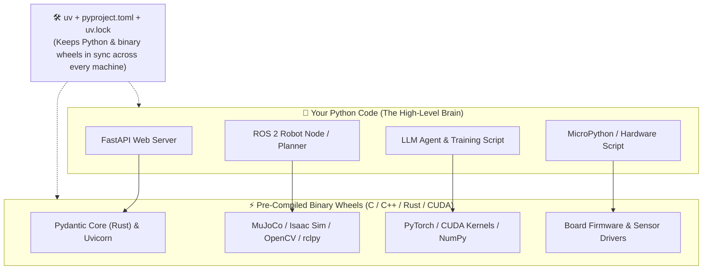
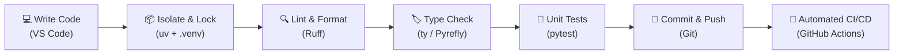

# Chapter 1: Introduction

[← Back to README](./README.md) | [Next: Virtual Environments →](./02-virtual-environments.md)

## Welcome to the Real World of Python

Here is a universal CS student experience:

You write a Python script for a class project or a weekend hackathon. It works great on your laptop. You push it to GitHub, your teammate clones it ten minutes before the demo, runs `python main.py`, and immediately gets hit with a wall of `ModuleNotFoundError` and a mysterious `ImportError` from a C++ library they don't have installed.

Or maybe *you* open your own project three months later to show a recruiter, and it no longer runs on your own machine because you upgraded a package for a different class.

**This guide is about making sure that never happens to you again.**

> [!NOTE]
> **First, a quick boundary: this is not a "How to write a `for` loop" tutorial.**
> We assume you already know enough Python to write a function, import a module, and read a traceback without panicking. If you want to learn or refresh the language itself first, start with one of these:
> - [Official Python Tutorial](https://docs.python.org/3/tutorial/) — the authoritative guide from Python.org
> - [Automate the Boring Stuff with Python](https://automatetheboringstuff.com/) — practical Python for people who want to automate real tasks fast
> - [Real Python](https://realpython.com/) — deep, patient tutorials and articles
> - [Python for Beginners](https://www.python.org/about/gettingstarted/) — getting-started resources from python.org

**This guide is about professional Python engineering practices**—the tools and habits that turn *"it works on my laptop (if you don't touch anything)"* into software a team can actually build, test, and ship.

---

## Where Python Powers the Real World (Yes, Including Robots)

Before we install any tools, let's talk about *why* Python's ecosystem looks the way it does.

People sometimes ask: *"Isn't Python slow compared to C++ or Rust? Why does everyone use it for AI and robotics?"*

Because Python's secret superpower is being the **high-level brain** that orchestrates blazing-fast **C, C++, CUDA, and Rust** libraries underneath:



Here is where you'll run into Python in the wild:

### 1. Robotics, Drones & Physical AI
Walk into a university robotics lab or an autonomous vehicle company and Python is everywhere:
- **ROS 2 (`rclpy`):** The Robot Operating System uses Python to write nodes that subscribe to LiDAR/camera topics, plan paths, and coordinate behaviors while C++ handles the 1,000 Hz motor-control loop.
- **Robot Simulation & Reinforcement Learning:** Before you let a $30,000 quadruped robot or humanoid fall down a real staircase, you train it in **MuJoCo**, **NVIDIA Isaac Lab**, or **PyBullet**—all controlled through Python APIs and PyTorch.
- **Edge AI & Single-Board Computers:** Running **OpenCV** or vision-language-action (VLA) models on a **Raspberry Pi 5** or **NVIDIA Jetson Orin** bolted to a rover frame.
- **Microcontrollers (`MicroPython` & `CircuitPython`):** Even tiny $4 boards like the Raspberry Pi Pico (RP2040/RP2350) and ESP32 run dialects of Python directly on bare metal to blink LEDs, read IMU gyroscopes, and drive servos.

### 2. LLMs & Autonomous AI Agents (The Plot Twist)
You probably know Python is used to *train* AI models (`PyTorch`, `JAX`, `Hugging Face`). Lately, there's an even cooler twist: **LLMs use Python as their own scripting language.**
When you ask a modern AI assistant or coding agent to solve a gnarly physics problem, analyze a 50,000-row CSV, or control a system, it doesn't try to "guess" the math in its head. Instead, the LLM writes a Python script on the fly, executes it in a sandboxed environment, checks the output, and hands you the verified answer. (We dive deep into how this works in [Chapter 11: LLMs](./11-llms.md)!)

### 3. Web APIs, Cloud & Serverless
With **FastAPI** ([Chapter 13](./13-fastapi.md)), **SQLModel** ([Chapter 12](./12-database-libraries.md)), and **AWS Lambda** ([Chapter 14](./14-aws-lambda.md)), Python powers massive production backends at places like Netflix, Uber, Microsoft, and thousands of startups.

### 4. Developer CLIs & Automation
Need a terminal tool with progress bars, colored tables, and `--help` menus that feel like a pro utility? **Typer** and **Rich** ([Chapter 15](./15-cli-libraries.md)) make that a 20-line job.

> [!TIP]
> **Why does this matter for your dev setup?**
> Because in all of these domains—especially AI and robotics—your Python code depends on **pre-compiled binary packages (wheels)**. Pick the wrong Python version or skip virtual environments, and `pip` will try to compile 400,000 lines of C++ from source on your laptop while your fans sound like a jet engine.

---

## Which Python Version Should You Use in 2026?

As of November 2026:
- **Python 3.15** is the newest stable release (shipped October 9, 2026; currently at `3.15.2`).
- **Python 3.14** is the previous stable release—and our **recommended daily driver** for examples in this guide.
- **Python 3.13** is the practical floor (`requires-python = ">=3.13"`). Python 3.12 and 3.13 are in security-only fixes now, and Python 3.10 hit end-of-life on October 1, 2026.

**Why use 3.14 in our examples if 3.15 is out?**
Because **3.14 has had a full year of pre-compiled wheel support.** When a brand-new Python version drops, heavy C/C++/Rust extension libraries (think robotics simulators, ML packages, or specialized database drivers) sometimes take weeks or months to publish pre-built wheels. Using 3.14 locally while testing 3.15 in CI gives you instant installs *and* future-proofing. Whatever you do, don't start a new project on Python 3.11 just because a 2024 blog post screenshot used it!

### What's New in Python 3.15?
If you're curious what landed in 3.15:
- **Lazy imports (PEP 810):** Defers executing imported modules until you actually touch them, which can slice CLI startup times in half without ugly inline `import` hacks.
- **Built-in `frozendict` and `sentinel`:** Native immutable dictionaries and clean sentinel objects right in the language.
- **UTF-8 is the default text encoding everywhere:** `open()` and filesystem calls default to UTF-8 across platforms, killing off a classic source of `UnicodeDecodeError` headaches on Windows.
- **Unpacking in comprehensions:** Cleaner syntax when flattening sequences inside list/dict comprehensions.
- **Stable ABI for free-threaded (no-GIL) builds:** Library authors can ship a single compiled wheel that works across free-threaded Python versions.

**The smart play:** Add `3.15` to your GitHub Actions test matrix right now ([Chapter 10](./10-ci-cd.md)), keep `3.14` as your local default until your whole dependency tree installs cleanly, and then flip the switch.

---

## Software Engineering Best Practices (The Safety Net)

Tools change every few years. The core engineering habits do not. Think of these five practices as the **safety net** between your keyboard and production (or demo day):



### 1. Version Control ([Chapter 4](./04-version-control.md))
Instead of a folder full of `rover_control_v2_FINAL_actual.py`, Git records every change: what changed, when, and why. You can experiment on a branch without breaking `main`, collaborate with teammates via Pull Requests, and time-travel back when a 3 a.m. refactor goes sideways.

### 2. Linting ([Chapter 5](./05-linting.md))
A linter is an automated code reviewer that reads your file in milliseconds and catches bugs *before* you even run the code: typos in variable names, unused imports, mutable default arguments (`def add_waypoint(pt, path=[]):`—a classic robotics bug!), or a bare `except:` that silently swallows hardware errors.

### 3. Code Formatting ([Chapter 6](./06-code-formatting.md))
Formatting is the peace treaty that ends all arguments about tabs, spaces, and line breaks. You hit Save, the formatter snaps your code into a clean, consistent layout, and pull requests stay focused on logic instead of whitespace.

### 4. Static Type Checking ([Chapter 8](./08-static-type-checking.md)) & Unit Testing ([Chapter 7](./07-unit-testing.md))
- **Type Checkers** verify that if a function expects a `SensorReading` or `float`, nobody accidentally passes it `None` or a `str`.
- **Unit Tests** are small scripts that test your functions automatically—including edge cases like divide-by-zero or an empty sensor buffer—so you can refactor with confidence.

### 5. CI/CD — Continuous Integration & Deployment ([Chapter 10](./10-ci-cd.md))
CI/CD is the robot on GitHub's servers that runs all the checks you might forget to run on a Friday afternoon. Every time anyone pushes code or opens a PR, GitHub Actions spins up a clean machine, installs your exact lockfile, and runs your linter, type checker, and test suite automatically.

---

## Tools We'll Use

### `uv`: Your All-in-One Python Project Manager

If you've talked to older Python developers, you've probably heard horror stories about juggling `pip`, `venv`, `pyenv`, `pipx`, `virtualenvwrapper`, and `requirements.txt`.

Forget all that. Throughout this tutorial we use **[uv](https://github.com/astral-sh/uv)**, a blazingly fast Python package and project manager written in Rust. It replaces half a dozen older tools with one cohesive workflow.

Here are the commands you'll use almost every day:

| Command | What it does |
|---------|--------------|
| `uv init` | Scaffolds a new project (`pyproject.toml`, `.gitignore`, starter files) |
| `uv add <pkg>` | Adds a runtime dependency (e.g., `uv add fastapi` or `uv add numpy`) |
| `uv add --dev <pkg>` | Adds a dev-only tool (e.g., `uv add --dev pytest ruff`) |
| `uv sync` | Installs exact versions from `uv.lock` into your `.venv` |
| `uv run <cmd>` | Runs a script or tool inside the project environment (no manual activation needed!) |
| `uvx <tool>` | Runs a standalone CLI tool once without adding it to your project |
| `uv tree` | Shows a visual tree of every package you have installed |
| `uv python install` | Downloads and installs a specific Python version in seconds |

Best of all, `uv` generates a **`uv.lock`** lockfile so your teammate on macOS, your friend on Windows, and your Linux Raspberry Pi all get the exact same dependency versions. And when you inherit an older repo from 2021 that still uses `requirements.txt`, `uv` speaks that dialect too.

#### Installing `uv`

Use the official standalone installer—it doesn't even require Python to be installed on your machine first!

**macOS and Linux:**

```bash
curl -LsSf https://astral.sh/uv/install.sh | sh
```

**Windows (PowerShell):**

```powershell
powershell -ExecutionPolicy ByPass -c "irm https://astral.sh/uv/install.ps1 | iex"
```

Close and reopen your terminal (or reload your shell config) so `uv` is on your `PATH`, then verify it works:

```bash
uv --version
```

**Fallback (`pip`):** If you're on a locked-down machine where the standalone installer isn't an option and you already have Python:

```bash
pip install uv
```

*(Prefer the standalone installer whenever possible—see the [uv installation docs](https://docs.astral.sh/uv/getting-started/installation/) for Homebrew, WinGet, and Docker options.)*

---

### VS Code: Your Code Editor

We use **Visual Studio Code** throughout this guide. It's free, runs everywhere (Windows, macOS, Linux), and has first-class support for Python, remote SSH (super handy when coding on a headless robot or cloud GPU!), and AI assistants. If you already love Neovim, PyCharm, Cursor, or Zed, keep using it—every command in this guide runs in the terminal anyway.

**Get VS Code:**
- [Download VS Code](https://code.visualstudio.com/)
- [VS Code GitHub Repository](https://github.com/microsoft/vscode)

**Recommended Extensions (`Ctrl+Shift+X` / `Cmd+Shift+X`):**
1. **Python** (Microsoft) — core language support and environment detection
2. **Python Debugger** (Microsoft) — step-through debugging with breakpoints
3. **Ruff** (Astral) — instant linting and format-on-save
4. **Pylance** (Microsoft) — fast autocomplete and IntelliSense (usually installed automatically with the Python extension)

> [!NOTE]
> **A note on tool choices:** The tools in this guide (`uv`, `Ruff`, `pytest`, `ty`/`Pyrefly`, `FastAPI`, `SQLModel`, `Typer`) are popular modern defaults, not the only valid stack. You will also run into other great tools in internships and open-source repos: package managers (Poetry, PDM, Conda/Pixi—especially in robotics/ROS), linters (Flake8, Pylint), formatters (Black), type checkers (mypy, Pyright), web frameworks (Django, Flask, Litestar), and AI tools (GitHub Copilot, Cursor, Claude Code, Codex, Grok Build). Learn the **concepts** here, and switching tools takes an afternoon.

---

## What's Next?

You know why dev environments matter—whether you're building a web API, an AI agent, or a robot brain—and you have `uv` installed.

In Chapter 2, we build the foundation: **Python Virtual Environments**—first peeking under the hood with Python's built-in `venv` so you understand how isolation actually works, and then switching to `uv` for the fast daily workflow.

[← Back to README](./README.md) | [Next: Virtual Environments →](./02-virtual-environments.md)
