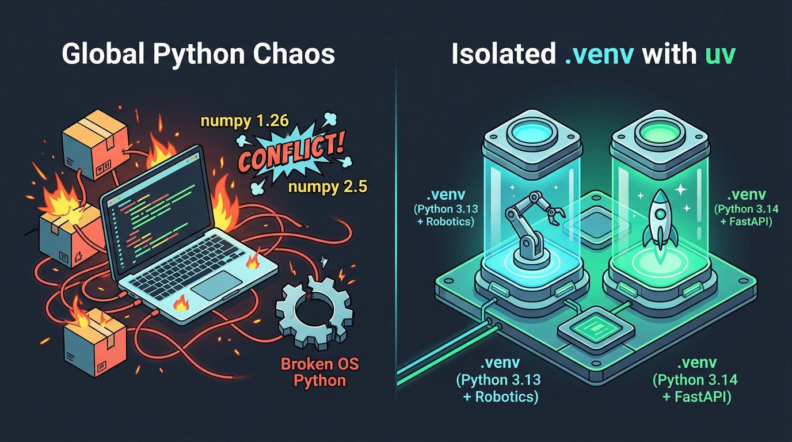
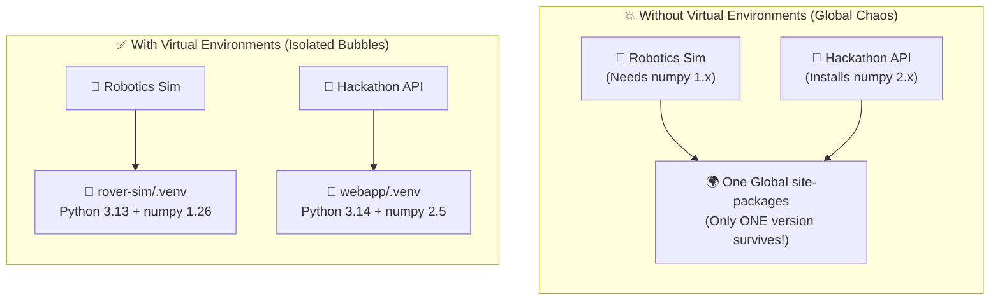
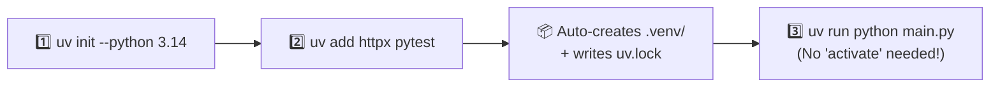

# Chapter 2: Python Virtual Environments

[← Previous: Introduction](./01-introduction.md) | [Back to README](./README.md) | [Next: Managing Dependencies →](./03-dependencies.md)

## What is a Virtual Environment (And Why Should I Care)?



Imagine two projects sitting on your laptop:
- **Project A (Your Robotics Lab Homework):** Needs a simulator package that only works with `numpy 1.26` on Python 3.13.
- **Project B (Your Hackathon Web App):** Needs the brand-new ML library that demands `numpy 2.5` on Python 3.14.

If you install packages globally (`pip install ...` straight into your system Python), **one global `site-packages` folder cannot hold two versions of `numpy` at the same time.** Installing Project B silently overwrites Project A's dependencies. Worse, on Linux or macOS, your operating system uses Python for its own system utilities—overwrite the wrong global package, and you can literally break your OS terminal tools!

A **virtual environment** solves this with a simple trick: **every project gets its own private folder (`.venv/`) containing its own Python interpreter link and its own `site-packages` directory.**



---

## Why You'll Love Having One Per Project

- **Zero Version Collisions:** Your robotics simulator, your CS class homework, and your FastAPI side project never step on each other's toes.
- **Reproducibility:** Pairing your environment with `pyproject.toml` and `uv.lock` means your teammate (or grader) gets the exact same libraries you used.
- **A Clean System Python:** Your OS tools stay untouched.
- **The "Nuke & Rebuild" Superpower:** Messed up your packages? Just delete the `.venv` folder (`rm -rf .venv`) and run `uv sync`. Three seconds later, you have a fresh, working environment. No digging through `/usr/local/lib` trying to uninstall 80 packages by hand.
- **Different Python Versions Side by Side:** Run Python 3.13 in one folder and Python 3.14 or 3.15 in the next without playing roulette with your `$PATH`.

> [!TIP]
> **The TL;DR of daily life:** You won't actually spend much time thinking about virtual environments once you use `uv`. You'll type `uv init`, `uv add`, and `uv run`. The environment is just a hidden folder named `.venv` inside your project. We cover the mechanics below so that `.venv` folder isn't a black box to you.

---

## Under the Hood: Python's Built-in `venv` Module

Python ships with a standard-library module called `venv`. Even though `uv` will handle this for you 99% of the time, every Python developer should know how the built-in tool works because you'll see it in older READMEs, Dockerfiles, and lab machines.

### 1. Creating a Virtual Environment with `venv`

```bash
# Create a virtual environment in a folder named 'venv'
python3 -m venv venv

# Or pick any folder name you want
python3 -m venv myenv

# Prefer naming the exact Python version when you have multiple installed
python3.14 -m venv venv
```

That creates a folder containing a link to the Python binary, a copy of `pip`, and an empty `site-packages` directory waiting for libraries.

### 2. Activating the Virtual Environment

Activating temporarily puts the environment's `bin/` (or `Scripts/`) folder at the front of your shell's `PATH`.

**On macOS / Linux:**

```bash
source venv/bin/activate
```

**On Windows (Command Prompt / PowerShell):**

```bash
venv\Scripts\activate
```

Your terminal prompt changes to remind you that you're "inside" the bubble:

```bash
(venv) user@machine:~/project$
```

### 3. Installing and Running Inside `venv`

While activated, `python` and `pip` point strictly to your local folder:

```bash
# Installs land inside ./venv/ only!
pip install requests pandas

# Runs with the environment's Python
python script.py

# See what's installed in this bubble
pip list
```

### 4. Deactivating

When you're done and want your normal shell back:

```bash
deactivate
```

**Remember:** `venv` is the *concept*. **`uv` is the modern workflow.**

---

## The Fast Way: Virtual Environments with `uv`

`uv` creates virtual environments in milliseconds (about 80× faster than `python -m venv`) and manages the whole project around them: downloading the right Python version, updating `pyproject.toml`, locking versions in `uv.lock`, and running your code.



### The Recommended Path: Start a Project with `uv init`

For any real project, initialize it with `uv init`. That gives you a `pyproject.toml`, a `.gitignore`, and automatic `.venv` management:

```bash
# Create a new project folder and scaffold it
uv init --python 3.14 rover-telemetry
cd rover-telemetry

# Or if you're already inside an existing folder:
uv init --python 3.14
```

Don't have Python 3.14 installed on your machine yet? `uv` can fetch a standalone Python build for you in seconds:

```bash
uv python install 3.14
uv python list
```

Now add dependencies and run your code—**you don't even have to activate the environment!**

```bash
uv add requests          # adds runtime dependency + creates .venv automatically
uv add --dev pytest ruff # adds dev tools into the `dev` dependency group
uv sync                  # ensures .venv matches uv.lock
uv run python main.py    # runs main.py inside .venv automatically!
```

`uv run` is your new best friend. No more *"Wait, did I forget to run `source .venv/bin/activate` in this terminal tab?"*

### Creating *Only* a Bare Virtual Environment

Sometimes you just want a quick throwaway environment without a full project scaffold:

```bash
# Creates .venv/ by default
uv venv

# Or give it a custom folder name
uv venv myenv

# Pin a specific Python version (uv downloads it if missing)
uv venv --python 3.14
```

### Activating a `uv` Environment (Optional)

If you still want the classic `(.venv)` prompt in your terminal (or your IDE asks for it), activation works the exact same way as standard `venv`:

**macOS / Linux:**

```bash
source .venv/bin/activate
```

**Windows:**

```bash
.venv\Scripts\activate
```

Most of the time, skip activation and just type `uv run`.

---

### Installing Packages with `uv`

**1. Project-first workflow (Use this for all real projects):**

```bash
uv add requests
uv add --dev ruff pytest
uv remove requests
uv sync
```

**2. `pip`-compatible interface (For legacy `requirements.txt` repos or quick throwaway scripts):**

```bash
uv pip install requests
uv pip install -r requirements.txt
uv pip install -e .
```

> [!NOTE]
> **Why `uv add` over `uv pip install`?**
> `uv add` records your dependency in `pyproject.toml` and locks it in `uv.lock` so your teammates get it too. `uv pip install` just drops the files into `.venv` silently—useful for a 5-minute experiment, bad for a team project.

### Why is `uv` So Fast?

`uv` is written in Rust, downloads wheels in parallel, uses a global content-addressed cache on your disk (so if five projects use `numpy` or `torch`, it uses hardlinks/copy-on-write instead of downloading and unpacking gigabytes five times!), and resolves version trees in milliseconds.

---

## Running Python Programs

### Option A: With `uv run` (Recommended — Zero Activation Ceremony)

```bash
# Run your script in the project's .venv
uv run python my_script.py

# Run dev tools installed in the project
uv run pytest
uv run ruff check .

# Run a CLI tool once in an ephemeral environment without adding it to the project
uvx ruff check .
```

`uv run` works identically on your laptop, your teammate's Windows PC, and inside a GitHub Actions Linux runner. Nobody can "forget to activate."

### Option B: With Manual Activation

```bash
source .venv/bin/activate  # macOS/Linux (or .venv\Scripts\activate on Windows)

python my_script.py
python -m my_module
```

---

## Golden Rules of Virtual Environments

1. **One project = one `.venv`.** Never share one giant virtual environment across five unrelated classes or repos.
2. **Never `pip install` into your system Python.** Keep the global interpreter clean.
3. **Never commit `.venv/` to Git.** A virtual environment contains thousands of files and OS-specific compiled binaries (`.so` on Linux, `.dylib` on macOS, `.pyd` on Windows). Pushing `.venv` to GitHub will bloat your repo by hundreds of megabytes and still crash on your teammate's OS!
4. **Commit `pyproject.toml` and `uv.lock` instead.** Those two text files are the *recipe*; anyone can recreate `.venv` in seconds with `uv sync`.

### Your `.gitignore` Must-Have

```gitignore
# Virtual environments — NEVER commit these!
venv/
.venv/
env/
ENV/
```

*(Good news: `uv init` automatically creates a `.gitignore` with `.venv/` already ignored.)*

---

## Quick Reference

```bash
# --- The Modern uv Workflow (Daily Driver) ---
uv python install 3.14
uv init --python 3.14 myapp && cd myapp
uv add requests
uv add --dev ruff pytest
uv sync
uv run python main.py
uv run pytest
uvx ruff check .

# --- Bare uv Virtual Environment ---
uv venv --python 3.14
source .venv/bin/activate   # optional (macOS/Linux)
.venv\Scripts\activate      # optional (Windows)
deactivate

# --- Classic Standard Library venv (Good to recognize) ---
python3.14 -m venv venv
source venv/bin/activate
pip install requests
deactivate
```

---

## Troubleshooting Common Headaches

### `uv: command not found` or `python3.14: command not found`
Your terminal's `PATH` hasn't picked up the new install yet. Close and reopen your terminal window (or run `source ~/.bashrc` / `source ~/.zshrc`). Run `uv python list` to see every Python interpreter `uv` knows about.

### Permission Denied Errors (Step Away From `sudo`!)
> [!CAUTION]
> **Never run `sudo pip install` or `sudo uv venv`!** Running package tools as `root` litters your project directory with root-owned files that your normal user account can't edit or delete, and can corrupt your OS's built-in Python utilities. If you get a permission error, check that you own the project folder (`ls -la`).

### My Editor Shows Red Squiggles Under Installed Imports
VS Code is probably looking at your global system Python instead of `.venv`. Press `Ctrl+Shift+P` (`Cmd+Shift+P` on macOS) → **Python: Select Interpreter** → pick the one labeled `('.venv': venv) ./venv/bin/python`.

---

## What's Next?

You know how to isolate a project in `.venv` and run code inside it with `uv run`. In Chapter 3, we look at what actually goes inside that bubble: **Managing Dependencies**, version constraints, `pyproject.toml`, and lockfiles.

[← Previous: Introduction](./01-introduction.md) | [Back to README](./README.md) | [Next: Managing Dependencies →](./03-dependencies.md)
