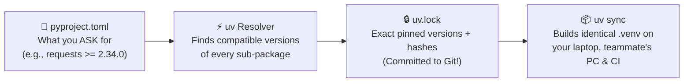
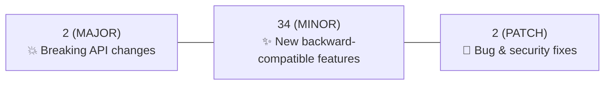

# Chapter 3: Managing Dependencies

[← Previous: Virtual Environments](./02-virtual-environments.md) | [Back to README](./README.md) | [Next: Version Control →](./04-version-control.md)

## What Are Dependencies?

Dependencies are packages your project needs to run that you didn't write yourself. Somebody else spent years writing them, testing edge cases, and publishing them so you don't have to reinvent an HTTP client, a matrix solver, or a robot kinematics engine on a Tuesday night.

- Need to talk to an API? **`requests`** or **`httpx`**
- Crunching sensor arrays or matrices? **`numpy`** and **`scipy`**
- Simulating a robot arm or quadruped? **`mujoco`**
- Building a web backend? **`fastapi`** (or Flask, Django, Litestar)
- Analyzing data tables? **`pandas`** or **`polars`**

All of those are dependencies.

---

## Why Use a Dependency? (A 10-Second Example)

You *can* fetch JSON from a web API using only Python's built-in `urllib.request`. It works, right up until you have to deal with query params, connection pooling, custom headers, and error decoding by hand:

**With the standard library alone:**

```python
import json
import urllib.request

# Works, but you will quickly grow to resent writing this 50 times.
response = urllib.request.urlopen("https://api.example.com/telemetry")
data = json.loads(response.read().decode("utf-8"))
```

**With `requests`:**

```python
import requests

response = requests.get("https://api.example.com/telemetry", timeout=10)
data = response.json()
```

`requests` is a dependency: battle-tested code doing the unglamorous plumbing so you can focus on your actual project.

---

## Why Manage Dependencies Carefully?

When you just type `pip install whatever` into the void without recording versions, four things eventually happen:

1. **"It worked in October!"** — Six months later, a library releases version `3.0.0` with breaking API changes, and a fresh install crashes.
2. **Transitive Drift** — You only installed 3 packages, but those 3 packages secretly pulled in 35 sub-packages (*transitive dependencies*). Without a **lockfile**, your teammate's laptop gets slightly different sub-package versions than yours.
3. **Production Bloat** — Your test runner (`pytest`) and linter (`ruff`) end up baked into the Docker image running on your cloud server or Raspberry Pi rover.
4. **Dependency Hell** — Package A demands `numpy<2.5`, Package B demands `numpy>=2.5`, and you find out at runtime instead of install time.

Here is how modern Python solves this using **two files** that work as a team (`pyproject.toml` + `uv.lock`):



---

## The Python Package Index (PyPI)

**[PyPI](https://pypi.org)** (the Cheese Shop, if you're a Monty Python fan) is the official public warehouse of Python packages. When you run `uv add requests`, `uv` queries PyPI, downloads a pre-compiled **wheel** (`.whl`) that matches your OS and CPU architecture (e.g., Apple Silicon `arm64`, Linux `x86_64`, or Raspberry Pi `aarch64`), and records the exact hash in `uv.lock`.

> [!TIP]
> **Look before you `uv add`:** Before adding an unfamiliar library from a random blog post, check its page on [pypi.org](https://pypi.org). Does it have recent releases? A real GitHub repo? A license you can use? Five seconds of checking beats building your capstone project on a library that was abandoned in 2018.

---

## Background: `pip` and `requirements.txt`

`pip` is Python's classic package installer. You will see it in older tutorials, legacy Dockerfiles, and Stack Overflow answers from 2021. You should know how to read it, even though `uv` is what you'll use day to day.

### Basic `pip` Commands (Always Inside a Virtual Environment!)

```bash
# Install a package
pip install requests

# Install an exact version
pip install requests==2.34.2

# Upgrade to the latest allowed version
pip install --upgrade requests

pip uninstall requests
pip list
pip show requests
```

### Classic `requirements.txt`

Historically, Python projects listed their dependencies in a flat text file called `requirements.txt`:

```text
requests==2.34.2
pandas==3.1.1
numpy==2.5.4
```

And installed them with:

```bash
pip install -r requirements.txt
```

### Why `pip` + `requirements.txt` Shows Its Age
- **Slow:** Installing a heavy ML or robotics stack with `pip` feels like watching paint dry.
- **No separation of direct vs. transitive deps:** Either you list only your top-level packages (so sub-packages drift and break), or you run `pip freeze > requirements.txt` and dump 90 messy sub-packages into one file where nobody knows what your project actually imports directly.
- **No automatic virtualenv sync:** Uninstall a package in code, and it lingers in your `.venv` forever like a ghost.

That is the exact gap `uv` + `pyproject.toml` + `uv.lock` fills.

---

## Managing Dependencies with `uv`

In Chapter 2, we met `uv` as a virtual environment manager. It is also your dependency manager.

### The Daily Loop: `uv add`, `uv remove`, `uv sync`

Once you've created a project (`uv init`), you never type `pip install`. Instead, you **declare** what you want and let `uv` update `pyproject.toml`, solve the version tree, write `uv.lock`, and sync `.venv` in one shot:

```bash
# 1. Add a runtime dependency (needed for your app to run)
uv add requests

# 2. Add a development tool (goes into [dependency-groups] dev, PEP 735)
uv add --dev pytest

# 3. Create a custom named group if you want to separate lint from test
uv add --group lint ruff

# 4. Add with a version constraint
uv add "requests>=2.34.0"

# 5. Remove a package (cleans pyproject.toml, uv.lock, AND .venv!)
uv remove requests
uv remove --dev pytest
```

When you (or a teammate) clone the project onto a new machine:

```bash
# Install everything from uv.lock (runtime + dev group by default)
uv sync

# Production / Robot / Docker deploy: install ONLY runtime dependencies (skip pytest/ruff)
uv sync --no-dev
```

And run commands inside the environment without activating anything:

```bash
uv run python main.py
uv run pytest
uvx ruff check .     # runs ruff as a one-off tool without adding it to the project
```

Want to see what your dependencies pulled in under the hood?

```bash
uv tree
```

```text
myapp v0.1.0
├── requests v2.34.2
│   ├── certifi v2026.8.14
│   ├── charset-normalizer v3.4.3
│   ├── idna v3.11
│   └── urllib3 v2.5.0
└── pytest v9.2.0 (group: dev)
    ├── iniconfig v2.2.0
    ├── packaging v25.0
    └── pluggy v1.6.0
```

`uv tree` shows you the full family tree instead of a mysterious flat list.

---

## Inside `pyproject.toml` and `uv.lock`

Modern Python projects store all their configuration in a single standard file: **`pyproject.toml`**.

- **Runtime dependencies** live in `[project.dependencies]`.
- **Development tools** (`pytest`, `ruff`, type checkers) live in **`[dependency-groups]`** ([PEP 735](https://peps.python.org/pep-0735/)).

```toml
[project]
name = "myapp"
version = "0.1.0"
requires-python = ">=3.13"
dependencies = [
    "requests>=2.34.0",
    "pandas>=3.1.0",
    "numpy>=2.5.0",
]

[dependency-groups]
dev = [
    "pytest>=9.2.0",
    "ruff>=0.17.0",
    "ty",
]
```

> [!NOTE]
> **Optional dependencies vs. Dependency groups:**
> - `[project.optional-dependencies]` is for **published extras** that end-users can opt into when installing a library (like `fastapi[standard]` or `scipy[plot]`).
> - `[dependency-groups]` is for **your team's dev tools** (`pytest`, `ruff`, `ty`) that should never be shipped to end-users.

You rarely need to type these lists by hand—`uv add` and `uv add --dev` edit `pyproject.toml` for you.

### Lockfiles (`uv.lock`)

While `pyproject.toml` says *"I need `requests>=2.34.0`"*, **`uv.lock`** records the exact resolved version (`2.34.2`), every sub-dependency (`urllib3==2.5.0`, `idna==3.11`), and cryptographic hashes.

```bash
uv sync              # install exact versions from uv.lock
uv lock --upgrade    # upgrade uv.lock to the newest versions allowed by pyproject.toml
```

> [!IMPORTANT]
> **Always commit `uv.lock` to Git!** That is how your laptop, your teammate's machine, and your GitHub Actions runner are guaranteed to run the exact same code.

### `pip`-Compatible Escape Hatch

Need to work with an older project that still uses `requirements.txt`? `uv` has a drop-in `uv pip` subcommand:

```bash
uv pip install requests
uv pip install "requests>=2.34.0,<3.0.0"
uv pip install -r requirements.txt
uv pip freeze > requirements.txt
```

And if a cloud platform or deployment script demands a `requirements.txt` file, don't maintain it by hand—generate it straight from your lockfile:

```bash
uv export --format requirements.txt -o requirements.txt
```

---

## Practical Example: Building a Web Scraper

Let's walk through the complete 60-second loop from empty directory to running code.

### Step 1: Initialize the Project

```bash
uv python install 3.14   # if not already installed
uv init --python 3.14 web-scraper
cd web-scraper
```

### Step 2: Add Runtime and Dev Dependencies

```bash
uv add "requests>=2.34.0" "beautifulsoup4>=4.15.0"
uv add --dev "pytest>=9.2.0" "pytest-cov>=7.1.0"
```

Take a peek at the `pyproject.toml` that `uv` just updated for you:

```toml
[project]
name = "web-scraper"
version = "0.1.0"
description = "A simple web scraper"
requires-python = ">=3.13"
dependencies = [
    "requests>=2.34.0",
    "beautifulsoup4>=4.15.0",
]

[dependency-groups]
dev = [
    "pytest>=9.2.0",
    "pytest-cov>=7.1.0",
]
```

### Step 3: Verify the Environment Tree

```bash
uv sync
uv tree
```

### Step 4: Write `scraper.py`

```python
import requests
from bs4 import BeautifulSoup


def fetch_page_title(url: str) -> str:
    """Fetch and return the <title> of a web page."""
    response = requests.get(url, timeout=10)
    response.raise_for_status()

    soup = BeautifulSoup(response.content, "html.parser")
    title = soup.find("title")

    return title.string if title else "No title found"


if __name__ == "__main__":
    url = "https://www.python.org"
    title = fetch_page_title(url)
    print(f"Page title: {title}")
```

### Step 5: Run It

```bash
uv run python scraper.py
# Output: Page title: Welcome to Python.org
```

---

## Version Constraints & Semantic Versioning (SemVer)

Most Python packages follow **Semantic Versioning (`MAJOR.MINOR.PATCH`)**, like `2.34.2`:



Here is how you express version rules in `pyproject.toml`:

```toml
[project]
dependencies = [
    "requests==2.34.2",        # Exact version only
    "pandas>=3.1.0",           # Minimum version (any version 3.1.0 or higher)
    "numpy>=2.5.0,<3.0.0",     # Version range (2.5.0 up to, but not including, 3.0.0)
    "flask~=3.1.0",            # Compatible release (~= 3.1.0 means >=3.1.0, <3.2.0)
]
```

### Which Constraint Style Should You Use?

```toml
# ✅ Great default — allows minor/patch updates, blocks breaking major bumps
"requests>=2.34.0,<3.0.0"

# ✅ Good — minimum floor when uv.lock handles the exact pin
"numpy>=2.5.0"

# ⚠️ Use sparingly — locks pyproject.toml to one exact patch version
"pandas==3.1.1"

# ❌ Avoid — bare package name with no version floor at all
"requests"
```

Let `pyproject.toml` define the **acceptable range**, and let `uv.lock` hold the **exact pin**.

---

## Common Dependency Stacks by Domain

Depending on what you're building in school or at work, you'll see these classic stacks in `pyproject.toml`:

### 1. Web APIs & Backends
```toml
dependencies = [
    "fastapi[standard]>=0.162.0",  # API framework + Uvicorn server + CLI
    "sqlalchemy>=2.1.0",           # Database ORM
    "pydantic>=2.14.0",            # Data validation (also bundled with FastAPI)
]
```

### 2. Data Science & Machine Learning
```toml
dependencies = [
    "pandas>=3.1.0",         # Tabular data manipulation
    "numpy>=2.5.0",          # Fast N-dimensional arrays & linear algebra
    "matplotlib>=3.11.0",    # Plotting & visualization
    "scikit-learn>=1.9.0",   # Classical machine learning
]
```

### 3. Robotics, Simulation & Computer Vision
```toml
dependencies = [
    "numpy>=2.5.0",                  # Spatial transforms, matrices & sensor arrays
    "scipy>=1.16.0",                 # Rotations (scipy.spatial.transform), signal filters & kinematics
    "mujoco>=3.3.0",                 # Physics simulation for robot arms, quadrupeds & humanoids
    "opencv-python-headless>=4.11",  # Camera frame processing & computer vision
]
```
*(Note: If you're working with **ROS 2**, system-level message buses like `rclpy` are often installed via OS packages or [Pixi](https://pixi.sh)/RoboStack, while pure-Python planning, vision, and ML modules use `pyproject.toml`.)*

### 4. Developer CLI Tools
```toml
dependencies = [
    "typer>=0.29.0",         # Build CLIs automatically from Python type hints
    "rich>=15.0.0",          # Beautiful tables, progress bars & colored terminal output
]
```

---

## Updating, Auditing & Resolving Conflicts

### Updating Dependencies on Purpose

Don't let your dependencies rot for two years, and don't upgrade them blindly 10 minutes before a demo:

```bash
# Upgrade all packages in uv.lock to the newest versions allowed by pyproject.toml
uv lock --upgrade
uv sync

# Or upgrade just one specific package
uv lock --upgrade-package requests
uv sync

# Always run your test suite right after upgrading!
uv run pytest
```

### Dealing with Dependency Conflicts

What happens if two libraries demand incompatible versions of a third library?

```text
Package A requires: numpy>=2.4.0,<2.5.0
Package B requires: numpy>=2.5.0
```

Unlike older `pip` versions that would sometimes install a broken combo and let you crash at runtime, **`uv`'s resolver stops immediately and explains the conflict.** To fix it:
1. Check if upgrading Package A (`uv lock --upgrade-package package-a`) adds support for the newer `numpy`.
2. Relax an overly strict version pin in your own `pyproject.toml`.
3. Use `uv tree` to inspect which package is holding back the tree.

### Security Auditing (`pip-audit`)

Check your dependency tree against known CVE security advisories:

```bash
uv add --dev pip-audit
uv run pip-audit
```

> [!WARNING]
> **Watch out for typosquatting!** Attackers sometimes publish malicious packages on PyPI with names one letter off from popular libraries (like `reqeusts` instead of `requests`, or `beautifulsoup` instead of `beautifulsoup4`). Double-check the spelling before hitting Enter!

---

## Migrating an Old `requirements.txt` Repo to `pyproject.toml`

Inherited a class project or older repo with a `requirements.txt`? You can upgrade it to a modern `uv` project in four commands:

```bash
# 1. Initialize pyproject.toml
uv init --python 3.14

# 2. Import runtime and dev requirements
uv add -r requirements.txt
# uv add --dev -r requirements-dev.txt   # if you have a dev requirements file

# 3. Sync and run tests
uv sync
uv run pytest

# 4. Commit the new files (and optionally git rm requirements.txt)
git add pyproject.toml uv.lock
```

---

## Quick Reference

```bash
# --- Daily uv Project Workflow (Preferred) ---
uv init --python 3.14 myapp
uv add requests
uv add --dev pytest ruff
uv remove requests
uv sync                  # install runtime + dev deps from uv.lock
uv sync --no-dev         # install runtime deps only (for production/deploy)
uv lock --upgrade        # refresh uv.lock to newest allowed versions
uv tree                  # view dependency tree
uv run pytest            # run command inside .venv
uvx ruff check .         # run standalone tool once

# --- Legacy pip / requirements.txt Compatibility ---
uv pip install -r requirements.txt
uv add -r requirements.txt
uv export --format requirements.txt -o requirements.txt
```

### Troubleshooting Tips
- **Package Not Found:** Verify the exact package name on [pypi.org](https://pypi.org) (e.g., `beautifulsoup4`, not `bs4`; `scikit-learn`, not `sklearn`) and check that your `requires-python` matches the package's supported Python versions.
- **Weird Install Failure:** Run `uv add -v <package>` for verbose logs, or `uv cache clean` if a interrupted download left a corrupted wheel in cache.

---

## What's Next?

Your project is isolated in `.venv`, and your dependencies are declared in `pyproject.toml` and locked in `uv.lock`. Now we need a time machine to track every change to your code and lockfile—and save you from ever naming a folder `project_final_v3_REAL.zip` again. Next up: **Version Control with Git**.

[← Previous: Virtual Environments](./02-virtual-environments.md) | [Back to README](./README.md) | [Next: Version Control →](./04-version-control.md)
