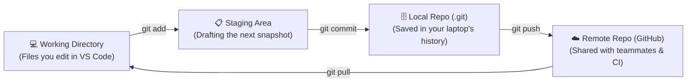
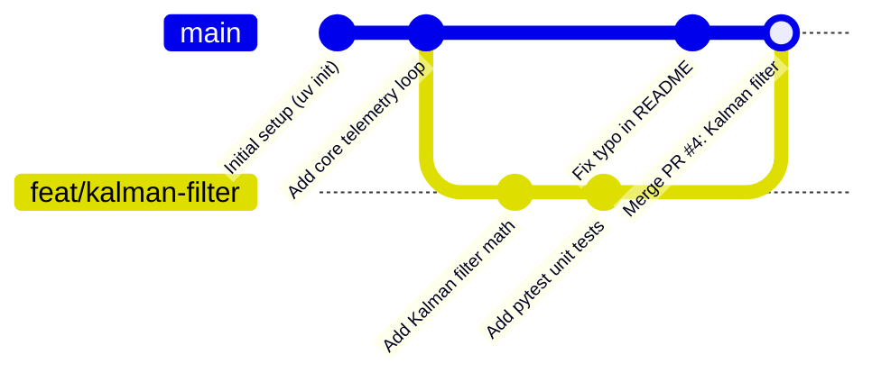

# Chapter 4: Version Control

[← Previous: Managing Dependencies](./03-dependencies.md) | [Back to README](./README.md) | [Next: Linting →](./05-linting.md)

## Goodbye `project_final_v2_ACTUALLY_FINAL/`

Without version control, almost every student eventually invents this filing system the night before a deadline:

```text
rover_project/
rover_project_backup/
rover_project_working_tuesday/
rover_project_final/
rover_project_final_v2/
rover_project_ACTUALLY_FINAL_DO_NOT_TOUCH/
```

Then you zip it up, email it to your lab partner, they edit three files, email back `rover_project_partner_edits.zip`, and you spend two hours copying and pasting lines between folders trying to figure out who broke the obstacle-avoidance loop.

**Version control** replaces that nightmare with an actual time machine. It tracks every change to every file: **what** changed, **when**, **who** wrote it, and **why**.

---

## Why Git Is Non-Negotiable

- **Fearless Experimentation:** Want to try a wild refactor or swap out your robot's path-planning algorithm? Spin up a **branch**. If it works, merge it. If it catches fire, delete the branch and your `main` code doesn't even know it happened.
- **Time Travel (`git log` & `git revert`):** If your app worked at 2 p.m. and is broken at 4 p.m., you can see the exact 8 lines that changed in between and undo them cleanly.
- **Team Collaboration Without Collisions:** Four people can work on the same repository at the same time, review each other's changes in **Pull Requests (PRs)**, and let Git merge the files automatically.

---

## Introduction to Git

**[Git](https://git-scm.com/)** is the version control system used by virtually the entire software industry. Created by Linus Torvalds in 2005 to manage the Linux kernel, it is:

- **Distributed:** Every clone on every laptop contains the complete history of the project. You can commit, diff, branch, and view history on an airplane with zero Wi-Fi.
- **Fast:** Almost every operation happens locally on your disk in milliseconds.
- **Free and Open Source.**

### Essential Resources
- [Git on GitHub](https://github.com/git/git)
- [Official Git Documentation](https://git-scm.com/doc)
- [Pro Git Book](https://git-scm.com/book/en/v2) (100% free online and genuinely readable)

---

## Installing Git

### macOS
```bash
# Using Homebrew (recommended)
brew install git
```

### Linux
```bash
# Debian / Ubuntu / Raspberry Pi OS
sudo apt install git

# Fedora
sudo dnf install git

# Arch
sudo pacman -S git
```

### Windows
Download the installer from [git-scm.com](https://git-scm.com/download/win) or run in PowerShell:
```powershell
winget install Git.Git
```

Verify your install:
```bash
git --version
```

---

## How Git Actually Thinks (The Four Zones)

New developers often get confused about why you have to `git add` *and* `git commit` *and* `git push`. This diagram is the entire mental model:



1. **Repository (Repo):** Your project folder plus the hidden `.git/` directory where Git stores all snapshots and branches. (`uv init` automatically creates a Git repo for you!)
2. **Staging Area (`git add`):** The "loading dock" where you choose which modified files belong in your next snapshot. Having a separate staging step lets you edit 5 files, but commit only the 2 files that fix a specific bug.
3. **Commit (`git commit`):** A permanent snapshot of your staged files, identified by a unique cryptographic hash (like `a4f92c1`) and a commit message explaining *why* you made the change.
4. **Branch:** A movable pointer to a line of commits. The default branch is named **`main`** (older repos may use `master`).
5. **Remote (`origin`):** The copy of your repository hosted online (on GitHub, GitLab, or Bitbucket) so your team and CI pipeline can access it.

---

## Essential Git Commands

### 1. First-Time Setup

Tell Git who you are so your commits have your name and email attached:

```bash
git config --global user.name "Your Name"
git config --global user.email "your.email@example.com"
```

> [!TIP]
> Use the **same email address** linked to your GitHub account! Otherwise, when you push commits, GitHub won't recognize them as yours and your contribution graph will stay mysteriously blank.

### 2. Starting or Cloning a Repo

```bash
# Turn the current folder into a Git repo (uv init does this automatically!)
git init

# Or download an existing repo from GitHub
git clone https://github.com/username/repository.git
```

### 3. The Everyday Local Loop

```bash
# Check what files are modified, untracked, or staged
git status

# Stage specific files (or everything in the current folder)
git add sensor_node.py
git add .

# Save a snapshot with a clear message
git commit -m "Filter out negative NaN readings from lidar sensor"

# View commit history (compact 1-line view is much easier to read!)
git log --oneline
```

### 4. Syncing with GitHub (`origin`)

```bash
# Link a local repo to a new GitHub repo
git remote add origin https://github.com/username/repo.git

# Upload your commits to GitHub
git push origin main

# Download and merge new commits from GitHub
git pull origin main

# Check which remote URLs are configured
git remote -v
```

---

## Branching & Pull Requests (How Teams Work)

Never do experimental work directly on `main` when working with a team. Instead, create a **feature branch**, do your work there, and merge it back via a Pull Request:



### Modern Branch Commands (`git switch`)

Use **`git switch`** to change branches. (You'll still see the older `git checkout` in 2017 Stack Overflow answers—`git checkout` was confusingly overloaded to both switch branches *and* overwrite files, so Git split it into `git switch` and `git restore`.)

```bash
# Create a new branch AND switch to it immediately
git switch -c feat/kalman-filter

# Switch back to an existing branch
git switch main

# List all local branches
git branch

# Merge feat/kalman-filter into your current branch
git merge feat/kalman-filter

# Delete the branch once it's merged
git branch -d feat/kalman-filter
```

*(Older equivalents you'll still recognize in the wild: `git checkout -b feat/kalman-filter` and `git checkout main`.)*

### The Complete Feature-Branch Workflow

Here is the exact 11-step dance you will use at every internship, hackathon, and software job:

```bash
# 1. Start on main and make sure you have the latest code
git switch main
git pull origin main

# 2. Create a branch for your feature or bugfix
git switch -c add-login-feature

# 3. Write code and run your tests (uv run pytest)

# 4. Inspect your changes before staging
git status
git diff

# 5. Stage and commit
git add .
git commit -m "Add login feature with email validation"

# 6. Push your branch to GitHub
git push origin add-login-feature

# 7. Open a Pull Request (PR) on GitHub, let CI run, and merge!

# 8. Switch back to main, pull the merged code, and clean up your old branch
git switch main
git pull origin main
git branch -d add-login-feature
```

---

## Protecting Your Repo with `.gitignore`

A **`.gitignore`** file tells Git which files and folders it should completely ignore. You **never** want to commit:
- **Virtual environments (`.venv/`, `venv/`)** — massive, OS-specific, and rebuildable from `uv.lock`
- **Bytecode caches (`__pycache__/`, `.pytest_cache/`, `.ruff_cache/`)** — auto-generated noise
- **Secrets (`.env`, API keys, cloud credentials)** — security nightmare!
- **OS & Editor clutter (`.DS_Store`, `.vscode/`)**

### Starter `.gitignore` for Python

```gitignore
# Virtual environments
venv/
.venv/
env/
ENV/

# Python bytecode & caches
__pycache__/
*.py[cod]
*$py.class
*.so

# Distribution / packaging builds
dist/
build/
*.egg-info/

# Testing & tool caches
.pytest_cache/
.ruff_cache/
.ty_cache/
.mypy_cache/
.coverage
htmlcov/

# IDEs
.vscode/
.idea/
*.swp
*.swo

# Secrets & Environment variables — NEVER COMMIT THESE!
.env
.env.local

# OS clutter
.DS_Store
Thumbs.db
```

> [!IMPORTANT]
> **What about `uv.lock`?**
> **DO commit `uv.lock`!** Ignore `.venv/`, track `pyproject.toml` and `uv.lock`.

*(Tip: `uv init` automatically creates a `.gitignore` for you, and [gitignore.io](https://www.toptal.com/developers/gitignore) can generate rules for any OS or framework.)*

---

## Habits That Make Teammates Love You

### 1. Write Commit Messages for Future You
Six months from now, when you're hunting down why a sensor threshold changed, which `git log` would you rather read?

```bash
# ✅ Good — tells you WHAT changed and WHY
git commit -m "Add email validation to login form"
git commit -m "Clamp rover wheel velocity to 2.5 m/s to prevent motor brownout"

# ❌ Bad — tells you nothing
git commit -m "Fixed stuff"
git commit -m "wip"
git commit -m "asdfasdf"
```

### 2. Never Commit Secrets (And What to Do If You Do)
> [!CAUTION]
> Never commit API keys, database passwords, AWS credentials, or `.env` files. Automated bots scrape public GitHub commits within **seconds** of a push looking for leaked keys.
> If you ever accidentally commit and push a secret: **deleting the file in a new commit does NOT erase it from Git history!** Immediately go to the provider's dashboard and **revoke/rotate the key** first.

### 3. Always Check `git diff` Before Committing
Running `git add .` blindly is how temporary `print("HERE 123")` statements and 50 MB CSV files sneak into your Pull Request. Run these first:

```bash
git status
git diff           # see unstaged edits
git diff --staged  # see exact lines about to be committed
```

---

## Lifesaver Commands: Undoing Mistakes & Merge Conflicts

### Undoing Uncommitted Changes (`git restore`)

```bash
# Throw away unstaged edits in a file (reset it back to the last commit)
git restore filename.py

# Unstage a file you accidentally ran 'git add' on (keeps your edits in the file!)
git restore --staged filename.py

# Forgot to include a file in your last commit? (Only use BEFORE git push!)
git add forgotten_file.py
git commit --amend

# Safely undo an older commit that was already pushed (creates a new inverse commit)
git revert <commit_hash>
```

### Surviving a Merge Conflict
When you and a teammate edit the exact same lines of the same file, Git pauses the merge and puts conflict markers inside the file:

```python
<<<<<<< HEAD
MAX_SPEED_MPS = 2.0
=======
MAX_SPEED_MPS = 3.5
>>>>>>> feat/faster-teleop
```

Don't panic!
1. Open the file in VS Code (which gives you nice buttons like *Accept Current*, *Accept Incoming*, or edit by hand).
2. Pick the code you want to keep and **delete the `<<<<<<<`, `=======`, and `>>>>>>>` marker lines**.
3. Run `git add filename.py` and `git commit` to finish the merge.

### Parking Unfinished Work (`git stash`)
Need to switch branches right now for an urgent bugfix, but your current files are half-written?

```bash
git stash        # sweeps your uncommitted changes into a temporary drawer
git switch main  # your working directory is now clean!
# ... do other work ...
git switch my-branch
git stash pop    # brings your parked changes right back
```

---

## Git vs. GitHub (Wait, Aren't They the Same Thing?)

- **Git** is the command-line version control tool running on your computer.
- **[GitHub](https://github.com)** (along with [GitLab](https://gitlab.com) and [Bitbucket](https://bitbucket.org)) is a website that hosts your Git repositories in the cloud and adds Pull Requests, code review, issue tracking, and CI/CD (GitHub Actions, which we'll set up in [Chapter 10](./10-ci-cd.md)).

---

## Quick Reference

```bash
# First-time setup
git config --global user.name "Your Name"
git config --global user.email "email@example.com"

# Start or clone
git init
git clone <url>

# Daily loop
git status
git diff
git add <file>              # or git add .
git commit -m "Clear message"
git pull origin main
git push origin main

# Branching (modern)
git switch -c <new-branch>  # create and switch
git switch <branch>         # switch existing
git merge <branch>
git branch -d <branch>

# Inspecting history
git log --oneline
git show <commit-hash>

# Undoing & Stashing
git restore <file>          # discard unstaged edits
git restore --staged <file> # unstage file
git revert <commit-hash>    # undo a committed change safely
git stash / git stash pop   # temporarily park uncommitted work
```

---

## What's Next?

Your environment is isolated, your dependencies are locked, and your code history is tracked in Git. Next, let's put an automated copilot on your shoulder that catches bugs and bad habits in milliseconds before you even run your script: **Linting with Ruff**.

[← Previous: Managing Dependencies](./03-dependencies.md) | [Back to README](./README.md) | [Next: Linting →](./05-linting.md)
