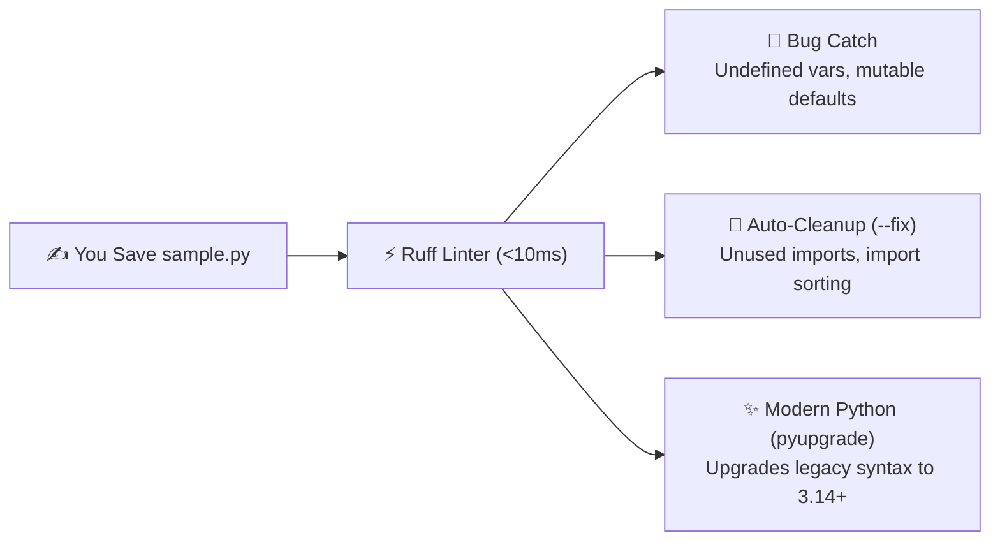

# Chapter 5: Linting

[← Previous: Version Control](./04-version-control.md) | [Back to README](./README.md) | [Next: Code Formatting →](./06-code-formatting.md)

## What is Linting?

Because Python is an interpreted language, there is no compiler step that checks your whole file before it runs. If you misspell a variable name inside an `else` branch that only triggers when your robot's battery drops below 5%, Python won't complain when you start the program—it will wait until the battery actually hits 5% during your live demo and then crash with a `NameError`.

A **linter** fixes that. It reads your source code statically (without running it) and flags bugs, unused imports, dangerous anti-patterns, and style drift in milliseconds.

*(Fun fact: The name comes from the 1978 Unix `lint` utility for C, which picked "lint"—tiny bits of fuzz and traps—out of source code. The name stuck; the 1970s C code mostly didn't.)*

---

## Why You Want a Linter Watching Your Back

1. **Catches Real Bugs Instantaneously:** Undefined variables (`F821`), unused imports (`F401`), shadowing built-ins like `id` or `list` (`A001`), mutable default arguments (`B006`), or bare `except:` blocks that swallow `KeyboardInterrupt` so you can't even `Ctrl+C` your script.
2. **Saves Code Review for the Interesting Stuff:** Nobody wants a Pull Request with 14 comments saying *"please alphabetize your imports"* or *"remove unused `import os`."* Let the linter enforce the baseline automatically.
3. **Teaches You Idiomatic Python:** When a linter suggests replacing `if type(x) == list:` with `if isinstance(x, list):`, or upgrading an old loop into a modern comprehension, you level up your Python fluency passively as you code.



---

## The Python Linter Landscape

We use **Ruff** throughout this guide, but you will run into these classic tools in older repos:

- **[Ruff](https://github.com/astral-sh/ruff):** The modern standard. Written in Rust by Astral (the same team behind `uv`), it is 10–100× faster than older linters and bundles 800+ rules from Flake8, isort, pyupgrade, and flake8-bugbear into a single binary.
- **[Flake8](https://github.com/PyCQA/flake8):** The classic wrapper around Pyflakes, pycodestyle, and McCabe complexity. Battle-tested and everywhere in older repos, but requires installing and configuring separate plugins for import sorting (`isort`), bugbear, etc.
- **[Pylint](https://github.com/pylint-dev/pylint):** Extremely thorough and opinionated—sometimes to a fault. Great when you want deep static checks; noisy out of the box if you don't tune it.

*(Note: Static type checkers like [mypy](https://github.com/python/mypy), `ty`, and `Pyrefly` work alongside your linter to verify type annotations—we cover those in [Chapter 8](./08-static-type-checking.md).)*

---

## Deep Dive into Ruff

**[Ruff](https://github.com/astral-sh/ruff)** is both a linter *and* a code formatter ([Chapter 6](./06-code-formatting.md)). One tool replaces Flake8, isort, Black, pyupgrade, autoflake, and dozens of plugins—and it runs so fast on a typical project that you'll wonder if it actually ran at all.

The current release series is **0.17.x**. Add it to your project's `dev` dependency group:

```bash
uv add --dev "ruff>=0.17.0"
uv run ruff check .
```

Or run it once on any folder without even installing it into the project:

```bash
uvx ruff check .
```

*(See the [uv docs on Ruff integration](https://docs.astral.sh/uv/guides/tools/) and the [official Ruff docs](https://docs.astral.sh/ruff/) for more details.)*

### Essential Ruff Commands

```bash
# Lint the entire project
uv run ruff check .

# Lint a specific directory or file
uv run ruff check src/
uv run ruff check sample.py

# Automatically fix everything that can be safely fixed!
uv run ruff check --fix .

# Show a diff of what --fix changed
uv run ruff check --fix --show-fixes .

# Count errors by rule code (amazing when cleaning up a messy legacy repo)
uv run ruff check . --statistics

# Watch mode: re-lints automatically every time you save a file
uv run ruff check --watch .
```

---

## Configuring Ruff in `pyproject.toml`

Instead of littering your project root with `.flake8`, `.isort.cfg`, and `setup.cfg`, Ruff reads its settings straight from **`pyproject.toml`**.

Here is the clean, battle-tested configuration we use throughout this guide:

```toml
[project]
name = "my-sample-project"
version = "0.1.0"
requires-python = ">=3.13"

[tool.ruff]
line-length = 88
target-version = "py314"

exclude = [
    ".git",
    ".venv",
    "__pycache__",
    "build",
    "dist",
]

[tool.ruff.lint]
select = [
    "E",   # pycodestyle errors (syntax & PEP 8 essentials)
    "W",   # pycodestyle warnings
    "F",   # Pyflakes (unused imports, undefined variables — the real bug catchers)
    "I",   # isort (automatic alphabetical & grouped import sorting)
    "B",   # flake8-bugbear ("this is almost certainly a bug" patterns)
    "C4",  # flake8-comprehensions (cleaner list/dict/set comprehensions)
    "UP",  # pyupgrade (automatically modernizes old Python syntax to py314)
]

# Let the formatter (ruff format) handle line lengths instead of nagging on E501
ignore = [
    "E501",
]

[tool.ruff.lint.per-file-ignores]
# If you later enable flake8-bandit ("S" security rules), allow plain 'assert' in pytest files:
"tests/**/*.py" = ["S101"]
```

### Decoding Ruff's Rule Prefixes

When Ruff flags an issue, it prints a code like `F401` or `B006`. Here is what those prefixes mean:

| Prefix | Origin Plugin | What It Catches |
|--------|---------------|-----------------|
| **`F`** | Pyflakes | Undefined names, unused variables, unused imports |
| **`E` / `W`** | pycodestyle | PEP 8 errors and warnings (`type(x) == list`, whitespace issues) |
| **`I`** | isort | Unsorted or ungrouped `import` blocks |
| **`B`** | flake8-bugbear | Mutable default arguments (`def fn(x=[]):`), loop variable traps |
| **`C4`** | comprehensions | Unnecessary `list([x for x in y])` wrappers |
| **`UP`** | pyupgrade | Outdated syntax that has a cleaner Python 3.14+ equivalent |
| **`N`** | pep8-naming | `camelCase` functions or `snake_case` classes |
| **`A`** | flake8-builtins | Variables named `list`, `id`, `type`, or `input` that shadow built-ins |
| **`S`** | flake8-bandit | Security smells (`eval()`, hardcoded passwords, unsafe `subprocess`) |

You can browse all 800+ rules at [Ruff Rules](https://docs.astral.sh/ruff/rules/) (and see default-enabled rules at [Default Rules](https://docs.astral.sh/ruff/default-rules/)).

---

## Hands-On: Watching Ruff Catch (and Fix) Bugs

Let's spin up a tiny project and feed Ruff some intentionally messy code.

### 1. Create a Sample Project

```bash
mkdir my_sample_project
cd my_sample_project
uv init --python 3.14
uv add --dev "ruff>=0.17.0"
```

### 2. Create `sample.py` with Deliberate Issues

```python
import os
import sys
import json

def calculate_sum(numbers):
    """Calculate sum of numbers"""
    total = 0
    for num in numbers:
        total = total + num
    return total

def process_data(data):
    if type(data) == list:
        return calculate_sum(data)
    else:
        return 0

# Unused import example
def main():
    nums = [1,2,3,4,5]
    result = process_data(nums)
    print(f"Sum is {result}")

if __name__ == "__main__":
    main()
```

### 3. Run Ruff

```bash
uv run ruff check --select E,W,F,I,B,C4,UP --output-format=concise sample.py
```

Output:

```text
sample.py:1:1: I001 [*] Import block is un-sorted or un-formatted
sample.py:1:8: F401 [*] `os` imported but unused
sample.py:2:8: F401 [*] `sys` imported but unused
sample.py:3:8: F401 [*] `json` imported but unused
sample.py:13:8: E721 Use `is` and `is not` for type comparisons, or `isinstance()` for isinstance checks
Found 5 errors.
[*] 4 fixable with the `--fix` option.
```

Notice the `[*]` markers! Ruff is telling you: *"I found 5 issues, and I can fix 4 of them for you automatically right now."*

### 4. Let Ruff Auto-Fix

```bash
uv run ruff check --select E,W,F,I,B,C4,UP --fix sample.py
```

Ruff deletes the three unused imports automatically. It leaves `E721` (`type(data) == list`) for you to change to `isinstance(data, list)` because changing type checks could subtly alter behavior if subclasses are involved. Once you fix that line and run `uv run ruff format sample.py`, the file is spotless!

---

## Classic Python Bugs Ruff Saves You From

If you're new to Python, **Rule `B006` (Mutable Default Arguments)** alone will save you hours of debugging. Look at this innocent-looking robotics function:

```python
# ❌ BUG (Flagged by Ruff B006: Do not use mutable data structures for argument defaults)
def append_waypoint(new_point: tuple[float, float], path: list = []):
    path.append(new_point)
    return path
```

**Why is that a bug?** In Python, default list `[]` is created **only once** when the `def` statement is first loaded—*not* each time the function is called! Every time you call `append_waypoint((1.0, 2.0))`, it mutates the *same shared list* from previous calls, so your robot starts re-driving yesterday's waypoints!

**The fix Ruff teaches you:**

```python
# ✅ FIXED: Use None as the default and create a fresh list inside the function
def append_waypoint(
    new_point: tuple[float, float], path: list[tuple[float, float]] | None = None
) -> list[tuple[float, float]]:
    if path is None:
        path = []
    path.append(new_point)
    return path
```

Here are three more everyday catches:

| Issue | What You Wrote (Flagged) | What You Meant (Fixed) |
|-------|--------------------------|------------------------|
| **Unused import (`F401`)** | `import os, sys` (never used) | Deleted automatically by `--fix` |
| **Undefined variable (`F821`)** | `return toatl` (typo!) | `return total` |
| **Fragile type check (`E721`)** | `if type(data) == list:` | `if isinstance(data, list):` |

---

## Automating Ruff in VS Code and Git

Running `uv run ruff check .` in the terminal is great, but having it run **automatically** every time you hit Save or `git commit` is even better.

### 1. VS Code Setup (`.vscode/settings.json`)

Install the **Ruff** extension (`charliermarsh.ruff`), then drop this into `.vscode/settings.json`:

```json
{
    "[python]": {
        "editor.defaultFormatter": "charliermarsh.ruff",
        "editor.formatOnSave": true,
        "editor.codeActionsOnSave": {
            "source.fixAll.ruff": "explicit",
            "source.organizeImports.ruff": "explicit"
        }
    }
}
```

Now every time you press `Ctrl+S` / `Cmd+S`, VS Code automatically removes unused imports, sorts your `import` block, and formats your file!

### 2. Git Pre-Commit Hook (`.pre-commit-config.yaml`)

What if a teammate uses Vim or forgets to install the VS Code extension? Add a **pre-commit hook** so Git checks the code before allowing a commit:

```bash
uv add --dev pre-commit
```

Create `.pre-commit-config.yaml`:

```yaml
repos:
  - repo: https://github.com/astral-sh/ruff-pre-commit
    rev: v0.17.4
    hooks:
      - id: ruff
        args: [--fix, --exit-non-zero-on-fix]
      - id: ruff-format
```

Activate the hook in your repo:

```bash
uv run pre-commit install
```

Now if you try to commit messy code, Ruff cleans it up and pauses the commit so you can `git add` the cleaned version.

---

## Quick Reference

```bash
# Add Ruff to your project
uv add --dev "ruff>=0.17.0"

# Daily commands
uv run ruff check .              # check whole project
uv run ruff check --fix .        # auto-fix safe issues
uv run ruff check --watch .      # live watch mode
uv run ruff check . --statistics # summarize rule counts

# Run without installing in project
uvx ruff check .
```

---

## What's Next?

Linting catches bugs and bad patterns ("Is this code wrong?"). Next up is its twin sibling—**Code Formatting** ("Does this code look consistent?")—using the exact same `ruff` binary you already installed!

[← Previous: Version Control](./04-version-control.md) | [Back to README](./README.md) | [Next: Code Formatting →](./06-code-formatting.md)
