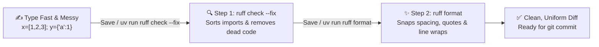

# Chapter 6: Code Formatting

[← Previous: Linting](./05-linting.md) | [Back to README](./README.md) | [Next: Unit Testing →](./07-unit-testing.md)

## What is Code Formatting?

If **linting** asks *"Is this code buggy?"*, **formatting** asks *"Is this code readable and consistent?"*

Formatting controls indentation, spaces around operators, single vs. double quotes, and where long lines wrap. Look at the exact same function written two ways:

**Unformatted (the "2 a.m. before the deadline" style):**
```python
def calculate_total(items,tax_rate=0.1,discount=0):
    subtotal=sum([item['price']for item in items])
    tax=subtotal*tax_rate
    total=subtotal+tax-discount
    return {"subtotal":subtotal,"tax":tax,"total":total}
```

**Formatted (after 5 milliseconds of `ruff format`):**
```python
def calculate_total(items, tax_rate=0.1, discount=0):
    subtotal = sum([item["price"] for item in items])
    tax = subtotal * tax_rate
    total = subtotal + tax - discount
    return {"subtotal": subtotal, "tax": tax, "total": total}
```

Python's interpreter executes both identically. Humans (including you next week) can read the second one without squinting.

---

## Why Automate Formatting?

1. **Ends Style Debates Forever:** Should a 5-argument function signature stay on one line or wrap? Single quotes or double quotes? Put a formatter in your repo and nobody ever wastes a Pull Request comment arguing about whitespace again.
2. **Clean Git Diffs:** Without a formatter, if Teammate A uses single quotes and Teammate B's editor converts them to double quotes, a 2-line bugfix turns into a 400-line Git diff where nobody can spot the actual code change.
3. **Zero Mental Overhead:** You can type ugly, cramped code as fast as you think, hit `Ctrl+S` / `Cmd+S`, and watch it snap into clean PEP 8 layout automatically.



---

## The Python Formatter Landscape

- **[Ruff (`ruff format`)](https://github.com/astral-sh/ruff):** The default in this guide. Written in Rust, built right into the same `ruff` binary you installed in Chapter 5, and **99.9% style-compatible with Black**.
- **[Black](https://github.com/psf/black):** The legendary "uncompromising Python code formatter" (famous for the slogan *"Any color you like, as long as it's black"*). Black pioneered opinionated, zero-config formatting in Python and is still used in thousands of repos (`uvx black --check .`). Ruff's formatter was explicitly designed as a drop-in, ultra-fast replacement for Black.
- **[autopep8](https://github.com/hhatto/autopep8) & [YAPF](https://github.com/google/yapf):** Older formatters you may occasionally spot in legacy repositories.

---

## Formatting with Ruff

Since you already added `ruff` in Chapter 5, you already have the formatter installed! No extra package required:

```bash
uv add --dev "ruff>=0.17.0"
uv run ruff --version
```

Or run it anywhere without a project install:

```bash
uvx ruff format .
```

*(See the [uv tools guide](https://docs.astral.sh/uv/guides/tools/) and [Ruff Formatter docs](https://docs.astral.sh/ruff/formatter/).)*

### Everyday Commands

```bash
# Format every Python file in the project (writes changes to disk)
uv run ruff format .

# Format a specific directory or file
uv run ruff format src/
uv run ruff format messy.py

# Dry-run for CI: exit with an error code if any file is unformatted (does NOT modify files)
uv run ruff format --check .

# Preview the exact diff Ruff WOULD make without touching the files
uv run ruff format --diff .
```

> [!TIP]
> **Remember the difference:**
> - Locally while coding: `uv run ruff format .` (rewrites your files)
> - In GitHub Actions CI: `uv run ruff format --check .` (fails the build if someone forgot to format)

---

## Configuring the Formatter in `pyproject.toml`

Ruff's defaults (88-character line length, double quotes, 4 spaces) match Black out of the box, so you technically don't have to configure anything. If you want to make the settings explicit in `pyproject.toml`:

```toml
[project]
requires-python = ">=3.13"

[tool.ruff]
line-length = 88
target-version = "py314"

[tool.ruff.format]
quote-style = "double"
indent-style = "space"
line-ending = "lf"
docstring-code-format = true
```

*(Bonus: `docstring-code-format = true` even formats Python code examples inside your docstrings!)*

---

## Hands-On: Cleaning Up `messy.py`

### 1. Create `messy.py`

```python
import sys,os
import json

def process_data(data,multiplier=2,offset=0):
    """Process data with multiplier and offset"""
    results=[]
    for item in data:
        value=item*multiplier+offset
        results.append(value)
    return results

class DataProcessor:
    def __init__(self,name,config=None):
        self.name=name
        self.config=config if config else {}

    def process(self,items):
        return [self.transform(x) for x in items]

    def transform(self,value):
        return value**2

# Main execution
if __name__=='__main__':
    processor=DataProcessor('default')
    data=[1,2,3,4,5]
    result=processor.process(data)
    print(f"Results: {result}")
```

### 2. Run the Power Combo: Lint Fix + Format

Why run both? Because **`ruff format` only changes whitespace and quotes—it never deletes unused code or splits `import sys, os`.** That's the linter's job (`ruff check --fix`). Running them back-to-back cleans everything:

```bash
uv run ruff check --fix messy.py
uv run ruff format messy.py
```

### 3. The Result

```python
def process_data(data, multiplier=2, offset=0):
    """Process data with multiplier and offset"""
    results = []
    for item in data:
        value = item * multiplier + offset
        results.append(value)
    return results


class DataProcessor:
    def __init__(self, name, config=None):
        self.name = name
        self.config = config if config else {}

    def process(self, items):
        return [self.transform(x) for x in items]

    def transform(self, value):
        return value**2


# Main execution
if __name__ == "__main__":
    processor = DataProcessor("default")
    data = [1, 2, 3, 4, 5]
    result = processor.process(data)
    print(f"Results: {result}")
```

Unused `sys`, `os`, and `json` imports are gone, spacing around `=` and `*` is clean, quotes are unified to `"`, and PEP 8's two-blank-line rule between top-level functions and classes is applied automatically.

---

## Cool Tricks Ruff's Formatter Does Automatically

### 1. Wrapping Long Function Signatures
**Before:**
```python
def configure_pid_controller(kp, ki, kd, max_integral, min_output, max_output, sample_rate_hz=100.0):
    pass
```

**After:**
```python
def configure_pid_controller(
    kp,
    ki,
    kd,
    max_integral,
    min_output,
    max_output,
    sample_rate_hz=100.0,
):
    pass
```

### 2. The "Magic Trailing Comma"
Ever wonder why Python developers put a comma after the *last* item in a list or dict?
If you put a **trailing comma** after the last element (`"port": 5432,`) and run `ruff format`, Ruff knows you *want* that dictionary expanded onto multiple lines, even if it's short enough to fit on one line! Remove the trailing comma, and Ruff collapses short dicts onto a single line.

### 3. Sorting Imports into Three Clean Blocks (via rule `I`)
When you enable `"I"` in `[tool.ruff.lint]`, `ruff check --fix` automatically groups your imports into:
1. **Standard library** (`import json`, `import math`, `import os`)
2. **Third-party packages** (`import fastapi`, `import numpy as np`)
3. **Your own project modules** (`from myapp.sensors import Lidar`)

---

## Ruff vs. Black at a Glance

| Feature | Ruff (`ruff format`) | Black |
|---------|----------------------|-------|
| **Speed** | ~30–100× faster (Rust) | Fast enough for small repos, slower on large ones |
| **Style output** | >99.9% Black-compatible | The original standard |
| **Includes Linter + Import Sorter?** | Yes (one binary does all three!) | No (needs separate Flake8 + isort) |
| **Configuration** | `pyproject.toml` | `pyproject.toml` |
| **When to pick** | Default for all new projects | Existing repos already standardized on Black |

---

## Format-on-Save + Pre-Commit (Set It and Forget It)

Just like in Chapter 5, combine **VS Code Format-on-Save** (for instant feedback while you type) with **pre-commit** (so nobody on your team can commit unformatted code):

**.vscode/settings.json:**
```json
{
    "[python]": {
        "editor.defaultFormatter": "charliermarsh.ruff",
        "editor.formatOnSave": true,
        "editor.codeActionsOnSave": {
            "source.fixAll.ruff": "explicit",
            "source.organizeImports.ruff": "explicit"
        }
    }
}
```

**.pre-commit-config.yaml:**
```yaml
repos:
  - repo: https://github.com/astral-sh/ruff-pre-commit
    rev: v0.17.4
    hooks:
      - id: ruff
        args: [--fix, --exit-non-zero-on-fix]
      - id: ruff-format
```

> [!WARNING]
> **Formatting an Existing Legacy Repo? Use a Dedicated Commit!**
> If you join a project that has never used a formatter and you run `uv run ruff format .` for the first time, it might touch 80 files. **Never mix a massive formatting pass into the same commit as a bugfix or new feature!** Make one standalone commit (`git commit -m "Apply Ruff formatting across repo"`) so reviewers don't have to hunt for your 5 lines of logic inside 3,000 lines of whitespace changes.

---

## Quick Reference

```bash
# Install Ruff
uv add --dev "ruff>=0.17.0"

# Format files (modifies files in place)
uv run ruff format .
uv run ruff format file.py

# Check formatting in CI (does NOT modify files; exits non-zero if unformatted)
uv run ruff format --check .
uv run ruff format --diff .

# The Daily Power Combo (Lint + Import Sort + Format)
uv run ruff check --fix . && uv run ruff format .
```

---

## What's Next?

Your code is clean, free of obvious lint bugs, and formatted consistently. Now comes the million-dollar question: **Does your code actually compute the right answers—and will it still work after you refactor it next month?** Next up: **Unit Testing with `pytest`**.

[← Previous: Linting](./05-linting.md) | [Back to README](./README.md) | [Next: Unit Testing →](./07-unit-testing.md)
