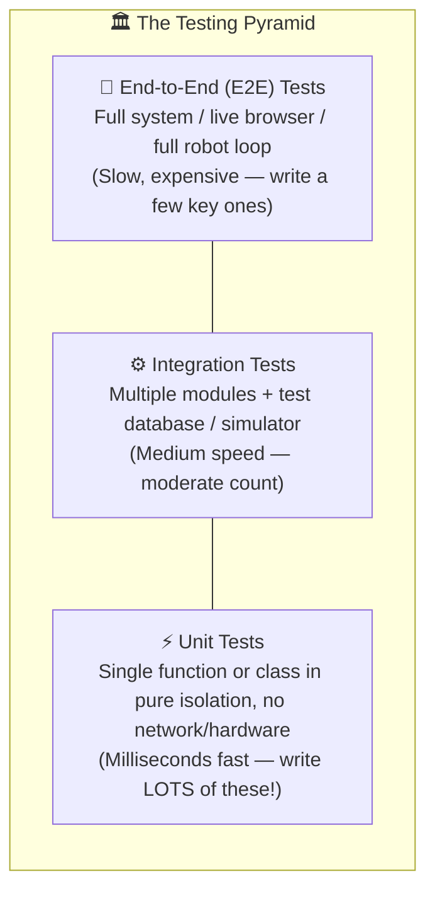
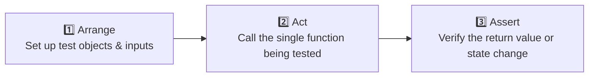

# Chapter 7: Unit Testing

[← Previous: Code Formatting](./06-code-formatting.md) | [Back to README](./README.md) | [Next: Static Type Checking →](./08-static-type-checking.md)

## What is Unit Testing?

How do most beginners test their code? They run the script, type a few numbers into `input()`, eyeball the terminal output, say *"Looks right to me!"*, and push it to GitHub.

That works when your project is 40 lines long. When your project has 20 files—say, a FastAPI backend, an LLM agent pipeline, or a robot obstacle-avoidance controller—manual testing falls apart completely. You fix a bug in one function, accidentally break another function you wrote three weeks ago, and don't notice until demo day.

A **unit test** is simply a small Python function that calls your code with known inputs and asserts that the output matches what you expect:

```python
def add(a: int, b: int) -> int:
    return a + b


def test_add() -> None:
    assert add(2, 3) == 5
    assert add(-1, 1) == 0
    assert add(0, 0) == 0
```

You write the test once, and your computer re-runs hundreds of tests in 0.05 seconds every time you touch the code.

---

## Why Write Unit Tests?

1. **Fearless Refactoring:** Want to rewrite a messy algorithm to make it 10× faster? If your test suite is green before and green after, you know you didn't break existing behavior.
2. **Test Hardware & APIs Without the Hardware:** If you're programming a rover or drone, you can't spin up physical motors in a hallway every time you edit a math function. Unit tests let you verify your PID controller, coordinate transforms, and sensor filters on your laptop in milliseconds.
3. **Executable Documentation:** Comments go stale and lie. A test that runs on every Pull Request cannot lie without failing the build.
4. **Regression Armor:** Every time you fix a real bug, write a 5-line test that reproduces it. Now that bug can never sneak back into your codebase again.

---

## The Testing Pyramid

Not all tests are created equal. Software teams organize tests into three layers:



This chapter focuses on the base of the pyramid: **fast, isolated unit tests**.

---

## Meet `pytest`: The Only Test Runner You Need

Python's standard library comes with `unittest` (which forces you to write Java-style classes like `class TestCalc(unittest.TestCase):` and `self.assertEqual(a, b)`). You'll see `unittest` in older codebases, alongside `doctest` (tests inside docstrings).

For almost everything you build today, **[pytest](https://github.com/pytest-dev/pytest)** is the undisputed champion:
- Tests are plain functions named `test_*`
- Assertions use Python's regular `assert` keyword (`assert x == y`)
- When a test fails, `pytest` inspects the expression and prints the exact values of every variable involved!

The current release series is **9.x** (`9.2.0` as of this writing). Add it alongside `pytest-cov` (for measuring code coverage) to your `dev` dependency group:

```bash
uv add --dev "pytest>=9.2.0" pytest-cov
uv run pytest --version
```

*(See the [uv guide on pytest](https://docs.astral.sh/uv/guides/First steps/) and the [pytest GitHub repo](https://github.com/pytest-dev/pytest).)*

---

## Writing and Running Your First Tests

### 1. Code to Test (`calculator.py`)

```python
def add(a: float, b: float) -> float:
    """Add two numbers."""
    return a + b


def subtract(a: float, b: float) -> float:
    """Subtract b from a."""
    return a - b


def multiply(a: float, b: float) -> float:
    """Multiply two numbers."""
    return a * b


def divide(a: float, b: float) -> float:
    """Divide a by b."""
    if b == 0:
        raise ValueError("Cannot divide by zero")
    return a / b
```

### 2. The Test File (`test_calculator.py`)

`pytest` automatically discovers any file named `test_*.py` or `*_test.py`, and any function inside named `test_*`:

```python
import pytest

from calculator import add, divide, multiply, subtract


def test_add():
    assert add(2, 3) == 5
    assert add(-1, 1) == 0
    assert add(0, 0) == 0


def test_subtract():
    assert subtract(5, 3) == 2
    assert subtract(0, 5) == -5


def test_multiply():
    assert multiply(3, 4) == 12
    assert multiply(0, 100) == 0


def test_divide():
    assert divide(10, 2) == 5
    assert divide(9, 3) == 3


def test_divide_by_zero():
    # Verify that dividing by zero raises the exact exception we expect!
    with pytest.raises(ValueError, match="Cannot divide by zero"):
        divide(10, 0)
```

### 3. Run `pytest` with `uv`

```bash
# Run every test in the repo
uv run pytest

# Run one specific file
uv run pytest test_calculator.py

# Run one specific test function inside that file
uv run pytest test_calculator.py::test_add

# Verbose output (prints each test function name)
uv run pytest -v

# Show print() output even on passing tests
uv run pytest -s
```

Output:

```text
============================= test session starts ==============================
collected 5 items

test_calculator.py .....                                                 [100%]

============================== 5 passed in 0.02s ===============================
```

Five green dots in 20 milliseconds. That is the best feeling in software engineering.

---

## Project Layout & Configuration

In a real project, keep your test files in a separate `tests/` directory so you don't accidentally ship test files inside your production package:

```text
myproject/
├── src/
│   └── mypackage/
│       ├── __init__.py
│       ├── calculator.py
│       └── user.py
├── tests/
│   ├── __init__.py
│   ├── test_calculator.py
│   └── test_user.py
├── pyproject.toml
└── README.md
```

Configure `pytest` right inside your `pyproject.toml`:

```toml
[project]
name = "myproject"
version = "0.1.0"
requires-python = ">=3.13"

[tool.pytest.ini_options]
minversion = "9.0"
testpaths = ["tests"]
python_files = ["test_*.py", "*_test.py"]
python_classes = ["Test*"]
python_functions = ["test_*"]
addopts = [
    "-v",
    "--strict-markers",
    "--tb=short",
]
```

*(Note: `minversion = "9.0"` refers to the minimum `pytest` version, not the Python version!)*

---

## The "Arrange – Act – Assert" Pattern

Good unit tests follow a dead-simple three-beat rhythm called **Arrange, Act, Assert (AAA)**:



```python
def test_user_full_name():
    # 1. Arrange — prepare the data
    user = User(first_name="Ada", last_name="Lovelace")

    # 2. Act — call the method under test
    full_name = user.get_full_name()

    # 3. Assert — check the result
    assert full_name == "Ada Lovelace"
```

> [!TIP]
> **One behavior per test!** Instead of writing one giant `test_everything()` function with 30 assertions, write small focused tests (`test_add_positive_numbers()`, `test_add_negative_numbers()`, `test_divide_by_zero_raises()`). When a test named `test_battery_low_cutoff_triggers_landing` fails in CI, you almost know the bug before you even open the file.

---

## `pytest` Superpowers You'll Use Every Day

### 1. Fixtures (`@pytest.fixture`) — Reusable Test Setup
Tired of copy-pasting the same 6 lines of setup code at the top of 15 tests? Turn it into a **fixture**. When a test function includes the fixture's name as a parameter, `pytest` automatically calls the fixture and passes you a fresh copy!

```python
import pytest


@pytest.fixture
def sample_user():
    return User(
        username="testuser",
        email="test@example.com",
        age=25,
    )


def test_user_greeting(sample_user):
    assert sample_user.greet() == "Hello, testuser!"


def test_user_email(sample_user):
    assert sample_user.email == "test@example.com"
```

Need to clean up a resource (like closing a temporary file or disconnecting a mock database) after the test finishes? Use **`yield`** instead of `return`:

```python
@pytest.fixture
def database():
    db = Database()
    db.connect()       # Runs BEFORE the test
    yield db           # Hands 'db' to the test function
    db.disconnect()    # Runs AFTER the test finishes (even if the test failed!)
```

### 2. Parametrization (`@pytest.mark.parametrize`) — 10 Tests for the Price of 1
Instead of writing five copy-pasted functions to test five different inputs (like normal values, zero, negatives, and boundary thresholds), use `@pytest.mark.parametrize`:

```python
@pytest.mark.parametrize(
    "a,b,expected",
    [
        (2, 3, 5),
        (0, 0, 0),
        (-1, 1, 0),
        (100, 200, 300),
    ],
)
def test_add_various_inputs(a, b, expected):
    assert add(a, b) == expected
```

`pytest` runs that function 4 separate times and reports each tuple as its own test case!

*(Bonus tip for robotics, physics & ML: Never compare floating-point math with raw `==` like `assert 0.1 + 0.2 == 0.3`—binary floating point will give `0.30000000000000004`! Use `assert result == pytest.approx(0.3)` instead.)*

### 3. Testing Exceptions (`pytest.raises`)
Good code fails loudly when given bad data. Verify that your error checks actually fire:

```python
def test_divide_by_zero_raises_error():
    with pytest.raises(ValueError) as exc_info:
        divide(10, 0)
    assert "Cannot divide by zero" in str(exc_info.value)


def test_invalid_age_raises_error():
    # Even cleaner: match the error message with a regex!
    with pytest.raises(ValueError, match="Age must be non-negative"):
        User(username="john", email="john@example.com", age=-5)
```

### 4. Markers (`@pytest.mark`) — Filtering Slow or OS-Specific Tests
Got a test that runs a heavy MuJoCo physics simulation and takes 8 seconds? Mark it as `slow` so you can skip it during rapid local edits and run it in CI:

```python
import sys
import pytest


@pytest.mark.slow
def test_quadruped_gait_simulation():
    pass


@pytest.mark.integration
def test_database_connection():
    pass


@pytest.mark.skipif(sys.platform == "win32", reason="Uses Linux /dev/ttyUSB serial port")
def test_serial_lidar_port():
    pass
```

Run or skip markers from the CLI:

```bash
uv run pytest -m "not slow"    # fast local loop!
uv run pytest -m slow          # run only slow tests
uv run pytest -m integration   # run integration tests
```

### 5. Testing `async` Functions (`pytest-asyncio`)
Testing `async def` functions (like FastAPI endpoints or async HTTP clients)? Install `pytest-asyncio`:

```bash
uv add --dev pytest-asyncio
```

```python
import pytest


@pytest.mark.asyncio
async def test_async_fetch():
    result = await async_fetch_telemetry()
    assert result["status"] == "ok"
```

---

## Complete Worked Example: Testing a `User` Class

**`user.py`:**

```python
from dataclasses import dataclass


@dataclass
class User:
    username: str
    email: str
    age: int
    is_active: bool = True

    def __post_init__(self) -> None:
        if self.age < 0:
            raise ValueError("Age must be non-negative")
        if "@" not in self.email:
            raise ValueError("Invalid email format")

    def greet(self) -> str:
        return f"Hello, {self.username}!"

    def can_vote(self, voting_age: int = 18) -> bool:
        return self.age >= voting_age

    def deactivate(self) -> None:
        self.is_active = False
```

**`test_user.py`:**

```python
import pytest

from user import User


@pytest.fixture
def valid_user() -> User:
    return User(
        username="johndoe",
        email="john@example.com",
        age=25,
    )


def test_user_creation(valid_user: User) -> None:
    assert valid_user.username == "johndoe"
    assert valid_user.email == "john@example.com"
    assert valid_user.age == 25
    assert valid_user.is_active is True


def test_user_creation_with_invalid_age() -> None:
    with pytest.raises(ValueError, match="Age must be non-negative"):
        User(username="test", email="test@example.com", age=-1)


def test_user_creation_with_invalid_email() -> None:
    with pytest.raises(ValueError, match="Invalid email format"):
        User(username="test", email="invalid-email", age=25)


def test_greet(valid_user: User) -> None:
    assert valid_user.greet() == "Hello, johndoe!"


@pytest.mark.parametrize(
    "age,voting_age,can_vote",
    [
        (18, 18, True),
        (25, 18, True),
        (17, 18, False),
        (21, 21, True),
        (20, 21, False),
    ],
)
def test_can_vote(age: int, voting_age: int, can_vote: bool) -> None:
    user = User(username="test", email="test@example.com", age=age)
    assert user.can_vote(voting_age) == can_vote


def test_deactivate(valid_user: User) -> None:
    assert valid_user.is_active is True
    valid_user.deactivate()
    assert valid_user.is_active is False
```

Run it:

```bash
uv run pytest test_user.py -v
```

---

## Code Coverage (`pytest-cov`)

**Code coverage** measures which lines of your source code were actually executed during your test run—and more importantly, which lines (`Missing`) were never touched at all!

```bash
uv run pytest --cov=mypackage --cov-report=term-missing
uv run pytest --cov=mypackage --cov-report=html
uv run pytest --cov=mypackage --cov-fail-under=80
```

```text
---------- coverage: platform linux, python 3.14 -----------
Name                  Stmts   Miss  Cover   Missing
---------------------------------------------------
mypackage/__init__.py     2      0   100%
mypackage/user.py        25      2    92%   45-46
---------------------------------------------------
TOTAL                    27      2    93%
```

Configure coverage in `pyproject.toml`:

```toml
[tool.coverage.run]
source = ["src"]
omit = [
    "*/tests/*",
    "*/test_*.py",
]

[tool.coverage.report]
exclude_lines = [
    "pragma: no cover",
    "def __repr__",
    "raise AssertionError",
    "raise NotImplementedError",
    "if __name__ == .__main__.:",
]
```

> [!NOTE]
> **Coverage is a flashlight, not a high score.** 85% coverage with thoughtful edge-case assertions is way better than 100% coverage where someone called every function without asserting anything meaningful.

---

## Mocking External APIs & Hardware (`unittest.mock`)

Unit tests shouldn't make real HTTP calls to Stripe/OpenAI or require a real USB LiDAR sensor to be plugged into your laptop. Use **`patch`** from `unittest.mock` to replace the external boundary with a fake object during the test:

```python
from unittest.mock import patch

from mymodule import fetch_user_data


def test_fetch_user_data():
    # Replace 'api_client.get' with a mock that returns instant fake JSON
    with patch("mymodule.api_client.get") as mock_get:
        mock_get.return_value = {"name": "Ada", "age": 30}

        user = fetch_user_data(user_id=123)

        assert user["name"] == "Ada"
        mock_get.assert_called_once_with("/users/123")
```

---

## Quick Reference

```bash
# Install pytest and coverage plugin
uv add --dev "pytest>=9.2.0" pytest-cov

# Everyday runs
uv run pytest                                  # run all tests
uv run pytest tests/test_file.py               # run one file
uv run pytest tests/test_file.py::test_name    # run one test function
uv run pytest -k "vote"                        # run tests matching keyword 'vote'
uv run pytest -x                               # stop immediately on first failure
uv run pytest --lf                             # re-run only the tests that failed last time!

# Coverage
uv run pytest --cov=src --cov-report=term-missing
uv run pytest --cov=src --cov-report=html      # opens htmlcov/index.html
```

---

## What's Next?

Your unit tests prove that your functions return the right values for the inputs you tested. Next, let's catch an entire category of bugs *without even writing a test*: **Static Type Checking** with type hints, `ty`, `mypy`, and `Pyrefly`.

[← Previous: Code Formatting](./06-code-formatting.md) | [Back to README](./README.md) | [Next: Static Type Checking →](./08-static-type-checking.md)
