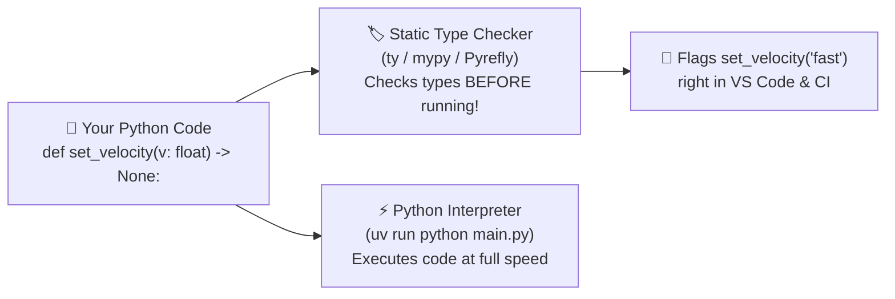

# Chapter 8: Static Type Checking

[← Previous: Unit Testing](./07-unit-testing.md) | [Back to README](./README.md) | [Next: Logging →](./09-logging.md)

## What is Static Type Checking?

Python is **dynamically typed**, which means the Python interpreter doesn't check the types of your variables until the exact millisecond that line of code executes at runtime:

```python
def greet(name):
    return "Hello, " + name


greet("Alice")  # Works fine!
greet(123)      # 💥 TypeError: can only concatenate str (not "int") to str
                # ...but you only find out when this line actually runs!
```

Now add **type hints** (`name: str` and `-> str`):

```python
def greet(name: str) -> str:
    return "Hello, " + name


greet("Alice")  # ✅ Type checker is happy
greet(123)      # 🚨 Type checker flags this IMMEDIATELY in your editor & CI!
```

Here is the plot twist that surprises new Python developers: **the Python interpreter itself completely ignores type hints at runtime!** Adding `name: str` does not slow down your code or make Python enforce types when `python main.py` runs.

Instead, a **static type checker** (`ty`, `mypy`, `Pyright`, or `Pyrefly`) reads those annotations before your code ever runs, traces every variable across your entire codebase, and catches type mismatches before they can blow up in production:



---

## Why Type Hints Are a Game-Changer

1. **Goodbye `AttributeError: 'NoneType' object has no attribute ...`:** The #1 runtime crash in Python happens when a function returns `None` on an edge case and the caller forgets to check for `None`. Type checkers spot `User | None` and force you to handle the `None` case first!
2. **Magical Editor Autocomplete:** If you write `def process(sensor):`, VS Code has no idea what `sensor.` can do. Write `def process(sensor: LidarSensor):`, and the moment you type `sensor.`, VS Code pops up every method and property with full documentation.
3. **Self-Verifying Documentation:** You don't have to guess whether `timestamp` is a `float` (Unix seconds), an `int` (milliseconds), an ISO `str`, or a `datetime` object—the signature tells you, and the type checker proves it's still true.
4. **Supercharges FastAPI, Typer, SQLModel & AI Agents:** As you'll see in Chapters 11–15, modern Python libraries actually inspect your type hints to auto-generate API validation, database schemas, CLI `--help` menus, and LLM tool schemas!

---

## Modern Type Hint Syntax (Python 3.10–3.15)

> [!TIP]
> **Don't copy old 2019 type hints!**
> In older Python (`3.8` and earlier), you had to write `from typing import List, Dict, Tuple, Optional, Union`.
> Since Python 3.9 and 3.10 (and we target **3.14+**), you use built-in types directly (`list[int]`, `dict[str, float]`) and the clean pipe operator (`str | None`)!

### 1. Variables & Functions

```python
name: str = "Alice"
age: int = 30
max_torque_nm: float = 12.5
is_armed: bool = False


def add(a: int, b: int) -> int:
    return a + b


def greet(name: str) -> str:
    return f"Hello, {name}"


# Functions that don't return a value use -> None
def log_message(message: str) -> None:
    print(message)
```

### 2. Collections & Optional Values (`| None`)

```python
# Lists and Sets
readings: list[float] = [1.2, 3.4, 5.6]
tags: set[str] = {"robotics", "lidar"}

# Dictionaries: dict[KeyType, ValueType]
scores: dict[str, int] = {"alice": 100, "bob": 95}

# Tuples: fixed-size vs variable-length
point_3d: tuple[float, float, float] = (0.5, -1.2, 0.8)
person: tuple[str, int, bool] = ("Alice", 30, True)

# Optional values: use `| None` (no import needed!)
active_target: str | None = None
```

### 3. Unions, `Callable`, `TypedDict`, and `Any`

```python
from collections.abc import Callable
from typing import Any, TypedDict


# Union: accepts either int OR str
def format_id(raw_id: int | str) -> str:
    return f"ID-{raw_id}"


# Callable[[Arg1Type, Arg2Type], ReturnType] — great for callbacks!
def apply_op(func: Callable[[int, int], int], a: int, b: int) -> int:
    return func(a, b)


# TypedDict — when you have a structured JSON dictionary with known keys
class TelemetryPacket(TypedDict):
    battery_v: float
    armed: bool
    mode: str


# Any — the escape hatch (disables type checking for that value; use sparingly!)
def parse_legacy_payload(data: Any) -> dict[str, Any]:
    return dict(data)
```

### 4. Dataclasses & Custom Classes

Your own classes automatically work as types!

```python
from dataclasses import dataclass


@dataclass
class Waypoint:
    x: float
    y: float
    label: str = "wp"


def compute_path_length(path: list[Waypoint]) -> float:
    # Type checker knows item.x and item.y are floats!
    return sum((wp.x**2 + wp.y**2) ** 0.5 for wp in path)
```

### 5. Modern Type Aliases (`type` statement in Python 3.12+)

```python
type UserId = int
type PoseMatrix = list[list[float]]


def get_user_pose(user_id: UserId) -> PoseMatrix:
    ...
```

*(In older pre-3.12 code, you'll see `UserId: TypeAlias = int`.)*

---

## Meet the Type Checkers

| Tool | Built By | Written In | The Vibe |
|------|----------|------------|----------|
| **[ty](https://github.com/astral-sh/ty)** | Astral (`uv` / `Ruff` team) | Rust | **Tutorial default.** Blazing fast, great diagnostics, built-in LSP. Currently **beta** (`0.0.100`). |
| **[mypy](https://github.com/python/mypy)** | Python / Dropbox | Python | The battle-tested pioneer. Slower on huge repos, rock-solid stability. |
| **[Pyright](https://github.com/microsoft/pyright)** / Pylance | Microsoft | TypeScript | Powers VS Code's in-editor type checking via Pylance. |
| **[Pyrefly](https://pyrefly.org/)** | Meta | Rust | Fast, next-gen Rust checker designed for massive codebases. |

---

## 1. `ty` (Our Tutorial Default)

**[ty](https://docs.astral.sh/ty/)** comes from Astral (the creators of `uv` and `Ruff`). Written in Rust, it checks projects in a fraction of a second and prints Rust-compiler-style error messages that actually show you *where* a type came from.

> [!NOTE]
> **`ty` is currently in Beta (`0.0.100`).** It is already super practical for daily work, but because its rule set is still evolving, **pin its version in `pyproject.toml` / `uv.lock`** so a minor update doesn't surprise your CI pipeline on a Tuesday morning. (Try it in your browser at [play.ty.dev](https://play.ty.dev)!)

### Install and Run `ty`

```bash
# Add to your project's dev group
uv add --dev ty
uv run ty check
uv run ty check src/

# Or run once without installing
uvx ty check
```

### Configure `ty` in `pyproject.toml`

```toml
[project]
requires-python = ">=3.13"

[tool.ty.environment]
python-version = "3.14"

[tool.ty.src]
include = ["src", "tests"]
```

*(Full configuration reference: [docs.astral.sh/ty/reference/configuration](https://docs.astral.sh/ty/reference/configuration/).)*

### Watching `ty` Catch a Bug

Create `calculator.py`:

```python
def add(a: int, b: int) -> int:
    return a + b


def greet(name: str) -> str:
    return f"Hello, {name}"


result = add("1", "2")
```

Run `uvx ty check calculator.py`:

```text
error[invalid-argument-type]: Argument to function `add` is incorrect
 --> calculator.py:8:14
  |
8 | result = add("1", "2")
  |              ^^^ Expected `int`, found `Literal["1"]`
info: Function defined here
 --> calculator.py:1:5
  |
1 | def add(a: int, b: int) -> int:
  |     ^^^ ------ Parameter declared here

error[invalid-argument-type]: Argument to function `add` is incorrect
 --> calculator.py:8:19
  |
8 | result = add("1", "2")
  |                   ^^^ Expected `int`, found `Literal["2"]`
info: Function defined here
 --> calculator.py:1:5
  |
1 | def add(a: int, b: int) -> int:
  |     ^^^         ------ Parameter declared here

Found 2 diagnostics
```

Look how clean that is! Without type checking, `add("1", "2")` in Python silently concatenates the strings into `"12"` instead of `3`—a classic bug when reading unparsed strings from environment variables or query parameters!

---

## 2. `mypy` (The Classic Industry Standard)

**[mypy](https://github.com/python/mypy)** is the original static type checker for Python (guided early on by Guido van Rossum himself). If you join an established Python team or open-source library, there is a high chance their CI runs `mypy`.

```bash
uv add --dev mypy
uv run mypy src/
uv run mypy --strict src/
```

Configure `mypy` in `pyproject.toml`:

```toml
[tool.mypy]
python_version = "3.14"
warn_return_any = true
warn_unused_configs = true
disallow_untyped_defs = true
show_error_codes = true
pretty = true

[[tool.mypy.overrides]]
module = "tests.*"
disallow_untyped_defs = false
```

---

## 3. `Pyrefly` (Meta's Fast Rust Checker)

**[Pyrefly](https://pyrefly.org/)** is Meta's next-generation Rust type checker and language server.

```bash
uv add --dev pyrefly
uv run pyrefly check src/

# Or try it without installing:
uvx pyrefly check
```

> [!IMPORTANT]
> **Initialize `Pyrefly` first!**
> With zero configuration, Pyrefly defaults to a super-conservative `basic` preset that skips many argument-type checks (so it won't flag `add("1", "2")` out of the box). Run `uvx pyrefly init` or add `[tool.pyrefly]` to your `pyproject.toml` to enable full checking:

```toml
[tool.pyrefly]
python-version = "3.14"
```

Once configured, `uvx pyrefly check calculator.py` catches the bug immediately:

```text
ERROR Argument `Literal['1']` is not assignable to parameter `a` with type `int` in function `add` [bad-argument-type]
 --> calculator.py:8:14
  |
8 | result = add("1", "2")
  |              ^^^
```

---

## 4. `Pyright` & VS Code Pylance

When you install the Python extension in VS Code, Microsoft's **Pylance** extension (powered by **[Pyright](https://github.com/microsoft/pyright)**) runs in the background. By default, Pylance leaves strict type checking turned off so it doesn't overwhelm beginners with red squiggles.

Want VS Code to underline type errors live while you type? Add this to `.vscode/settings.json`:

```json
{
    "python.analysis.typeCheckingMode": "basic",
    "python.analysis.diagnosticMode": "workspace"
}
```

---

## Remember: Types and Tests Are Partners, Not Replacements!

Why do we need *both* `pytest` (Chapter 7) and `ty` (Chapter 8)? Look at these two broken functions:

```python
# Bug #1: Caught by the TYPE CHECKER (ty), might be missed by a lazy test
def get_ speed_limit(zone: str) -> int:
    if zone == "school":
        return 25
    # Oops! Forgot an 'else' return — Python implicitly returns None!
    # ty immediately flags: "Function declared -> int can return None!"


# Bug #2: Caught by UNIT TESTS (pytest), invisible to the type checker
def add(a: int, b: int) -> int:
    return a - b  # Types are 100% valid (int in, int out), math is 100% wrong!
```

- **Type checkers** verify the *shapes and contracts* of every code path (even `if/else` branches your tests forgot to hit).
- **Unit tests** verify that the *business logic and math* actually produce the right values.

Run both!

---

## Quick Tips for Gradual Typing

- **Start with function signatures:** Annotating `def filter_points(pts: list[float]) -> list[float]:` gives you 90% of the benefit. You rarely need to annotate local variables inside the function (`x = 5` is obviously an `int`—the checker infers it automatically).
- **Do annotate empty collections:** If you write `items = []`, the checker doesn't know what will go inside it later. Write `items: list[str] = []`.
- **Third-party libraries without types:** Most modern packages include built-in type hints. Older ones (like `boto3`) have companion stub packages (`types-boto3`, `types-requests`). In the rare case an untyped C extension confuses the checker, use a targeted `# type: ignore[code]` comment on that specific line.

---

## Quick Reference

```bash
# ty (Tutorial default — fast Rust checker from Astral)
uv add --dev ty
uv run ty check
uv run ty check src/
uvx ty check

# mypy (Classic standard)
uv add --dev mypy
uv run mypy src/
uv run mypy --strict src/

# Pyrefly (Meta's Rust checker — run init first!)
uvx pyrefly init
uvx pyrefly check

# Modern Python 3.14+ Type Hint Cheat Sheet
def process(items: list[int], label: str | None = None) -> dict[str, float]: ...
type SensorId = str
```

---

## What's Next?

Your code is linted, formatted, tested, and type-checked. Now what happens when your program is running on a cloud server or an autonomous rover and something goes weird at 3 a.m.? It's time to graduate from `print("HERE!!!")` to real **Logging**.

[← Previous: Unit Testing](./07-unit-testing.md) | [Back to README](./README.md) | [Next: Logging →](./09-logging.md)
