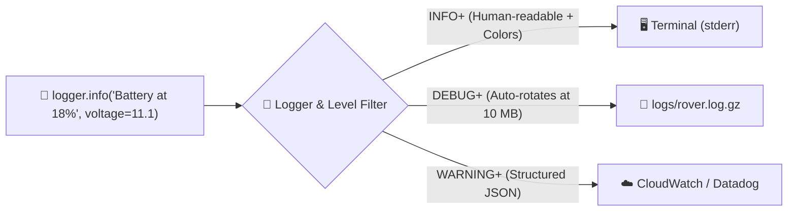

# Chapter 9: Logging

[← Previous: Static Type Checking](./08-static-type-checking.md) | [Back to README](./README.md) | [Next: CI/CD →](./10-ci-cd.md)

## Why `print("HERE 2")` Stops Working

We have all debugged a program like this:

```python
print("Starting job...")
print("got here 1")
print(f"x is {x}")
print("WHY IS THIS NONE???")
```

`print()` is totally fine for a 15-line homework script. It becomes a disaster the moment your code runs on a web server, an AWS Lambda function, or a headless Raspberry Pi bolted to a robot:

- **No Timestamps:** Did that error happen 2 seconds ago or 4 hours ago?
- **No Severity Levels:** You can't turn off noisy debug messages in production without deleting `print()` lines across 20 files.
- **No Source Context:** Which file, function, and line number printed `Connection failed`?
- **No Routing:** `print()` just dumps text to `stdout`. It can't simultaneously show pretty colored warnings in your terminal, save detailed debug logs to a rotating file on disk, and ship structured JSON errors to Datadog or CloudWatch.

**Logging** gives you all of that—a volume knob, a timestamp, caller info, and smart routing:



---

## The Three Logging Tools Worth Knowing

| Tool | The Pitch |
|------|-----------|
| **[stdlib `logging`](https://docs.python.org/3/library/logging.html)** | Built into Python. Zero dependencies, slightly verbose setup, spoken by every library on PyPI. |
| **[Loguru](https://github.com/Delgan/loguru)** | **Our #1 pick for new projects.** Zero boilerplate, automatic colors, easy file rotation, and 1-flag JSON output. |
| **[Picologging](https://github.com/microsoft/picologging)** | Microsoft's C-accelerated drop-in for `logging` (still beta; wheels only through Python 3.12). |

---

## 1. Python's Standard Library: `logging`

Every Python developer needs to know the built-in `logging` module because frameworks like FastAPI, Uvicorn, SQLAlchemy, and `httpx` all use it under the hood.

### The Five Standard Log Levels

Logs are ranked by severity from lowest (`DEBUG`) to highest (`CRITICAL`):

```python
import logging

logging.debug("Detailed diagnostic info (e.g., raw sensor packet bytes)")  # 10
logging.info("Normal milestone (e.g., Server started on port 8000)")       # 20
logging.warning("Something sketchy, but we recovered (e.g., Retry #1)")    # 30
logging.error("An operation failed! (e.g., Database query timed out)")     # 40
logging.critical("Everything is on fire (e.g., Out of disk / E-stop!)")    # 50
```

> [!TIP]
> **Why did `logging.info("hello")` print nothing?!**
> By default, Python's `logging` module sets its threshold to **`WARNING`**, so it silently ignores `DEBUG` and `INFO` until you configure it! It isn't broken—it's just waiting for you to turn the volume knob up.

### Basic Setup (`basicConfig` & Named Loggers)

```python
import logging

logging.basicConfig(
    level=logging.DEBUG,
    format="%(asctime)s %(levelname)-8s %(name)s: %(message)s",
    datefmt="%Y-%m-%d %H:%M:%S",
)

# Always create a named logger using __name__ (the current module's name!)
logger = logging.getLogger(__name__)

logger.debug("Calibrating IMU gyroscope...")
logger.info("Rover telemetry node started")
logger.warning("Wi-Fi signal weak (-82 dBm), buffering locally")
logger.error("Failed to open /dev/ttyUSB0 lidar port")
```

Output:

```text
2026-11-10 12:00:00 DEBUG    rover.sensors: Calibrating IMU gyroscope...
2026-11-10 12:00:00 INFO     rover.sensors: Rover telemetry node started
2026-11-10 12:00:00 WARNING  rover.sensors: Wi-Fi signal weak (-82 dBm), buffering locally
2026-11-10 12:00:00 ERROR    rover.sensors: Failed to open /dev/ttyUSB0 lidar port
```

### Why `logging.getLogger(__name__)` Matters
Using `__name__` automatically names the logger after your package structure (`myapp.database`, `myapp.api.routes`). That lets you crank up `DEBUG` logs on your own broken module while keeping noisy third-party libraries quiet:

```python
logging.getLogger("myapp.database").setLevel(logging.DEBUG)
logging.getLogger("httpx").setLevel(logging.WARNING)
```

### Handlers and Formatters (Routing Logs to Multiple Places)

In `logging`, **Handlers** decide *where* logs go (console vs. file), and **Formatters** decide *how* they look:

```python
import logging

logger = logging.getLogger("myapp")
logger.setLevel(logging.DEBUG)

# Handler 1: Show only INFO and above on the console
console = logging.StreamHandler()
console.setLevel(logging.INFO)
console.setFormatter(logging.Formatter("%(levelname)s: %(message)s"))

# Handler 2: Save EVERYTHING (DEBUG and above) with timestamps into app.log
file_handler = logging.FileHandler("app.log")
file_handler.setLevel(logging.DEBUG)
file_handler.setFormatter(
    logging.Formatter("%(asctime)s %(levelname)s %(name)s: %(message)s")
)

logger.addHandler(console)
logger.addHandler(file_handler)
```

### Structured JSON Logging with `python-json-logger`

When your app runs in production, cloud log search tools (AWS CloudWatch, Datadog, Grafana Loki) prefer **JSON fields** over plain sentences so you can filter by `status == 500` or `duration_ms > 1000`. With stdlib `logging`, you pass an `extra` dict and pair it with **[python-json-logger](https://github.com/nhairs/python-json-logger)**:

```bash
uv add python-json-logger
```

```python
import logging
from pythonjsonlogger.json import JsonFormatter

handler = logging.StreamHandler()
handler.setFormatter(JsonFormatter())

logger = logging.getLogger("myapp")
logger.addHandler(handler)
logger.setLevel(logging.INFO)

logger.info(
    "Request completed",
    extra={"method": "GET", "path": "/api/users", "status": 200, "duration_ms": 42},
)
```

---

## 2. Loguru: Logging for Humans

If setting up `StreamHandler`, `FileHandler`, `Formatter`, and `getLogger(__name__)` feels like too much ceremony just to print a timestamped line, meet **[Loguru](https://github.com/Delgan/loguru)**.

```bash
uv add loguru
```

### Zero-Config Out of the Box

Import `logger` from `loguru` and call it. That's it!

```python
from loguru import logger

logger.debug("Debug message")
logger.info("Application started")
logger.warning("Config file not found, using defaults")
logger.error("Failed to connect to database")
logger.critical("Unrecoverable hardware fault")
```

Out of the box, Loguru gives you colored terminal output, millisecond timestamps, severity level, module name, function name, and exact line number—with zero setup code.

### Configuring Sinks (Console, Rotating Files, and JSON)

Loguru calls destinations **sinks**. Want pretty colors in your terminal, automatic 10 MB file rotation + `.gz` compression on disk, and structured JSON for production? It takes three `logger.add()` calls:

```python
import sys
from loguru import logger

logger.remove()  # Remove the default stderr sink so we can customize it

# 1. Pretty colored console output (INFO and above)
logger.add(
    sys.stderr,
    level="INFO",
    colorize=True,
    format=(
        "<green>{time:YYYY-MM-DD HH:mm:ss}</green> | "
        "<level>{level: <8}</level> | "
        "<cyan>{name}</cyan>:<cyan>{line}</cyan> - "
        "<level>{message}</level>"
    ),
)

# 2. Rotating, compressed debug log file on disk!
logger.add(
    "logs/app.log",
    level="DEBUG",
    rotation="10 MB",    # Start a new file when app.log hits 10 MB
    retention="7 days",  # Automatically delete logs older than 7 days
    compression="gz",    # Compress rotated logs to save disk space
)

# 3. Structured JSON logs for production (just add serialize=True!)
logger.add("logs/app.json", level="INFO", serialize=True)
```

> [!TIP]
> **Why `rotation` and `retention` are lifesavers:** On a cloud VM or a Raspberry Pi SD card, an un-rotated log file in a 100 Hz control loop will eventually fill 100% of the disk and crash the whole machine. Loguru's `rotation="10 MB", retention="7 days", compression="gz"` solves log management in three keyword arguments.

### Attaching Context with `logger.bind()`

When handling a web request or tracking a specific task, `logger.bind()` attaches key-value fields to every log line automatically:

```python
from loguru import logger

request_logger = logger.bind(request_id="req-981", user_id=42)

request_logger.info("Processing checkout")
request_logger.debug("Charged card", amount_usd=19.99)
```

### Rich Exception Tracebacks (`logger.exception` & `@logger.catch`)

When an exception happens, `logger.exception()` logs both your message and a full traceback showing the actual values of local variables at the moment of the crash:

```python
from loguru import logger

try:
    speed = distance_m / elapsed_seconds
except ZeroDivisionError:
    logger.exception("Failed to compute velocity (elapsed_seconds was 0!)")
```

Or decorate an entry-point function with `@logger.catch` to automatically log any unhandled crash:

```python
@logger.catch
def process_packet(packet: dict) -> str:
    return packet["payload"]  # Logs full variable values if 'payload' key is missing!
```

### Intercepting Standard Library `logging` into Loguru

Since libraries like FastAPI/Uvicorn and SQLAlchemy use standard `logging`, you can route all their logs into Loguru so your whole app speaks one format:

```python
import inspect
import logging
from loguru import logger


class InterceptHandler(logging.Handler):
    def emit(self, record: logging.LogRecord) -> None:
        try:
            level: str | int = logger.level(record.levelname).name
        except ValueError:
            level = record.levelno

        frame, depth = inspect.currentframe(), 0
        while frame and (depth == 0 or frame.f_code.co_filename == logging.__file__):
            frame = frame.f_back
            depth += 1

        logger.opt(depth=depth, exception=record.exc_info).log(
            level, record.getMessage()
        )


logging.basicConfig(handlers=[InterceptHandler()], level=0, force=True)
```

---

## 3. Picologging (High-Speed C Extension — With a Catch)

**[Picologging](https://github.com/microsoft/picologging)** is Microsoft's C-accelerated reimplementation of Python's standard `logging` API. It is 4–17× faster than stdlib `logging` and uses the exact same API (`import picologging as logging`).

> [!WARNING]
> **Read Before Installing Picologging on Modern Python:**
> Picologging is still in **beta**, and its latest release (`0.9.3`) only publishes pre-built wheels up through **CPython 3.12**—there are no pre-built wheels for Python 3.13, 3.14, or 3.15.
> Only reach for Picologging if you are maintaining an existing Python ≤3.12 service that already uses stdlib `logging` and profiling proves logging overhead is a bottleneck. For everything else on Python 3.13–3.15, use **Loguru** or **stdlib `logging`**.

```bash
uv add picologging
```

```python
import picologging as logging

logging.basicConfig(level=logging.DEBUG)
logger = logging.getLogger(__name__)

logger.info("Same API as stdlib logging, backed by C")
```

---

## Head-to-Head Comparison

| Feature | `logging` (stdlib) | Loguru | Picologging |
|---|---|---|---|
| **Setup boilerplate** | Verbose (handlers/formatters) | **Zero** (`from loguru import logger`) | Same as `logging` |
| **Colored terminal output** | Manual | **Built-in** | Manual |
| **File rotation & `.gz`** | Manual (`RotatingFileHandler`) | **1 line (`rotation="10 MB"`)** | Manual |
| **Structured JSON** | Needs `python-json-logger` | **Built-in (`serialize=True`)** | Custom formatter |
| **Variable-inspecting tracebacks** | Basic | **Built-in (`logger.exception()`)** | Basic |
| **Python 3.13–3.15 support** | Built-in | **Full support** | Beta; wheels stop at 3.12 |
| **Best for** | Zero-dependency libraries | **New applications & scripts** | Legacy 3.12 hot-path services |

---

## Bonus: Logging Middleware in FastAPI

Here is how clean structured JSON request logging looks in a FastAPI web app using Loguru:

```python
import sys
from fastapi import FastAPI, Request
from loguru import logger

logger.remove()
logger.add(sys.stdout, level="INFO", serialize=True)  # Emit JSON to stdout

app = FastAPI()


@app.middleware("http")
async def log_requests(request: Request, call_next):
    logger.info("Request started", method=request.method, path=request.url.path)
    response = await call_next(request)
    logger.info("Request completed", status=response.status_code)
    return response
```

---

## What's Next?

You now have isolated environments (`uv`), locked dependencies (`uv.lock`), Git version control, instant linting and formatting (`Ruff`), unit tests (`pytest`), static type checking (`ty`), and structured logging (`Loguru`).

Now let's make sure nobody on your team can ever forget to run those tools before merging a Pull Request: **CI/CD with GitHub Actions**.

[← Previous: Static Type Checking](./08-static-type-checking.md) | [Back to README](./README.md) | [Next: CI/CD →](./10-ci-cd.md)
