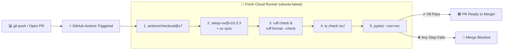

# Chapter 10: CI/CD

[← Previous: Logging](./09-logging.md) | [Back to README](./README.md) | [Next: LLMs →](./11-llms.md)

## What is CI/CD?


Imagine a world where every time you or your teammate pushes a commit or opens a Pull Request on GitHub, a brand-new cloud machine spins up in seconds, installs your exact `uv.lock` dependencies, runs `ruff`, checks types with `ty`, runs your entire `pytest` suite across Python 3.13, 3.14, and 3.15, and posts a green checkmark (or a red ❌) right on the PR.

That is **CI/CD**:
- **Continuous Integration (CI):** Automatically building, linting, type-checking, and testing every code change the moment it is pushed to Git. No more *"Oh, I forgot to run `pytest` before pushing"* or *"Wait, it passed on my MacBook, why does it crash on Linux?"*
- **Continuous Deployment / Delivery (CD):** Automatically packaging and shipping your code (to PyPI, AWS Lambda, or a container registry) once every CI check turns green.

---

## Why CI/CD Saves Group Projects and Startups Alike

1. **Kills "It Works on My Machine" Dead:** If you forgot to `git add` a new helper file, your tests still pass on your laptop (because the untracked file is sitting on your disk!), but CI runs in a fresh clone and catches the missing file immediately.
2. **Protects `main` at 2 a.m.:** Tired humans skip checklists on Friday afternoons or during hackathon crunches. GitHub Actions never gets sleepy.
3. **Tests Every OS & Python Version Automatically:** You code on macOS with Python 3.14; CI tests your code on Ubuntu, Windows, and macOS across Python 3.13, 3.14, and 3.15 in parallel.
4. **Living Onboarding Docs:** When a new developer joins your project and wants to know how to build and test it, `.github/workflows/ci.yml` is the exact recipe.



---

## Introduction to GitHub Actions

**[GitHub Actions](https://github.com/features/actions)** is built directly into GitHub.
- **Generous Free Tier:** Completely free for public open-source repositories, plus free monthly minutes for private repos (and extra benefits via the GitHub Student Developer Pack).
- **Configured as Code:** Your pipeline is just a YAML file inside `.github/workflows/` tracked right alongside your Python code.
- **Multi-OS Runners:** Spin up Linux (`ubuntu-latest`), macOS (`macos-latest`), or Windows (`windows-latest`) VMs on demand.

*(Other CI tools you'll meet in the wild include **GitLab CI/CD**, **CircleCI**, **Jenkins**, and **Azure Pipelines**—once you learn GitHub Actions YAML, the concepts translate everywhere.)*

### Core GitHub Actions Vocabulary

- **Workflow:** An automated pipeline defined in `.github/workflows/ci.yml`.
- **Event (`on:`):** What triggers the workflow (`push`, `pull_request`, `release`, `schedule` cron, or a manual `workflow_dispatch` button click).
- **Job (`jobs:`):** A set of steps that run on a fresh VM (**Runner**). Multiple jobs run in parallel by default unless you chain them with `needs:`.
- **Step (`steps:`):** A single shell command (`run: uv run pytest`) or a reusable action (`uses: actions/checkout@v7`).

---

## Creating Your First CI Workflow

### 1. Where the File Lives

Create a `.github/workflows/` folder in your project root and add `ci.yml`:

```text
myproject/
├── .github/
│   └── workflows/
│       └── ci.yml
├── src/
│   └── mypackage/
│       ├── __init__.py
│       └── main.py
├── tests/
│   └── test_main.py
├── pyproject.toml
├── uv.lock
└── README.md
```

### 2. The Essential `.github/workflows/ci.yml`

```yaml
name: CI

on:
  push:
    branches: [main]
  pull_request:
    branches: [main]

jobs:
  test:
    runs-on: ubuntu-latest

    steps:
      - name: Checkout code
        uses: actions/checkout@v7

      - name: Install uv
        uses: astral-sh/setup-uv@v10.3.3
        with:
          enable-cache: true

      - name: Set up Python
        run: uv python install 3.14

      - name: Install dependencies
        run: uv sync

      - name: Lint with Ruff
        run: uv run ruff check .

      - name: Check formatting with Ruff
        run: uv run ruff format --check .

      - name: Type check
        run: uv run ty check src/

      - name: Run tests
        run: uv run pytest --cov=src --cov-report=xml

      - name: Upload coverage to Codecov
        uses: codecov/codecov-action@v7
        with:
          files: ./coverage.xml
```

### Important Details in That File (Don't Copy Stale 2024 YAML!)

> [!IMPORTANT]
> 1. **Use `actions/checkout@v7`:** Older blog posts still show `actions/checkout@v4`, which ran on Node 20 (a runtime GitHub is retiring). Use `@v7`.
> 2. **Pin a full version on `astral-sh/setup-uv@v10.3.3`:** `setup-uv` dropped moving major tags, so always pin a full release version like `@v10.3.3` (check [setup-uv releases](https://github.com/astral-sh/setup-uv/releases) for the latest) and set `enable-cache: true` so `uv` caches downloaded wheels across runs!
> 3. **Supply-Chain Security Pro-Tip:** For high-security production repos, you can pin third-party actions to an immutable 40-character Git commit SHA (`uses: astral-sh/setup-uv@<40-char-sha> # v10.3.3`).

---

## Matrix Testing: 3 OSes × 3 Python Versions at Once

Want to prove your library works on Linux, macOS, and Windows across Python `3.13`, `3.14`, and `3.15`? You don't write 9 separate jobs—you use a **`matrix`**:

```yaml
name: CI

on: [push, pull_request]

jobs:
  test:
    runs-on: ${{ matrix.os }}
    strategy:
      fail-fast: false
      matrix:
        os: [ubuntu-latest, macos-latest, windows-latest]
        python-version: ['3.13', '3.14', '3.15']

    steps:
      - uses: actions/checkout@v7

      - name: Install uv
        uses: astral-sh/setup-uv@v10.3.3
        with:
          enable-cache: true

      - name: Set up Python ${{ matrix.python-version }}
        run: uv python install ${{ matrix.python-version }}

      - name: Install dependencies
        run: uv sync

      - name: Run tests
        run: uv run pytest
```

Setting **`fail-fast: false`** tells GitHub Actions: *"If Python 3.15 on Windows fails, don't immediately cancel the other 8 combinations—let them finish so I can see right away whether the bug is Windows-only or 3.15-only!"*

---

## Parallel Jobs (Splitting Lint, Types, and Tests)

Instead of running everything in one long list (where a missing space in `ruff format --check` stops `pytest` from even running), you can split them into parallel jobs that run at the exact same time:

```yaml
name: CI

on: [push, pull_request]

jobs:
  lint:
    runs-on: ubuntu-latest
    steps:
      - uses: actions/checkout@v7
      - uses: astral-sh/setup-uv@v10.3.3
        with:
          enable-cache: true
      - run: uv python install 3.14
      - run: uv sync
      - run: uv run ruff check .
      - run: uv run ruff format --check .

  typecheck:
    runs-on: ubuntu-latest
    steps:
      - uses: actions/checkout@v7
      - uses: astral-sh/setup-uv@v10.3.3
        with:
          enable-cache: true
      - run: uv python install 3.14
      - run: uv sync
      - run: uv run ty check src/

  test:
    runs-on: ubuntu-latest
    steps:
      - uses: actions/checkout@v7
      - uses: astral-sh/setup-uv@v10.3.3
        with:
          enable-cache: true
      - run: uv python install 3.14
      - run: uv sync
      - run: uv run pytest --cov=src

  all-checks-passed:
    needs: [lint, typecheck, test]
    runs-on: ubuntu-latest
    steps:
      - run: echo "All checks passed!"
```

---

## Production Pipeline: Quality + Matrix Tests + Trusted PyPI Publish

When you're ready to publish a package to PyPI automatically whenever you create a GitHub Release, use **PyPI Trusted Publishing (OIDC)**—no long-lived `PYPI_API_TOKEN` secret to copy-paste or leak!

```yaml
name: CI/CD

on:
  push:
    branches: [main, develop]
  pull_request:
    branches: [main]
  release:
    types: [published]

env:
  PYTHON_VERSION: '3.14'

jobs:
  quality:
    name: Code quality checks
    runs-on: ubuntu-latest
    steps:
      - uses: actions/checkout@v7
      - uses: astral-sh/setup-uv@v10.3.3
        with:
          enable-cache: true
      - run: uv python install ${{ env.PYTHON_VERSION }}
      - run: uv sync
      - run: uv run ruff check . --output-format=github
      - run: uv run ruff format --check .
      - run: uv run ty check src/

  test:
    name: Test Python ${{ matrix.python-version }}
    runs-on: ${{ matrix.os }}
    strategy:
      fail-fast: false
      matrix:
        os: [ubuntu-latest, macos-latest, windows-latest]
        python-version: ['3.13', '3.14', '3.15']

    steps:
      - uses: actions/checkout@v7
      - uses: astral-sh/setup-uv@v10.3.3
        with:
          enable-cache: true
      - run: uv python install ${{ matrix.python-version }}
      - run: uv sync
      - run: uv run pytest -v --cov=src --cov-report=xml --cov-report=term

      - name: Upload coverage
        if: matrix.os == 'ubuntu-latest' && matrix.python-version == '3.14'
        uses: codecov/codecov-action@v7
        with:
          files: ./coverage.xml

  publish:
    name: Publish to PyPI
    needs: [quality, test]
    runs-on: ubuntu-latest
    if: github.event_name == 'release'
    permissions:
      id-token: write  # Enables OIDC Trusted Publishing with PyPI!

    steps:
      - uses: actions/checkout@v7
      - uses: astral-sh/setup-uv@v10.3.3
        with:
          enable-cache: true
      - run: uv python install ${{ env.PYTHON_VERSION }}
      - run: uv build
      - name: Publish package distributions to PyPI
        uses: pypa/gh-action-pypi-publish@release/v1
```

*(See [PyPI's Trusted Publishers guide](https://docs.pypi.org/trusted-publishers/) to link your GitHub repo on pypi.org in 30 seconds.)*

---

## Adding the Green Badge of Honor to Your `README.md`

Nothing says *"This repo is actually maintained"* to recruiters and teammates like a live green CI badge at the top of your `README.md`:

```markdown
# My Project


[](https://codecov.io/gh/username/repo)
```

*(Make sure the badge URL points to the filename `ci.yml`, not the older workflow title syntax!)*

---

## CI/CD Best Practices & Lifesavers

### 1. Set `timeout-minutes` So Hung Tests Don't Burn All Your Free Minutes
If a test accidentally waits on `input()` or an infinite `while True:` robotics loop, GitHub Actions will happily let it spin for **6 hours** by default! Cap it at 10 minutes:

```yaml
jobs:
  test:
    runs-on: ubuntu-latest
    timeout-minutes: 10
```

### 2. Store Secrets in GitHub Settings, Never in YAML
Need an API key or cloud credential during CI/CD? Add it under **Repo Settings → Secrets and variables → Actions**, then reference it via `${{ secrets.MY_KEY }}`:

```yaml
- name: Run integration smoke test
  env:
    API_KEY: ${{ secrets.API_KEY }}
  run: uv run pytest -m integration
```

### 3. Turn On Branch Protection (Make Green CI Mandatory)
A CI pipeline is just a polite suggestion if people can still click **Merge** when it's red!
Go to your repo's **Settings → Rules → Rulesets** (or **Branches**), target `main`, and check **Require status checks to pass before merging**. Now `main` is officially invincible against broken tests.

### 4. Test Workflows Locally with `act`
Tired of making 8 commits named `"fix ci yaml typo"` just to test your workflow file? **[act](https://github.com/nektos/act)** runs your GitHub Actions workflows locally inside Docker:

```bash
# Install on macOS (or see nektos/act on GitHub for Linux/Windows)
brew install act

# Run the default push workflow locally
act

# Run just the 'test' job
act -j test
```

---

## Quick Reference

```yaml
# Minimal modern Python CI (.github/workflows/ci.yml)
name: CI
on: [push, pull_request]
jobs:
  test:
    runs-on: ubuntu-latest
    timeout-minutes: 10
    steps:
      - uses: actions/checkout@v7
      - uses: astral-sh/setup-uv@v10.3.3
        with:
          enable-cache: true
      - run: uv python install 3.14
      - run: uv sync
      - run: uv run ruff check .
      - run: uv run ruff format --check .
      - run: uv run ty check src/
      - run: uv run pytest --cov=src --cov-report=xml
```

---

## What's Next?

Congratulations—you've finished the entire **Core Track** (Chapters 1–10)! Your repo has isolated environments, locked dependencies, Git history, instant linting and formatting, unit tests, static type checking, structured logging, and automated CI/CD.

Now you can either jump straight to **[Chapter 16: Putting It All Together](./16-putting-it-together.md)** for the full capstone walkthrough, or dive into the **Power-Up Tracks** starting with **[Chapter 11: LLMs and AI-Powered Development](./11-llms.md)**!

[← Previous: Logging](./09-logging.md) | [Back to README](./README.md) | [Next: LLMs →](./11-llms.md)
