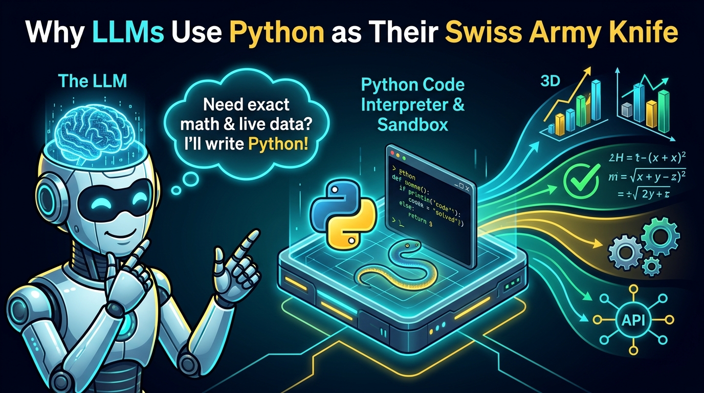
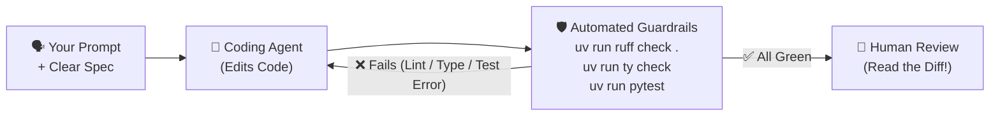

# Chapter 11: LLMs and AI-Powered Development

[← Previous: CI/CD](./10-ci-cd.md) | [Back to README](./README.md) | [Next: Database Libraries →](./12-database-libraries.md)

## What Are LLMs Doing in My Terminal?

Large Language Models (LLMs) are neural networks trained on massive amounts of text and code. At their core, they predict the next token—which turns out to be unreasonably effective for drafting functions, translating cryptic stack traces into plain English, and refactoring repetitive code.

In modern Python development, you'll run into LLMs in two completely different ways:

1. **AI Coding Assistants & Agents (Helping *You* Write Python):** Inline ghost-text in your editor, codebase-aware chat, and terminal agents that edit files, run `pytest`, read the failure, and try again.
2. **Python as the LLM's Own Scripting Language (Helping *the AI* Think & Act):** When an LLM faces a problem it can't reliably solve by "guessing the next word"—like crunching a 100,000-row dataset, solving a robotics kinematics equation, or chaining together ten API calls—it writes and executes a Python script in a sandbox.

Both change how you work as a developer. And neither replaces your type checker, your test suite, or your brain.

---

## Why LLMs Use Python as Their Own Scripting Language



Before we look at coding tools like Copilot or Claude Code, let's talk about a massive shift in how AI systems actually solve hard problems.

### The Problem: LLMs Are Terrible Calculators
An LLM predicts words based on patterns. Ask it to write a poem about a segfault, and it's brilliant. Ask it to multiply `84,912,847 × 93,104,729` or compute the inverse kinematics for a 6-DOF robot arm purely in its head (token by token), and it can easily hallucinate a confident-sounding wrong number.

### The Fix: Don't Guess It—Script It in Python!
Instead of guessing the answer, modern LLMs use **Python as an executable scratchpad and glue language**. When you give an LLM a complex analytical, mathematical, or multi-step task, here is what happens behind the scenes:

```mermaid
sequenceDiagram
    autonumber
    actor User as 👤 User
    participant LLM as 🧠 LLM Agent
    participant Box as 🐍 Python Sandbox (uv / Container)

    User->>LLM: "Analyze sensor_log.csv: find when the drone's IMU spiked >3G and plot the trajectory."
    Note over LLM: Don't guess the numbers!<br/>Write a Python script instead.
    LLM->>Box: Writes & runs analyze_imu.py (pandas + numpy + matplotlib)
    Box-->>LLM: Traceback: KeyError 'accel_z' (column is 'az_m_s2')
    Note over LLM: Self-corrects script using actual column names
    LLM->>Box: Re-runs fixed Python script
    Box-->>LLM: stdout: "Spike at t=14.22s (3.41G)" + trajectory.png
    LLM->>User: Verified exact timestamps, root-cause summary, and plot!
```

### Why Python Won This Job
Why did every major AI lab choose Python as the default runtime for LLM sandboxes, "Code Interpreter" tools, and agentic workflows?

1. **High Expressiveness per Token:** LLMs pay a cost (in latency and context window) for every token they generate. A 15-line Python script using `pandas`, `scipy`, or `httpx` can do what takes 120 lines of boilerplate in Java or C++. Fewer tokens = faster generation and fewer syntax mistakes.
2. **An Interactive REPL & Clear Tracebacks:** When an LLM's script crashes, Python's traceback tells the model *exactly* which line blew up and why (`KeyError`, `ValueError`, `ZeroDivisionError`). The LLM reads `stderr`, patches its own script, and re-runs it in a tight loop.
3. **"Code-as-Action" (Programmatic Tool Use):** Rather than making 50 separate back-and-forth JSON tool calls to filter records or control a device, an agent can write a single Python script with `for` loops, `if/else` branches, and error handling.
4. **From Data Science to Robotics ("Code as Policies"):** In robotics research and physical AI, LLMs literally write Python scripts on the fly to orchestrate robot actions—calling high-level Python APIs like `detect_object("red_block")`, `compute_grasp_pose()`, and `move_arm_to(pose)` using libraries like `numpy` for spatial math while lower-level C++ controllers handle safety and motor torque.

```python
# Example: The kind of on-the-fly Python glue script an LLM agent generates
# when asked to verify whether a robot arm waypoint is within safe reach.
import math

target_xyz = (0.45, -0.30, 0.55)  # meters from base
max_reach_m = 0.80
min_z_m = 0.05  # don't smash into the table!

distance = math.sqrt(sum(c**2 for c in target_xyz))
is_safe = (distance <= max_reach_m) and (target_xyz[2] >= min_z_m)

print(f"Distance: {distance:.3f}m | Safe to move: {is_safe}")
```

> [!TIP]
> **What this means for you as a developer:** When you write clean, well-typed Python functions with clear docstrings and `pyproject.toml` dependencies, you aren't just making your code easier for human teammates to read—you're also making it dramatically easier for AI agents to call, compose, and test accurately!

---

## Benefits of LLMs in Your Daily Python Workflow

When you turn LLMs toward *building your own projects*, here is where they shine:

1. **Crushing Boilerplate:** Writing your tenth FastAPI CRUD router, a CLI argument parser, or a `pyproject.toml` draft takes seconds instead of twenty minutes.
2. **Learning in Context:** Asking *"Why did we use `Depends()` here instead of a global variable?"* right inside your editor beats opening 30 browser tabs you'll never finish reading.
3. **Second-Opinion Debugging:** Pasting a weird traceback (with any API keys stripped!) often spots the missing `await` or wrong tensor shape immediately.
4. **Drafting Tests & Edge Cases:** Asking an agent to *"Write pytest cases for `parse_telemetry()`, including malformed packets and NaN values"* gives you a head start—as long as you read the tests afterward.
5. **Fast Repo Onboarding:** Jumping into a new codebase for an internship or open-source project? Ask the agent to trace how a request flows from the API endpoint down to the database.

None of this replaces [Ruff](./05-linting.md), [pytest](./07-unit-testing.md), [type checking](./08-static-type-checking.md), or [CI](./10-ci-cd.md). In fact, **those tools are what make AI coding agents safe to use.** An LLM will never feel embarrassed when `uv run pytest` fails at 4:55 p.m. on a Friday. You will.



---

## Categories of AI Development Tools

| Category | Examples | Best for |
|----------|----------|----------|
| **Editor / IDE assistants** | GitHub Copilot, Cursor | Instant inline ghost-text completions, side-panel chat, multi-file IDE edits |
| **Terminal coding agents** | Claude Code, Codex, Grok Build | Autonomous multi-step tasks, repo-wide refactors, running shell commands & tests |
| **Platform-integrated** | GitHub Copilot (PRs, reviews) | Summarizing pull requests and catching obvious issues on GitHub |

> [!NOTE]
> AI tools rename their tiers, swap underlying models, and update their pricing faster than JavaScript frameworks used to change build tools. **Always check the official vendor docs for current install commands and pricing.** What follows is a field guide to the tools you'll actually meet in Python teams today.

---

## GitHub Copilot

[GitHub Copilot](https://github.com/features/copilot) is GitHub's AI pair programmer. It lives inside your editor and across GitHub.com (chat, pull requests, and code review).

### Key Features
- **Inline completions** — ghost text appears as you type; hit `Tab` to accept
- **Copilot Chat** — ask questions, refactor, and generate tests without leaving your editor
- **Agent mode** — multi-step, multi-file edits that can iterate on errors
- **Wide editor support** — VS Code, JetBrains (PyCharm), Neovim, Visual Studio
- **GitHub integration** — PR summaries and review suggestions right on GitHub
- **Model picker** — switch between models depending on your plan

*(Bonus for students: Check out the [GitHub Student Developer Pack](https://education.github.com/pack)—verified students typically get Copilot access for free!)*

### Getting Started
1. Enable Copilot on your account at [GitHub Copilot](https://github.com/features/copilot)
2. Install the **GitHub Copilot** extension in VS Code (`Ctrl+Shift+X` / `Cmd+Shift+X`)
3. Sign in with your GitHub account
4. Start coding—inline completions show up in gray text, or open Chat for bigger tasks

Check the [Copilot documentation](https://docs.github.com/en/copilot) for the latest setup details.

### Using Copilot for Python
1. **Signature-driven completion:** Write a well-typed function signature and a 1-line docstring (`def clamp_motor_torque(torque_nm: float, max_nm: float = 12.0) -> float:`), then let Copilot draft the body.
2. **Chat for tests:** *"Add pytest tests for `calculate_total` including empty lists and negative discounts."*
3. **Explain unfamiliar code:** Highlight a gnarly regex or async generator and ask Chat to break it down line by line.
4. **Agent mode:** *"Add type hints to every module under `src/`."* Then run `uv run ty check` yourself to verify.

### Tips
- **Specificity wins:** *"Validate email with a regex, return `bool`, include type hints and a Google-style docstring"* beats *"write email validator."*
- Add a `.github/copilot-instructions.md` file to your repo so Copilot knows your project uses `uv`, `Ruff`, and `pytest`.
- Treat every completion as a draft patch, not gospel.

### Links
- [GitHub Copilot](https://github.com/features/copilot)
- [Copilot documentation](https://docs.github.com/en/copilot)

---

## Cursor

[Cursor](https://cursor.com) is an AI-first code editor forked from VS Code. Instead of bolting AI onto the side as a plugin, chat, inline diffs, and multi-file agents are built into the core editor experience.

### Key Features
- **Codebase-indexed AI chat** — understands how files across your repo connect
- **Inline edit (`Cmd+K` / `Ctrl+K`)** — highlight code, describe the change, and review an inline green/red diff
- **Multi-file Composer / Agent** — creates and edits multiple files across a project
- **100% VS Code familiarity** — imports your existing VS Code extensions, themes, and keybindings in one click

### Getting Started
1. Download from [cursor.com](https://cursor.com)
2. Import your VS Code extensions and settings during first launch
3. Sign in and pick a plan per Cursor's current options
4. Always open your **project root directory** so Cursor can see `pyproject.toml`, `src/`, and `tests/`

### Using Cursor for Python
1. **Inline edit:** Highlight a messy function, press `Cmd+K` / `Ctrl+K`, and type *"Convert this dict into a Pydantic BaseModel with validation."*
2. **Multi-file feature:** Ask the agent to add a new FastAPI endpoint in `routes.py`, a schema in `models.py`, and a test in `test_routes.py`.
3. **Debug from terminal:** When `uv run pytest` fails in Cursor's built-in terminal, send the traceback straight to chat for a targeted fix.

### Tips
- Avoid vague prompts like *"make this better"*—that's how you get an unreviewable 300-line rewrite.
- Read every diff before clicking **Accept**. Cursor generates code fast; untangling a bad accept takes much longer than reading it first.
- Keep `Ruff` and `pytest` as the final referee.

### Links
- [Cursor](https://cursor.com)
- [Cursor documentation](https://cursor.com/docs)

---

## Claude Code

[Claude Code](https://github.com/anthropics/claude-code) is Anthropic's agentic coding tool that lives directly in your terminal. It reads your codebase, edits files, runs terminal commands (`uv run pytest`, `uv run ruff check .`), reads the output, and loops until the task is done.

### Key Features
- **Terminal-first workflow** — works alongside any editor (VS Code, Neovim, PyCharm, SSH session)
- **Full repo awareness** — searches files, traces imports, and edits across directories
- **Autonomous implement-test-fix loops** — runs your test suite and fixes its own bugs
- **Great for refactors** — *"Migrate all logging calls in `src/` from `print()` to `loguru`"*

### Installing Claude Code

Anthropic recommends the **native installer** (no Node.js required):

```bash
# macOS / Linux / WSL
curl -fsSL https://claude.ai/install.sh | bash
```

Alternative if you already use `npm`:

```bash
npm install -g @anthropic-ai/claude-code
```

Verify the install:

```bash
claude --version
```

Authentication, plans, and supported models evolve quickly—follow the official [Claude Code docs](https://docs.anthropic.com/en/docs/claude-code).

### Using Claude Code

Start an interactive session in your project root:

```bash
cd myproject
claude
```

Then give it a concrete outcome:

```text
Add a FastAPI /health endpoint that returns the app version from pyproject.toml, and write pytest coverage for it.
```

Or run one-shot tasks straight from your shell (check `claude --help` for current flags):

```bash
claude "Review src/parser.py for edge cases and suggest pytest tests"
```

### Example Python Workflows

```bash
# Build a new module
claude "Create a small auth module with password hashing and JWT helpers"

# Generate tests with edge cases
claude "Write pytest tests for src/auth.py including expired tokens and bad passwords"

# Make the agent eat its vegetables
claude "Run uv run ruff check . and uv run pytest, then fix any issues you introduced"
```

### Links
- [Claude Code on GitHub](https://github.com/anthropics/claude-code)
- [Claude Code documentation](https://docs.anthropic.com/en/docs/claude-code)

---

## OpenAI Codex

[OpenAI Codex](https://openai.com/codex/) is OpenAI's coding-agent ecosystem. The open-source [Codex CLI](https://github.com/openai/codex) runs locally in your terminal: it inspects your repository, edits files, and executes commands to verify its work. Codex also powers cloud coding workflows inside ChatGPT depending on your plan.

### Key Features
- **Local terminal agent** with full repository context
- **Multi-step implement-and-debug loops**
- **Executes local commands** (linters, test suites, build scripts)
- **Integrates with OpenAI / ChatGPT plans** and editor workflows

### Installing Codex CLI

Check [openai.com/codex](https://openai.com/codex/) and the [GitHub README](https://github.com/openai/codex) for the current recommended install path. Common options:

```bash
# Standalone installer (macOS / Linux) — confirm on official docs
curl -fsSL https://chatgpt.com/codex/install.sh | sh

# npm
npm install -g @openai/codex

# Homebrew
brew install --cask codex
```

Launch it from your project directory:

```bash
cd myproject
codex
```

Sign in with your ChatGPT account or an API key per the current documentation.

### Using Codex for Python

```bash
# Start interactive session
codex

# Task-oriented prompts (exact flags depend on CLI version)
codex "Add a CLI entry point with Typer and a --verbose flag"
codex "Fix the failing pytest in tests/test_main.py"
```

### Tips
- Add an `AGENTS.md` file in your repo root describing your stack (`uv`, `ruff`, `ty`, `pytest`) so the agent follows your conventions automatically on every run.
- Prefer small, reviewable tasks over *"rewrite my whole app"* at 11 p.m.
- Always run `uv run pytest` and `uv run ruff check .` yourself before committing.

### Links
- [OpenAI Codex](https://openai.com/codex/)
- [Codex CLI on GitHub](https://github.com/openai/codex)

---

## Grok Build

**Grok Build** is xAI's terminal coding agent. Like Claude Code and Codex CLI, it explores your repository, edits files, runs shell commands, and iterates until your checks pass—powered by xAI's Grok models underneath.

### Key Features
- **Agentic terminal UI** for interactive coding
- **Project-aware navigation** (read, search, patch across files)
- **Command execution** for running `uv`, `pytest`, and linters in a loop
- **Structured workflows** for planning, implementing, and reviewing changes

*(Note: Stick to documented flags in `grok --help` and official xAI docs.)*

### Getting Started

```bash
# macOS / Linux / WSL (common install; confirm on xAI docs)
curl -fsSL https://x.ai/cli/install.sh | bash

grok --version
```

Start it inside your project:

```bash
cd myproject
grok
```

For authentication, access tiers, and current docs, start at [x.ai](https://x.ai/) and [x.ai/cli](https://x.ai/cli).

### Using Grok Build for Python

Prompts that pair well with this guide's stack:

```text
Set up this repo with uv, Ruff, pytest, and a GitHub Actions CI workflow
matching our existing pyproject.toml conventions.

Add SQLModel models and a FastAPI CRUD API for a Hero resource,
with pytest + FastAPI TestClient coverage.

Review uncommitted changes for security issues and missing tests.
```

Always tell the agent to **run** your tools (`uv run ruff check . && uv run pytest`), not just eyeball the code!

### Tips
- Point the agent at `pyproject.toml` and `.github/workflows/ci.yml` so it matches your exact rules.
- Treat it like a very fast junior teammate: give clear specs, work in small commits, and review every diff.

### Links
- [xAI](https://x.ai/)
- CLI install and product docs: start from [x.ai/cli](https://x.ai/cli) and current Grok Build documentation

---

## Comparing AI Development Tools

| Feature | GitHub Copilot | Cursor | Claude Code | Codex | Grok Build |
|---------|----------------|--------|-------------|-------|------------|
| **Primary interface** | Editor + GitHub | AI IDE (VS Code fork) | Terminal agent | Terminal agent (+ cloud) | Terminal / agent UI |
| **Inline completion** | Excellent | Excellent | Agent-first | Varies | Agent-first |
| **Multi-file agents** | Yes (Agent mode) | Yes | Yes | Yes | Yes |
| **Runs shell commands** | Via agent / CLI | Via agent features | Yes | Yes | Yes |
| **GitHub-native workflows** | Strong | Basic | Strong via CLI | Varies | Varies |
| **Learning curve** | Low | Low | Medium | Medium | Medium |
| **Typical access model** | Subscription (Free for students) | Subscription | Plan / API (Anthropic) | OpenAI / ChatGPT plans | xAI / Grok product |

---

## Best Practices: How to Use AI Without Shooting Your Foot

### 1. Read Every Line Before You Commit
Never merge code you haven't read and understood. Check for:
- **Logic bugs:** Does it actually solve the problem, or did it just make the test pass by deleting the assertion? (Yes, agents sometimes try that!)
- **Security holes:** SQL injection, hardcoded secrets, missing auth checks, path traversal.
- **Performance traps:** Loading a 2 GB dataset into RAM three times inside a loop "for simplicity."
- **Hallucinated APIs:** Inventing a flag or method that existed three versions ago—or never existed at all.

### 2. Write Prompts Like Mini-Specs

**Weak prompt (guaranteed mystery meat):**
```text
Write a sensor filter function
```

**Strong prompt (clear inputs, outputs, and constraints):**
```text
Write a Python function `filter_lidar_ranges(ranges: list[float], min_m: float = 0.1, max_m: float = 30.0) -> list[float]`
that filters out NaN/inf values and readings outside [min_m, max_m].
Include type hints, a short docstring with examples, and raises ValueError if min_m >= max_m.
Format for Ruff.
```

### 3. Work in Small, Verifiable Steps
Instead of asking an agent to build an entire app in one giant prompt:
1. Ask for the data model first → review it.
2. Ask for the core logic function → run `pytest`.
3. Ask for the API endpoint or CLI wrapper → test again.
4. Commit after each green step (`git commit`) so you always have a clean save point to roll back to.

### 4. Use AI as a Tutor, Not a Crutch
If an assistant writes a clever list comprehension or async context manager you don't recognize, pause and ask:
```text
Explain how this function works step by step.
Why use this pattern instead of X? What are the trade-offs?
```
If you can't explain the code in a code review or an interview, you don't own it yet.

### 5. Never Paste Secrets into Prompts
Never paste into any chat or agent prompt:
- API keys, AWS credentials, tokens, or passwords
- Private customer or student data
- `.env` files or production database connection strings

Always load secrets from environment variables ([Chapter 4](./04-version-control.md)):

```python
import os

# Good: Fails fast if missing; secret stays out of source code and prompts
API_KEY = os.environ["API_KEY"]
```

If an AI generates `API_KEY = "sk-..."` hardcoded in a Python file, delete it on sight!

### 6. Always Run the Verification Trio Yourself
Even if a terminal agent claims *"All tests passed!"*, run these three commands yourself before pushing:

```bash
uv run ruff check .
uv run ruff format --check .
uv run pytest
```

Thirty seconds of verification beats explaining a broken `main` branch to your team.

---

## Practical Example: Building a Feature with a Terminal Agent

Here is how a real workflow looks using Claude Code, Codex, or Grok Build:

**Step 1 — Plan first (don't let it start editing blindly):**
```text
Help me plan a small user authentication module for our FastAPI app.
List the components and implementation order. We use uv, pytest, and Ruff.
```

**Step 2 — Implement the core logic:**
```text
Create a user model, password hashing helpers, and JWT issue/verify functions in src/myapp/auth.py.
```

**Step 3 — Lock it down with tests:**
```text
Generate pytest tests in tests/test_auth.py covering happy paths, wrong passwords, and expired JWTs.
```

**Step 4 — Run the quality gauntlet:**
```text
Run uv run ruff check ., uv run ruff format --check ., and uv run pytest. Fix anything that fails.
```

**Step 5 — Adversarial review:**
```text
Review src/myapp/auth.py for security issues, timing attacks, or missing edge cases.
```

Then **you** read `git diff` line by line. Auth, payments, and hardware control loops are where "confident-sounding wrong code" hurts the most.

---

## Quick Reference

```bash
# GitHub Copilot (VS Code)
# - Install GitHub Copilot + Copilot Chat extensions
# - Tab to accept ghost text; open Chat / Agent mode for larger tasks

# Cursor
# Cmd/Ctrl+K  inline edit diff
# Cmd/Ctrl+L  chat with codebase context

# Claude Code
curl -fsSL https://claude.ai/install.sh | bash
claude
claude "Implement X and add pytest tests"

# OpenAI Codex CLI
# see https://github.com/openai/codex and https://openai.com/codex/
codex
codex "Implement X and add pytest tests"

# Grok Build
curl -fsSL https://x.ai/cli/install.sh | bash
grok
# Ask the agent to run: uv run ruff check . && uv run pytest

# The Golden Rule — Always run these yourself before git commit:
uv run ruff check .
uv run ruff format --check .
uv run pytest
```

---

## What's Next?

AI tools speed up the typing—and Python gives LLMs a scripting runtime to solve complex problems—but your application still needs a way to store data reliably. Next up: Python's database stack, from raw SQL with `sqlite3` to type-safe models with **SQLAlchemy** and **SQLModel**.

[← Previous: CI/CD](./10-ci-cd.md) | [Back to README](./README.md) | [Next: Database Libraries →](./12-database-libraries.md)
