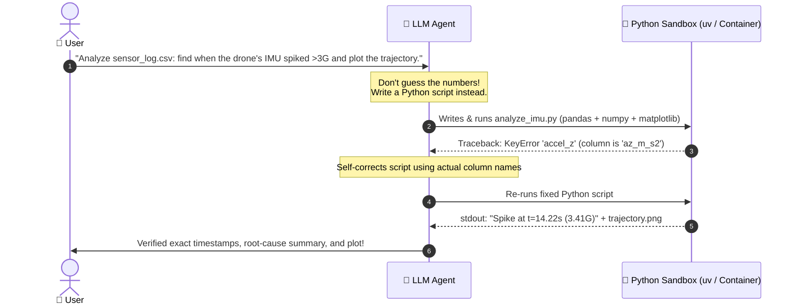
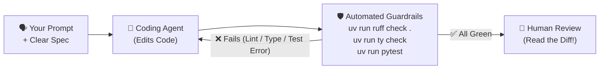
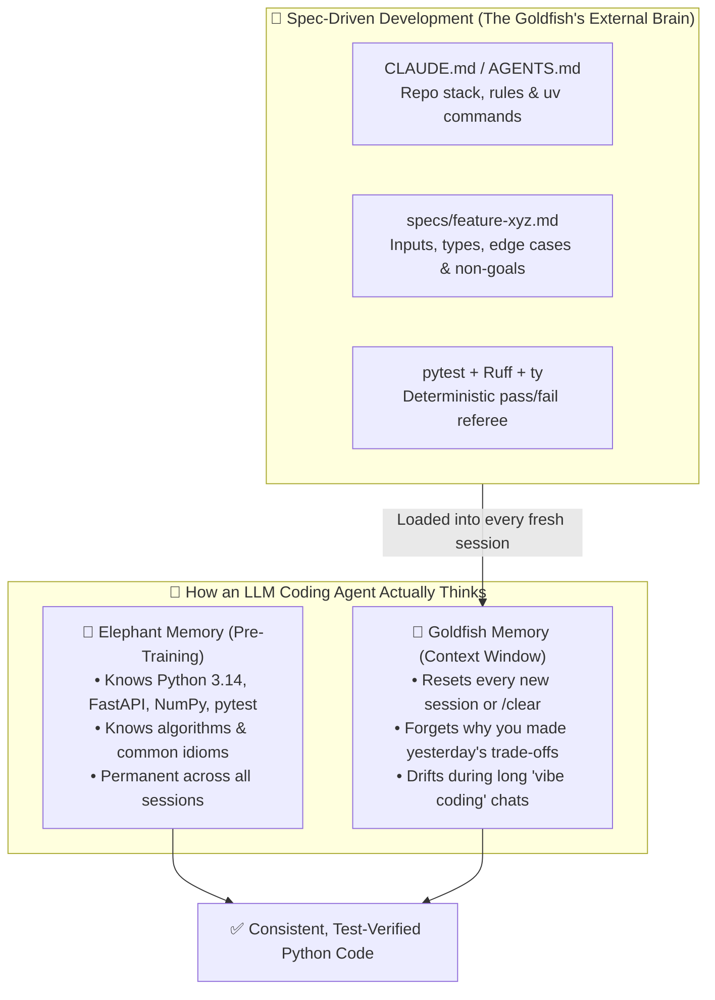

# Chapter 11: LLMs and AI-Powered Development

[← Previous: CI/CD](./10-ci-cd.md) | [Back to README](./README.md) | [Next: Database Libraries →](./12-database-libraries.md)

## What Are LLMs Doing in My Terminal?

Large Language Models (LLMs) are neural networks trained on massive amounts of text and code. At their core, they predict the next token—which turns out to be unreasonably effective for drafting functions, translating cryptic stack traces into plain English, and refactoring repetitive code.

In modern Python development, you'll run into LLMs in two completely different ways:

1. **AI Coding Assistants & Agents (Helping *You* Write Python):** Inline ghost-text in your editor, codebase-aware chat, and terminal agents that edit files, run `pytest`, read the failure, and try again.
2. **Python as the LLM's Own Scripting Language (Helping *the AI* Think & Act):** When an LLM faces a problem it can't reliably solve by "guessing the next word"—like crunching a 100,000-row dataset, solving a robotics kinematics equation, or chaining together ten API calls—it writes and executes a Python script in a sandbox.

Both change how you work as a developer. And neither replaces your type checker, your test suite, or your brain.

---

## Why LLMs Use Python as Their Own Scripting Language


Before we look at coding tools like Copilot or Claude Code, let's talk about a massive shift in how AI systems actually solve hard problems.

### The Problem: LLMs Are Terrible Calculators
An LLM predicts words based on patterns. Ask it to write a poem about a segfault, and it's brilliant. Ask it to multiply `84,912,847 × 93,104,729` or compute the inverse kinematics for a 6-DOF robot arm purely in its head (token by token), and it can easily hallucinate a confident-sounding wrong number.

### The Fix: Don't Guess It—Script It in Python!
Instead of guessing the answer, modern LLMs use **Python as an executable scratchpad and glue language**. When you give an LLM a complex analytical, mathematical, or multi-step task, here is what happens behind the scenes:



### Why Python Won This Job
Why did every major AI lab choose Python as the default runtime for LLM sandboxes, "Code Interpreter" tools, and agentic workflows?

1. **High Expressiveness per Token:** LLMs pay a cost (in latency and context window) for every token they generate. A 15-line Python script using `pandas`, `scipy`, or `httpx` can do what takes 120 lines of boilerplate in Java or C++. Fewer tokens = faster generation and fewer syntax mistakes.
2. **An Interactive REPL & Clear Tracebacks:** When an LLM's script crashes, Python's traceback tells the model *exactly* which line blew up and why (`KeyError`, `ValueError`, `ZeroDivisionError`). The LLM reads `stderr`, patches its own script, and re-runs it in a tight loop.
3. **"Code-as-Action" (Programmatic Tool Use):** Rather than making 50 separate back-and-forth JSON tool calls to filter records or control a device, an agent can write a single Python script with `for` loops, `if/else` branches, and error handling.
4. **From Data Science to Robotics ("Code as Policies"):** In robotics research and physical AI, LLMs literally write Python scripts on the fly to orchestrate robot actions—calling high-level Python APIs like `detect_object("red_block")`, `compute_grasp_pose()`, and `move_arm_to(pose)` using libraries like `numpy` for spatial math while lower-level C++ controllers handle safety and motor torque.

```python
# Example: The kind of on-the-fly Python glue script an LLM agent generates
# when asked to verify whether a robot arm waypoint is within safe reach.
import math

target_xyz = (0.45, -0.30, 0.55)  # meters from base
max_reach_m = 0.80
min_z_m = 0.05  # don't smash into the table!

distance = math.sqrt(sum(c**2 for c in target_xyz))
is_safe = (distance <= max_reach_m) and (target_xyz[2] >= min_z_m)

print(f"Distance: {distance:.3f}m | Safe to move: {is_safe}")
```

> [!TIP]
> **What this means for you as a developer:** When you write clean, well-typed Python functions with clear docstrings and `pyproject.toml` dependencies, you aren't just making your code easier for human teammates to read—you're also making it dramatically easier for AI agents to call, compose, and test accurately!

---

## Benefits of LLMs in Your Daily Python Workflow

When you turn LLMs toward *building your own projects*, here is where they shine:

1. **Crushing Boilerplate:** Writing your tenth FastAPI CRUD router, a CLI argument parser, or a `pyproject.toml` draft takes seconds instead of twenty minutes.
2. **Learning in Context:** Asking *"Why did we use `Depends()` here instead of a global variable?"* right inside your editor beats opening 30 browser tabs you'll never finish reading.
3. **Second-Opinion Debugging:** Pasting a weird traceback (with any API keys stripped!) often spots the missing `await` or wrong tensor shape immediately.
4. **Drafting Tests & Edge Cases:** Asking an agent to *"Write pytest cases for `parse_telemetry()`, including malformed packets and NaN values"* gives you a head start—as long as you read the tests afterward.
5. **Fast Repo Onboarding:** Jumping into a new codebase for an internship or open-source project? Ask the agent to trace how a request flows from the API endpoint down to the database.

None of this replaces [Ruff](./05-linting.md), [pytest](./07-unit-testing.md), [type checking](./08-static-type-checking.md), or [CI](./10-ci-cd.md). In fact, **those tools are what make AI coding agents safe to use.** An LLM will never feel embarrassed when `uv run pytest` fails at 4:55 p.m. on a Friday. You will.



---

## The "Elephant–Goldfish" Model & Spec-Driven Development (SDD)

Before you install a single AI coding tool, you need one mental model—the **[Elephant–Goldfish Model](https://egm.dev/)**—that explains 90% of why AI agents succeed on some tasks and produce unmaintainable spaghetti on others.

### Your AI Agent Is Half Elephant, Half Goldfish

- **🐘 The Elephant (Pre-trained Knowledge):** An LLM has an elephant's memory for general programming knowledge. It remembers almost every Python standard library module, FastAPI pattern, `pytest` fixture trick, robotics math formula, and RFC ever published.
- **🐠 The Goldfish (Project & Session Memory):** Across sessions—or as soon as a long conversation fills up the context window—that exact same model has the memory of a goldfish. Every new session wakes up with total amnesia about *your* project: it doesn't know why you rejected a design yesterday, which edge cases crash your drone controller, or that your team uses `uv` and `ty` instead of `pip` and `mypy`.



### Spec-Driven Development (SDD): Giving the Goldfish a Notebook

If you build software by casually chatting with an agent back and forth for two hours (*"vibe coding"*), the goldfish eventually forgets the constraints from message #3 while fixing a bug in message #47.

**Spec-Driven Development (SDD)** fixes the goldfish problem by moving your project context and requirements out of ephemeral chat history and into version-controlled files in your repository:

1. **Persistent Repo Memory (`CLAUDE.md` / `AGENTS.md`):** A short file in your repo root that tells every fresh agent session your exact stack (`uv`, `ruff`, `ty`, `pytest`), directory layout, and coding rules.
2. **Feature Specifications (`specs/<feature>.md`):** Before the agent writes a single line of implementation code, you write (or co-write with the agent) a crisp specification defining the **goal, non-goals, data models/signatures, edge cases, and acceptance criteria**.
3. **Fresh-Context Execution & Deterministic Verification:** Because the spec and repo rules live on disk, you can wipe the chat context (`/clear`) between planning, implementation, and review—and let `uv run ruff check .`, `uv run ty check`, and `uv run pytest` act as the unbribeable referee.

---

## AI Development Tools at a Glance

AI tools evolve and change pricing constantly, so always check their official documentation for current setup and plan details; here is the one-sentence field guide to the tools you'll meet in Python workflows today:

- **[Claude Code](https://github.com/anthropics/claude-code) ([docs](https://docs.anthropic.com/en/docs/claude-code)):** Anthropic's agentic terminal coding tool that reads your repository, edits files, runs shell commands (`uv`, `pytest`, `ruff`), and iterates in a loop until checks pass *(covered in depth below)*.
- **[GitHub Copilot](https://github.com/features/copilot) & [Copilot CLI](https://docs.github.com/en/copilot/github-copilot-in-the-cli) ([docs](https://docs.github.com/en/copilot)):** GitHub's AI pair programmer offering inline IDE completions, chat, multi-file agent mode, PR reviews, and terminal agent workflows via Copilot CLI *(free for verified students via the [GitHub Student Developer Pack](https://education.github.com/pack))*.
- **[Cursor](https://cursor.com) ([docs](https://cursor.com/docs)):** An AI-first code editor forked from VS Code with codebase-indexed chat, inline diff editing (`Cmd/Ctrl+K`), and multi-file agent workflows built into the editor.
- **[OpenAI Codex CLI](https://github.com/openai/codex) ([OpenAI Codex](https://openai.com/codex/)):** OpenAI's open-source terminal coding agent and cloud coding ecosystem that inspects your repo, edits files, and runs local test and lint commands to verify changes.
- **[Google Antigravity (`agy`)](https://antigravity.google/docs) ([CLI docs](https://antigravity.google/docs/cli/reference), [Python SDK](https://github.com/google-antigravity/antigravity-sdk-python)):** Google's AI-first development platform and terminal CLI (`agy`) for orchestrating autonomous coding agents, subagents, skills, and MCP tools across your workspace.
- **[OpenCode](https://opencode.ai) ([GitHub](https://github.com/sst/opencode)):** An open-source, provider-agnostic terminal coding agent with a rich TUI that lets you bring your own API keys or local models.
- **[Grok Build](https://x.ai/cli) ([xAI](https://x.ai/)):** xAI's terminal coding agent powered by Grok models that navigates repositories, patches files, and executes verification commands in an interactive loop.

---

## Deep Dive: Spec-Driven Python Development with Claude Code

Let's walk through a real **Spec-Driven Development** workflow using **[Claude Code](https://docs.anthropic.com/en/docs/claude-code)**—showing how to pair the Elephant's Python knowledge with external memory files so the Goldfish never loses the plot.

### 1. Install and Launch Claude Code

Anthropic recommends the native installer (no Node.js required):

```bash
# macOS / Linux / WSL
curl -fsSL https://claude.ai/install.sh | bash

# Verify installation
claude --version
```

*(If you prefer `npm`, `npm install -g @anthropic-ai/claude-code` also works; see the [Claude Code docs](https://docs.anthropic.com/en/docs/claude-code) for Windows and authentication setup.)*

Start an interactive session from your Python project's root directory:

```bash
cd rover-telemetry
claude
```

### 2. Cure Repo Amnesia with `CLAUDE.md`

Claude Code automatically reads **`CLAUDE.md`** in your repository root at the start of every session. You can generate a starter file by running `/init` inside Claude Code, or create a focused one like this:

```markdown
# CLAUDE.md — Project Memory for AI Agents

## Stack & Commands
- Package & env manager: `uv` (NEVER run bare `pip` or `python`; always use `uv add` and `uv run`)
- Python version: 3.14 (`requires-python = ">=3.13"`)
- Linter & formatter: `uv run ruff check .` and `uv run ruff format --check .`
- Type checker: `uv run ty check`
- Test runner: `uv run pytest`

## Code Conventions
- All functions in `src/` must have complete Python 3.14+ type hints (`list[float]`, `str | None`).
- Raise explicit domain exceptions (`ValueError`) on invalid sensor parameters; never silently return `None` on bad config.
- Every new feature or bugfix requires a spec in `specs/` and unit tests in `tests/`.
```

Now, even when you close your laptop and start a brand-new session next week, the Goldfish immediately knows your toolchain and rules on turn #1.

### 3. Step 1 of SDD: Co-Write the Spec First (Plan Mode)

Suppose we are building a LiDAR range-filtering module for a rover. Instead of typing *"write a lidar filter"* and hoping for the best, start Claude Code in **Plan Mode** (`Shift+Tab` to toggle Plan Mode, or ask it to draft a spec before touching `src/`):

```text
We need a LiDAR scan filter module for our rover.
Do NOT write implementation code yet.
Ask me any clarifying questions you need, then write a concise specification to specs/lidar_filter.md.
```

After answering its questions, you commit a concrete spec file (**`specs/lidar_filter.md`**) to Git:

```markdown
# Spec: LiDAR Scan Range & Median Filter (`specs/lidar_filter.md`)

## Goal
Provide pure, deterministic functions in `src/rover_telemetry/lidar.py` to sanitize raw 2D LiDAR distance scans before obstacle avoidance reads them.

## Non-Goals
- No ROS 2 node pub/sub wiring in this module (pure math/data functions only).
- No external C/NumPy dependencies; use Python stdlib (`math`, `statistics`, `dataclasses`).

## Data Model & Signatures
- `LidarConfig(min_range_m: float = 0.15, max_range_m: float = 12.0)` (frozen `@dataclass(slots=True)`)
  - Must validate `0.0 < min_range_m < max_range_m` in `__post_init__`, raising `ValueError` otherwise.
- `sanitize_scan(ranges_m: Sequence[float], config: LidarConfig) -> list[float]`
  - Drops `math.isnan` and `math.isinf` readings.
  - Clamps finite readings into `[config.min_range_m, config.max_range_m]`.
- `windowed_median(ranges_m: Sequence[float], window: int = 3) -> list[float]`
  - Raises `ValueError` if `window < 1` or `window` is even.
  - Returns `[]` for an empty input sequence.

## Acceptance Criteria
1. 100% type-annotated (`uv run ty check` passes with zero warnings).
2. `uv run ruff check .` and `uv run ruff format --check .` pass cleanly.
3. `tests/test_lidar.py` covers happy paths, `NaN`/`-inf`/`+inf`, clamping boundaries, invalid `LidarConfig`, even window sizes, and empty scans.
```

### 4. Step 2 of SDD: Implement Against the Spec in a Fresh Session

Here is the magic of the Elephant–Goldfish model: once `specs/lidar_filter.md` is saved, **run `/clear`** inside Claude Code (or start a fresh session). You just wiped the noisy brainstorming chat, so the context window is 100% clean, focused, and cheap:

```text
Implement specs/lidar_filter.md.
Follow all conventions in CLAUDE.md, write the unit tests in tests/test_lidar.py,
and run uv run ruff check ., uv run ty check, and uv run pytest until all checks pass.
```

Behind the scenes, Claude Code will:
1. Read `CLAUDE.md` and `specs/lidar_filter.md`.
2. Create `src/rover_telemetry/lidar.py` and `tests/test_lidar.py`.
3. Execute `uv run ruff check .`, `uv run ty check`, and `uv run pytest` in your terminal.
4. Read any failure traceback, fix the code, and re-run until green.

### 5. Step 3 of SDD: Independent Spec Verification & One-Shot CLI Runs

You can also invoke Claude Code directly from your shell for one-shot tasks, adversarial code reviews, or piping Unix output straight into the agent:

```bash
# Have a fresh "Goldfish" session audit the implementation against the written spec
claude -p "Compare src/rover_telemetry/lidar.py and tests/test_lidar.py against specs/lidar_filter.md. List any missing edge cases or spec deviations."

# Pipe a failing pytest run or git diff directly into Claude Code
uv run pytest | claude -p "Explain why this test failed and propose the minimal fix"

# Audit uncommitted changes before opening a Pull Request
git diff | claude -p "Review this diff for subtle bugs, security issues, or missing type hints"
```

---

## Best Practices: How to Use AI Without Shooting Your Foot

### 1. Read Every Line Before You Commit
Never merge code you haven't read and understood. Check for:
- **Logic & test-cheating bugs:** Did the agent actually fix the bug, or did it just weaken the `assert` in `tests/` so `pytest` turned green? (Yes, agents try that!)
- **Security holes:** SQL injection, hardcoded secrets, missing auth checks, path traversal.
- **Performance traps:** Loading a 2 GB dataset into RAM three times inside a loop "for simplicity."
- **Hallucinated APIs:** Inventing a flag or method that existed three versions ago—or never existed at all.

### 2. Write Prompts Like Mini-Specs (Even for Single Functions)
Even when you're just asking for a quick helper function, give the Elephant clear constraints instead of making the Goldfish guess:

**Weak prompt (vague vibe coding—guaranteed mystery meat):**
```text
Write a sensor filter function
```

**Strong prompt (mini-spec—clear signature, constraints, and error behavior):**
```text
Write a Python function `filter_lidar_ranges(ranges: list[float], min_m: float = 0.1, max_m: float = 30.0) -> list[float]`
that filters out NaN/inf values and readings outside [min_m, max_m].
Include type hints, a short docstring with examples, and raise ValueError if min_m >= max_m.
Format for Ruff.
```

### 3. Work in Small, Verifiable Commits
Instead of asking an agent to build an entire application in one giant prompt:
1. Write/update the spec in `specs/` → review it.
2. Implement the data model & core logic → run `uv run pytest`.
3. Add the FastAPI route or CLI command → test again.
4. Commit after each green step (`git commit`) so you always have a clean rollback point.

### 4. Use AI as a Tutor, Not a Crutch
If an agent writes a clever `@contextlib.asynccontextmanager` or `dataclass(slots=True)` pattern you don't recognize, pause and ask:
```text
Explain how this function works step by step.
Why use this pattern instead of X? What are the trade-offs?
```
If you can't explain the code in a code review or an interview, you don't own it yet.

### 5. Never Paste Secrets into Prompts
Never paste into any chat or agent prompt (and add `.env` to `.gitignore` so terminal agents don't commit it):
- API keys, AWS credentials, tokens, or passwords
- Private customer or student data
- `.env` files or production database connection strings

Always load secrets from environment variables ([Chapter 4](./04-version-control.md)):

```python
import os

# Good: Fails fast if missing; secret stays out of source code and prompts
API_KEY = os.environ["API_KEY"]
```

If an AI generates `API_KEY = "sk-..."` hardcoded in a Python file, delete it on sight!

### 6. Always Run the Verification Quartet Yourself
Even if a terminal agent claims *"All tests passed!"*, run these commands yourself before pushing:

```bash
uv run ruff check .
uv run ruff format --check .
uv run ty check
uv run pytest
```

Thirty seconds of verification beats explaining a broken `main` branch to your team.

---

## Quick Reference

```bash
# Install Claude Code (native installer)
curl -fsSL https://claude.ai/install.sh | bash
claude --version

# Start an interactive Claude Code session in your repo root
cd myproject
claude

# Inside Claude Code (Spec-Driven Workflow):
#   /init          -> Generate a starter CLAUDE.md for your repo
#   Shift+Tab      -> Toggle Plan Mode to co-write specs/<feature>.md before coding
#   /clear         -> Reset the "Goldfish" context window between spec & implementation

# One-shot & piped terminal commands
claude -p "Implement specs/lidar_filter.md and verify with pytest, ruff, and ty"
git diff | claude -p "Review this diff against specs/lidar_filter.md"

# The Golden Rule — Always run these yourself before git commit:
uv run ruff check .
uv run ruff format --check .
uv run ty check
uv run pytest
```

---

## What's Next?

AI tools speed up the typing—and Python gives LLMs a scripting runtime to solve complex problems—but your application still needs a way to store data reliably. Next up: Python's database stack, from raw SQL with `sqlite3` to type-safe models with **SQLAlchemy** and **SQLModel**.

[← Previous: CI/CD](./10-ci-cd.md) | [Back to README](./README.md) | [Next: Database Libraries →](./12-database-libraries.md)
