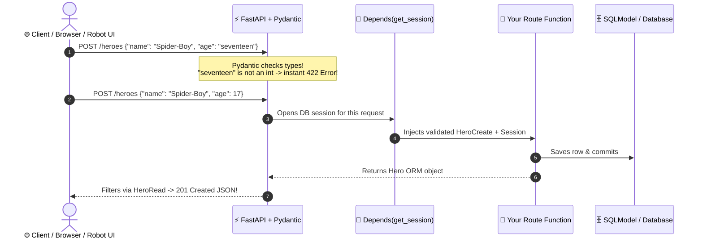

# Chapter 13: REST APIs with FastAPI

[← Previous: Database Libraries](./12-database-libraries.md) | [Back to README](./README.md) | [Next: AWS Lambda →](./14-aws-lambda.md)

## What is FastAPI?

[FastAPI](https://fastapi.tiangolo.com) ([GitHub](https://github.com/fastapi/fastapi)) is the modern standard for building Python REST APIs—whether you're shipping a web backend, serving an ML model, or exposing an HTTP control server on a robot. It combines two powerhouse libraries:

- **[Starlette](https://www.starlette.io/):** A fast ASGI web toolkit for routing, middleware, and async HTTP/WebSockets.
- **[Pydantic](https://docs.pydantic.dev/):** Rust-powered data validation that uses standard Python type hints to parse, validate, and serialize JSON automatically.



### Installation & First App

```bash
uv add "fastapi[standard]"
```

The `[standard]` extra includes **Uvicorn** (the ASGI server) and the `fastapi` CLI. Create `main.py`:

```python
from fastapi import FastAPI

app = FastAPI(title="My API", version="0.1.0")


@app.get("/")
def read_root() -> dict[str, str]:
    return {"message": "Hello, world!"}
```

Start the development server with auto-reload:

```bash
uv run fastapi dev main.py
# Or directly with Uvicorn: uv run uvicorn main:app --reload
```

Open your browser to see three automatic endpoints:
- **`http://127.0.0.1:8000`** — JSON response (`{"message": "Hello, world!"}`)
- **`http://127.0.0.1:8000/docs`** — Interactive **Swagger UI** where you can click *"Try it out"* to send live requests
- **`http://127.0.0.1:8000/redoc`** — Clean **ReDoc** reference documentation

---

## Path Parameters, Query Parameters & Pydantic Request Bodies

FastAPI infers where data comes from directly from your function signature:

1. **Path parameters** match `{name}` in the URL path (`int`, `str`, `UUID`, etc.).
2. **Query parameters** are primitive parameters not in the URL path (with optional defaults like `limit: int = 10` or `q: str | None = None`).
3. **Request bodies** are parameters typed as a **Pydantic `BaseModel`** (or `SQLModel`).

```python
from fastapi import FastAPI
from pydantic import BaseModel

app = FastAPI()


class WaypointCreate(BaseModel):
    x_m: float
    y_m: float
    speed_m_s: float = 1.0


@app.get("/rovers/{rover_id}/waypoints")
def list_waypoints(
    rover_id: int,                 # Path parameter (validated as int; /rovers/abc -> 422)
    limit: int = 10,               # Query parameter (?limit=10)
    frame: str | None = None,      # Optional query parameter (?frame=map)
) -> dict[str, object]:
    return {"rover_id": rover_id, "limit": limit, "frame": frame}


@app.post("/rovers/{rover_id}/waypoints", status_code=201)
def add_waypoint(rover_id: int, waypoint: WaypointCreate) -> dict[str, object]:
    return {"rover_id": rover_id, "waypoint": waypoint}
```

---

## Complete CRUD API with FastAPI, `Depends()`, and SQLModel

FastAPI's **`Depends()`** injects shared resources—like database sessions or authentication checks—into any route handler cleanly. Combining FastAPI with **[SQLModel](./12-database-libraries.md)** gives you a complete, database-backed CRUD API with zero schema duplication:

```bash
uv add "fastapi[standard]" sqlmodel
```

```python
# main.py
from collections.abc import AsyncGenerator, Generator
from contextlib import asynccontextmanager

from fastapi import Depends, FastAPI, HTTPException
from sqlmodel import Field, Session, SQLModel, create_engine, select

engine = create_engine("sqlite:///heroes.db", connect_args={"check_same_thread": False})


# --- Models (One hierarchy for DB Table + Request/Response Schemas) ---
class HeroBase(SQLModel):
    name: str = Field(index=True)
    superpower: str
    age: int | None = None


class Hero(HeroBase, table=True):
    id: int | None = Field(default=None, primary_key=True)


class HeroCreate(HeroBase):
    pass


class HeroRead(HeroBase):
    id: int


class HeroUpdate(SQLModel):
    name: str | None = None
    superpower: str | None = None
    age: int | None = None


# --- Lifespan & Dependency Injection ---
@asynccontextmanager
async def lifespan(_: FastAPI) -> AsyncGenerator[None, None]:
    SQLModel.metadata.create_all(engine)
    yield


app = FastAPI(title="Heroes API", version="1.0.0", lifespan=lifespan)


def get_session() -> Generator[Session, None, None]:
    with Session(engine) as session:
        yield session


# --- CRUD Routes ---
@app.post("/heroes", response_model=HeroRead, status_code=201)
def create_hero(hero: HeroCreate, session: Session = Depends(get_session)) -> Hero:
    db_hero = Hero.model_validate(hero)
    session.add(db_hero)
    session.commit()
    session.refresh(db_hero)
    return db_hero


@app.get("/heroes", response_model=list[HeroRead])
def list_heroes(session: Session = Depends(get_session)) -> list[Hero]:
    return list(session.exec(select(Hero)).all())


@app.get("/heroes/{hero_id}", response_model=HeroRead)
def get_hero(hero_id: int, session: Session = Depends(get_session)) -> Hero:
    hero = session.get(Hero, hero_id)
    if not hero:
        raise HTTPException(status_code=404, detail=f"Hero {hero_id} not found")
    return hero


@app.patch("/heroes/{hero_id}", response_model=HeroRead)
def update_hero(
    hero_id: int,
    updates: HeroUpdate,
    session: Session = Depends(get_session),
) -> Hero:
    hero = session.get(Hero, hero_id)
    if not hero:
        raise HTTPException(status_code=404, detail=f"Hero {hero_id} not found")
    hero.sqlmodel_update(updates.model_dump(exclude_unset=True))
    session.add(hero)
    session.commit()
    session.refresh(hero)
    return hero


@app.delete("/heroes/{hero_id}", status_code=204)
def delete_hero(hero_id: int, session: Session = Depends(get_session)) -> None:
    hero = session.get(Hero, hero_id)
    if not hero:
        raise HTTPException(status_code=404, detail=f"Hero {hero_id} not found")
    session.delete(hero)
    session.commit()
```

**Why this pattern works so well:**
- **`exclude_unset=True`** on `PATCH` ensures only fields actually sent by the client are updated.
- **`response_model=HeroRead`** guarantees internal database fields are filtered before serialization.
- **`Depends(get_session)`** opens a transaction per request and closes it automatically—and makes swapping in an in-memory SQLite database during unit tests trivial!

---

## Testing FastAPI with `pytest` and `TestClient`

FastAPI's `TestClient` wraps `httpx` so you can call your endpoints directly in `pytest` without spinning up a live network port:

```bash
uv add --dev pytest httpx
```

Use `app.dependency_overrides` to give every test an isolated, in-memory SQLite database:

```python
# tests/test_heroes.py
from collections.abc import Generator
import pytest
from fastapi.testclient import TestClient
from sqlmodel import Session, SQLModel, create_engine
from sqlmodel.pool import StaticPool

from main import app, get_session


@pytest.fixture(name="client")
def client_fixture() -> Generator[TestClient, None, None]:
    test_engine = create_engine(
        "sqlite://",
        connect_args={"check_same_thread": False},
        poolclass=StaticPool,
    )
    SQLModel.metadata.create_all(test_engine)

    def override_get_session() -> Generator[Session, None, None]:
        with Session(test_engine) as session:
            yield session

    app.dependency_overrides[get_session] = override_get_session
    with TestClient(app) as client:
        yield client
    app.dependency_overrides.clear()


def test_hero_crud_lifecycle(client: TestClient) -> None:
    # 1. Create
    res = client.post("/heroes", json={"name": "Spider-Boy", "superpower": "Webs", "age": 17})
    assert res.status_code == 201
    hero_id = res.json()["id"]

    # 2. Read & Patch
    patch_res = client.patch(f"/heroes/{hero_id}", json={"age": 18})
    assert patch_res.status_code == 200
    assert patch_res.json()["age"] == 18

    # 3. Delete & confirm 404
    assert client.delete(f"/heroes/{hero_id}").status_code == 204
    assert client.get(f"/heroes/{hero_id}").status_code == 404
```

---

## Calling External APIs: Python HTTP Client Libraries

Your FastAPI service (or CLI script) will often need to call *other* REST APIs. The two standard Python HTTP client libraries are:

- **[Requests](https://requests.readthedocs.io/)** ([GitHub](https://github.com/psf/requests)): The classic synchronous HTTP/1.1 client (`uv add requests`). Simple and ubiquitous for scripts and synchronous code (`requests.get(url, timeout=5)`), but blocks the event loop inside `async def` FastAPI routes.
- **[HTTPX](https://www.python-httpx.org/)** ([GitHub](https://github.com/encode/httpx)): The modern, Requests-compatible client from the Encode team (the same folks behind Starlette and Uvicorn) that supports **both synchronous and `async` calls**, strict timeouts by default, and **HTTP/2** (`uv add "httpx[http2]"`):

```python
import httpx

# Async client with HTTP/2 connection multiplexing (ideal inside `async def` FastAPI routes)
async with httpx.AsyncClient(http2=True, timeout=5.0) as client:
    response = await client.get("https://api.github.com/repos/fastapi/fastapi")
    response.raise_for_status()
    data = response.json()
```

---

## Running in Production & Python Web Alternatives

Never use `--reload` or `fastapi dev` in production. Instead, run multiple ASGI workers:

```bash
# Modern FastAPI CLI (recommended)
uv run fastapi run main.py --workers 4

# Uvicorn directly
uv run uvicorn main:app --host 0.0.0.0 --port 8000 --workers 4

# Gunicorn process manager with Uvicorn workers
uv run gunicorn main:app --workers 4 --worker-class uvicorn.workers.UvicornWorker --bind 0.0.0.0:8000
```

### Other Great Python Web Frameworks
- **[Litestar](https://litestar.dev/):** A high-performance, async-first ASGI framework with built-in dependency injection and first-class DTO support—the closest modern alternative to FastAPI.
- **[Flask](https://flask.palletsprojects.com/):** The classic minimalist microframework. Great for small server-rendered web apps or legacy services, though it lacks built-in type validation and OpenAPI generation.
- **[Django](https://www.djangoproject.com/) & [Django REST Framework](https://www.django-rest-framework.org/) / [Django Ninja](https://django-ninja.dev/):** The "batteries-included" giant with its own ORM, admin panel, auth system, and migrations.

---

## What's Next?

What if you want to deploy an API or background worker without managing servers at all? Next up: [Chapter 14: AWS Lambda with Python](./14-aws-lambda.md).

[← Previous: Database Libraries](./12-database-libraries.md) | [Back to README](./README.md) | [Next: AWS Lambda →](./14-aws-lambda.md)
