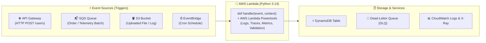

# Chapter 14: AWS Lambda with Python

[← Previous: FastAPI](./13-fastapi.md) | [Back to README](./README.md) | [Next: CLI Libraries →](./15-cli-libraries.md)

## What is AWS Lambda?

AWS Lambda is a **serverless, event-driven compute service** that runs your Python functions in response to events without provisioning or managing servers:

- **Event-driven:** Invoked by API Gateway HTTP requests, SQS queue batches, S3 file uploads, EventBridge cron schedules, or IoT telemetry streams.
- **Automatic scaling & pay-per-invocation:** Scales from zero to thousands of concurrent executions automatically; you pay per millisecond of compute time (with 1M free requests/month).
- **Python Runtimes:** Use **`python3.14`** (GA and console default) for production functions (`python3.15` is available for testing/preview).



---

## Python Lambda Handler Structure

Every Lambda function exposes a synchronous entry point `def handler(event, context) -> dict`:

```python
from aws_lambda_powertools.utilities.typing import LambdaContext


def handler(event: dict, context: LambdaContext) -> dict:
    name = event.get("name", "World")
    return {"message": f"Hello, {name}!", "request_id": context.aws_request_id}
```

> [!WARNING]
> **Python Lambda handlers cannot be `async def` directly!** The runtime invokes `handler(event, context)` synchronously. If you need `async` libraries inside a handler, call `return asyncio.run(_async_handler(event))` from a synchronous `def handler`.

---

## AWS Lambda Powertools for Python

[AWS Lambda Powertools for Python](https://docs.powertools.aws.dev/lambda/python/) ([GitHub](https://github.com/aws-powertools/powertools-lambda-python)) is the production standard for structured JSON logging, AWS X-Ray tracing, CloudWatch Embedded Metrics (EMF), typed event parsing, and SQS partial batch handling:

```bash
uv add aws-lambda-powertools boto3
uv add --dev "types-boto3[dynamodb,sqs]" "moto[dynamodb,sqs]" pytest
```

*(Note: `types-boto3` is the preferred package name for `boto3` type annotations so `ty` and `mypy` can verify your AWS SDK calls; you may still see the older `boto3-stubs` alias in legacy repos.)*

### 1. API Gateway Handler + DynamoDB (`src/handlers/create_user.py`)

Initialize `boto3` resources **at module scope** (outside `handler`) so warm Lambda execution environments reuse the connection across invocations:

```python
import json
import os
import uuid
from typing import Any

import boto3
from aws_lambda_powertools import Logger, Metrics, Tracer
from aws_lambda_powertools.metrics import MetricUnit
from aws_lambda_powertools.utilities.data_classes import APIGatewayProxyEventV2, event_source
from aws_lambda_powertools.utilities.typing import LambdaContext
from types_boto3_dynamodb import DynamoDBServiceResource
from types_boto3_dynamodb.service_resource import Table

logger = Logger(service="user-service")
tracer = Tracer(service="user-service")
metrics = Metrics(namespace="UserService", service="user-service")

dynamodb: DynamoDBServiceResource = boto3.resource("dynamodb")
table: Table = dynamodb.Table(os.environ.get("USERS_TABLE_NAME", "UsersTable"))


@logger.inject_lambda_context(log_event=True)
@tracer.capture_lambda_handler
@metrics.log_metrics(capture_cold_start_metric=True)
@event_source(data_class=APIGatewayProxyEventV2)
def handler(event: APIGatewayProxyEventV2, context: LambdaContext) -> dict[str, Any]:
    if not event.body:
        return {"statusCode": 400, "body": json.dumps({"error": "Request body required"})}

    body = json.loads(event.body)
    name, email = body.get("name"), body.get("email")
    if not name or not email:
        return {"statusCode": 422, "body": json.dumps({"error": "name and email required"})}

    user = {"userId": str(uuid.uuid4()), "name": name, "email": email}
    table.put_item(Item=user)

    metrics.add_metric(name="UserCreated", unit=MetricUnit.Count, value=1)
    logger.info("User created", extra={"user_id": user["userId"]})
    return {
        "statusCode": 201,
        "headers": {"Content-Type": "application/json"},
        "body": json.dumps(user),
    }
```

### 2. SQS Handler with Partial Batch Failure (`src/handlers/process_order.py`)

By default, if 1 message in a 10-message SQS batch raises an error, Lambda retries all 10. Powertools' `BatchProcessor` reports only the failed message IDs (`batchItemFailures`) so successful messages are not reprocessed:

```python
import json
from typing import Any

from aws_lambda_powertools import Logger, Tracer
from aws_lambda_powertools.utilities.batch import (
    BatchProcessor,
    EventType,
    process_partial_response,
)
from aws_lambda_powertools.utilities.data_classes.sqs_event import SQSRecord
from aws_lambda_powertools.utilities.typing import LambdaContext

logger = Logger(service="order-service")
tracer = Tracer(service="order-service")
processor = BatchProcessor(event_type=EventType.SQS)


@tracer.capture_method
def record_handler(record: SQSRecord) -> None:
    payload = json.loads(record.body)
    logger.info("Processing order", extra={"order_id": payload["orderId"]})


@logger.inject_lambda_context
@tracer.capture_lambda_handler
def handler(event: dict[str, Any], context: LambdaContext) -> dict[str, Any]:
    return process_partial_response(
        event=event,
        record_handler=record_handler,
        processor=processor,
        context=context,
    )
```

---

## AWS SAM (Serverless Application Model)

[AWS SAM](https://aws.amazon.com/serverless/sam/) declares your Lambda functions, API Gateway routes, DynamoDB tables, and SQS queues in a single `template.yaml` file and lets you test locally with Docker:

```bash
# Install AWS CLI and SAM CLI (macOS Homebrew shown; see AWS docs for Linux/Windows)
brew install awscli aws-sam-cli
aws --version && sam --version
```

### `template.yaml`

```yaml
AWSTemplateFormatVersion: "2010-09-09"
Transform: AWS::Serverless-2016-10-31
Description: User & Order service on Python 3.14

Globals:
  Function:
    Runtime: python3.14
    Architectures: [arm64]
    Timeout: 30
    MemorySize: 256
    Environment:
      Variables:
        POWERTOOLS_SERVICE_NAME: user-service
        LOG_LEVEL: INFO

Resources:
  CreateUserFunction:
    Type: AWS::Serverless::Function
    Properties:
      CodeUri: src/
      Handler: handlers.create_user.handler
      Events:
        CreateUser:
          Type: HttpApi
          Properties:
            Path: /users
            Method: POST
      Policies:
        - DynamoDBCrudPolicy:
            TableName: !Ref UsersTable
      Environment:
        Variables:
          USERS_TABLE_NAME: !Ref UsersTable

  ProcessOrderFunction:
    Type: AWS::Serverless::Function
    Properties:
      CodeUri: src/
      Handler: handlers.process_order.handler
      Events:
        OrderQueueEvent:
          Type: SQS
          Properties:
            Queue: !GetAtt OrderQueue.Arn
            BatchSize: 10
            FunctionResponseTypes: [ReportBatchItemFailures]

  UsersTable:
    Type: AWS::DynamoDB::Table
    Properties:
      TableName: UsersTable
      BillingMode: PAY_PER_REQUEST
      AttributeDefinitions:
        - AttributeName: userId
          AttributeType: S
      KeySchema:
        - AttributeName: userId
          KeyType: HASH

  OrderQueue:
    Type: AWS::SQS::Queue
```

### Local Invocation, API Emulation & Deployment

```bash
sam build --parallel                                                  # Build package
sam local invoke CreateUserFunction --event events/create-user.json   # Run one event in Docker
sam local start-api                                                   # Emulate API Gateway on :3000
sam deploy --guided                                                   # First-time interactive deploy
sam deploy                                                            # Subsequent deploys via samconfig.toml
```

### Packaging Dependencies with `uv`

Keep `pytest`, `moto`, `ruff`, and `types-boto3` inside `[dependency-groups] dev` so they never bloat your production Lambda zip! If you build deployment zips directly with `uv` (see Astral's [Using uv with AWS Lambda](https://docs.astral.sh/uv/guides/integration/aws-lambda/)):

```bash
uv export --frozen --no-dev --no-editable -o requirements.txt
uv pip install --no-installer-metadata --no-compile-bytecode \
  --python-platform aarch64-manylinux2014 --python 3.14 \
  --target packages -r requirements.txt
```

---

## Testing Lambda Handlers with `pytest` and `moto`

[moto](https://docs.getmoto.org/) mocks `boto3` AWS calls in memory so your tests run in milliseconds with zero cloud credentials:

```python
# tests/test_create_user.py
import json
import os
import uuid
import boto3
import pytest
from moto import mock_aws

os.environ["AWS_DEFAULT_REGION"] = "us-east-1"
os.environ["USERS_TABLE_NAME"] = "UsersTable"
os.environ["POWERTOOLS_METRICS_NAMESPACE"] = "UserService"


class FakeContext:
    function_name = "create-user"
    memory_limit_in_mb = 256
    invoked_function_arn = "arn:aws:lambda:us-east-1:123456789012:function:create-user"
    aws_request_id = str(uuid.uuid4())


@pytest.fixture
def apigw_event() -> dict[str, object]:
    return {
        "version": "2.0",
        "routeKey": "POST /users",
        "rawPath": "/users",
        "rawQueryString": "",
        "headers": {"content-type": "application/json"},
        "requestContext": {
            "accountId": "123456789012",
            "apiId": "api-id",
            "http": {
                "method": "POST",
                "path": "/users",
                "protocol": "HTTP/1.1",
                "sourceIp": "127.0.0.1",
                "userAgent": "pytest",
            },
            "requestId": "req-1",
            "routeKey": "POST /users",
            "stage": "$default",
        },
        "body": json.dumps({"name": "Alice", "email": "alice@example.com"}),
        "isBase64Encoded": False,
    }


@mock_aws
def test_create_user_persists_to_dynamodb(apigw_event: dict[str, object]) -> None:
    dynamodb = boto3.resource("dynamodb", region_name="us-east-1")
    dynamodb.create_table(
        TableName="UsersTable",
        BillingMode="PAY_PER_REQUEST",
        AttributeDefinitions=[{"AttributeName": "userId", "AttributeType": "S"}],
        KeySchema=[{"AttributeName": "userId", "KeyType": "HASH"}],
    )

    from src.handlers.create_user import handler

    response = handler(apigw_event, FakeContext())  # type: ignore[arg-type]
    assert response["statusCode"] == 201
    created = json.loads(response["body"])

    saved = dynamodb.Table("UsersTable").get_item(Key={"userId": created["userId"]})
    assert saved["Item"]["email"] == "alice@example.com"
```

---

## CI/CD with GitHub Actions & OIDC

Use **OpenID Connect (OIDC)** (`aws-actions/configure-aws-credentials@v6` with `role-to-assume`) rather than long-lived AWS keys in GitHub Secrets:

```yaml
name: Lambda CI/CD

on:
  push:
    branches: [main]
  pull_request:
    branches: [main]

permissions:
  id-token: write
  contents: read

jobs:
  quality-and-test:
    runs-on: ubuntu-latest
    steps:
      - uses: actions/checkout@v7
      - uses: astral-sh/setup-uv@v10.3.3
        with:
          enable-cache: true
      - run: uv python install 3.14
      - run: uv sync
      - run: uv run ruff check . && uv run ruff format --check .
      - run: uv run ty check
      - run: uv run pytest --cov=src

  deploy:
    needs: quality-and-test
    if: github.ref == 'refs/heads/main' && github.event_name == 'push'
    runs-on: ubuntu-latest
    steps:
      - uses: actions/checkout@v7
      - uses: actions/setup-python@v7
        with:
          python-version: "3.14"
      - uses: aws-actions/setup-sam@v3
        with:
          use-installer: true
      - uses: aws-actions/configure-aws-credentials@v6
        with:
          role-to-assume: ${{ secrets.AWS_DEPLOY_ROLE_ARN }}
          aws-region: us-east-1
      - run: sam build --parallel
      - run: sam deploy --no-confirm-changeset --no-fail-on-empty-changeset
```

---

## What's Next?

Not every tool lives in the cloud—some of the best developer and robotics tools run right in your terminal. Next up: building polished command-line apps with **Typer** and **Rich** in [Chapter 15: CLI Libraries](./15-cli-libraries.md).

[← Previous: FastAPI](./13-fastapi.md) | [Back to README](./README.md) | [Next: CLI Libraries →](./15-cli-libraries.md)
