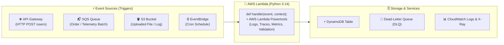

# Chapter 14: AWS Lambda with Python

[← Previous: FastAPI](./13-fastapi.md) | [Back to README](./README.md) | [Next: CLI Libraries →](./15-cli-libraries.md)

## What is AWS Lambda?

AWS Lambda is a **serverless, event-driven compute service** that runs your Python functions in response to events without making you provision or baby-sit Linux servers. You write a Python function, tell AWS what triggers it (an HTTP request, a file landing in an S3 bucket, a message arriving on an SQS queue, or an IoT/robotics telemetry batch), and AWS handles scaling, patching, and availability.

*(As the joke goes: "Serverless" doesn't mean there are no servers—it just means the servers are AWS's problem at 3 a.m., not yours.)*



The key characteristics of Lambda:

- **Serverless**: No EC2 instances to provision, patch, or manage. You pay only for compute time consumed — billed in milliseconds.
- **Event-driven**: Functions are invoked by events from other AWS services or external sources. Lambda does not run continuously; it wakes up, handles an event, and exits.
- **Automatic scaling**: Lambda scales horizontally and automatically. If 1,000 requests arrive simultaneously, Lambda runs 1,000 concurrent function instances without any configuration from you.
- **Pay per invocation**: You are charged based on the number of requests and the duration of each execution (with a generous free tier of 1 million requests/month). Idle time costs $0.00—which is awesome until you accidentally write an infinite recursion loop!

### Natural Fit for Event-Driven Workloads

Lambda integrates natively with the AWS ecosystem. Common trigger patterns include:

- **API Gateway**: HTTP requests invoke Lambda to serve REST or HTTP APIs.
- **SQS (Simple Queue Service)**: Lambda polls a queue and processes messages in batches. Dead-letter queues and partial batch failure handling are first-class features.
- **S3**: Object uploads, deletions, or modifications trigger Lambda functions — useful for image resizing, document processing, or ETL pipelines.
- **EventBridge**: Scheduled rules (like cron) and custom event buses trigger Lambda for background jobs and workflows.
- **DynamoDB Streams**: React to table changes in real time.
- **SNS**: Fan-out messaging to multiple Lambda consumers.

Because Lambda is invoked by events rather than running as a long-lived process, it is naturally suited for workloads that are bursty, unpredictable, or event-driven. If your process needs to sit there all day thinking, that is a container. If it needs to react when a file lands in a bucket, that is Lambda.

### Python runtimes (as of 2026)

Lambda's current GA Python runtimes include **python3.12**, **python3.13**, and **python3.14**. The console default when you click "Create function" is **Python 3.14**. **python3.15** is in **public preview**, with general availability targeted for November 2026 — useful for trying the next runtime, not for production. Preview runtimes are not covered by the Lambda SLA.

This chapter uses **python3.14** as the teaching default in SAM templates. It is GA, widely deployed, and has had a full year of wheel support. Add **python3.15** to your test matrix now if you like, but keep production functions on **python3.14** until the runtime is GA and your dependencies ship compatible wheels.

---

## Why Python for Lambda?

Python is one of the most popular runtimes on Lambda, and for good reasons.

### Fast Cold Starts

When Lambda has no warm instances available, it must initialize a new execution environment — this is a "cold start." Python cold starts are significantly faster than JVM-based runtimes (Java, Scala, Kotlin) and comparable to Node.js. For latency-sensitive APIs, this matters. For a nightly batch job, it does not, but people still argue about it.

### Small Deployment Packages

Python packages are typically small. A Lambda deployment zip with AWS Lambda Powertools and boto3 is a fraction of the size of an equivalent Java or .NET package. Smaller packages mean faster cold starts and simpler deployments. There is a 250 MB unzipped limit for zip deployments, which is generous until the first time someone adds pandas "just to parse one CSV."

### Rich Ecosystem for Data Processing

The Python ecosystem — pandas, numpy, Pillow, PyArrow, and countless others — is ideal for the data transformation, ETL, and processing workloads that Lambda commonly handles.

### AWS Lambda Powertools — The Essential Library

[AWS Lambda Powertools for Python](https://docs.powertools.aws.dev/lambda/python/) ([GitHub](https://github.com/aws-powertools/powertools-lambda-python)) is the de facto standard library for production Lambda development. Maintained by AWS, it provides:

- **Structured logging** with request context automatically injected
- **Distributed tracing** via AWS X-Ray
- **Custom CloudWatch metrics** with a simple decorator API
- **Typed event parsing** for every AWS trigger type
- **Idempotency**, **feature flags**, **batch processing utilities**, and more

You should consider Powertools a required dependency for any serious Lambda project — it eliminates large amounts of boilerplate and enforces production best practices by default. Rolling your own JSON logger on Lambda is a rite of passage you can skip.

```bash
uv add aws-lambda-powertools
```

---

## Python Lambda Handler Structure

Every Lambda function has an entry point called a **handler**. It is a plain Python function that Lambda invokes when an event arrives. There is no framework required. There is also no framework stopping you from putting everything in one file, which is why we will not.

### The Basic Handler Signature

```python
from aws_lambda_powertools.utilities.typing import LambdaContext


def handler(event: dict, context: LambdaContext) -> dict:
    ...
```

Lambda always calls your handler with exactly two arguments:

- **`event`**: A dictionary containing the trigger payload. The structure depends on the event source. An API Gateway event looks different from an SQS event.
- **`context`**: A `LambdaContext` object provided by the runtime with metadata about the invocation — function name, remaining execution time, request ID, and more.

### The Return Value

What you return depends on the trigger:

- **API Gateway / HTTP API**: Return a dict with `statusCode`, `headers`, and `body`. Lambda Powertools provides typed response helpers for this.
- **SQS**: Return `None` for full batch success, or a `batchItemFailures` structure for partial failures.
- **EventBridge / S3 / SNS**: Return value is ignored; raise an exception to signal failure.
- **Synchronous invocations**: The return value is passed back to the caller.

### A Minimal Handler

```python
from aws_lambda_powertools.utilities.typing import LambdaContext


def handler(event: dict, context: LambdaContext) -> dict:
    name = event.get("name", "World")
    return {"message": f"Hello, {name}!"}
```

### Trap Alert: `async def` Is Not Natively Supported on Lambda!

> [!WARNING]
> Unlike Node.js or FastAPI, **Python Lambda handlers cannot be `async def` functions directly!**
> Lambda's Python runtime calls `handler(event, context)` synchronously. If you write `async def handler(event, context):`, Lambda won't `await` it—it will receive an un-awaited Python `coroutine` object and crash with a confusing serialization error!

If you need to call `async` libraries inside Lambda (like `httpx.AsyncClient` or an async LLM SDK), keep `def handler` synchronous and run the event loop explicitly with `asyncio.run()`:

```python
import asyncio
from aws_lambda_powertools.utilities.typing import LambdaContext


async def _async_handler(event: dict) -> dict:
    # async work here
    return {"status": "ok"}


def handler(event: dict, context: LambdaContext) -> dict:
    return asyncio.run(_async_handler(event))
```

`asyncio.run()` creates a new event loop, runs the coroutine to completion, and closes the loop. This works well for handlers that need async I/O internally, though the overhead of creating a new loop on each invocation is small.

For most Lambda use cases — calling DynamoDB, SQS, or other AWS services via `boto3` — synchronous code works perfectly well and avoids this complexity entirely. Reach for `asyncio.run` when a library forces you to, not as a lifestyle.

---

## AWS Lambda Powertools for Python

[AWS Lambda Powertools for Python](https://docs.powertools.aws.dev/lambda/python/) provides three core observability utilities — logging, tracing, and metrics — plus a comprehensive suite of utilities for parsing events, enforcing idempotency, and handling batch workloads.

Install it:

```bash
uv add aws-lambda-powertools
```

### Structured Logging

Powertools' `Logger` outputs structured JSON logs to CloudWatch. Use the `@logger.inject_lambda_context` decorator to automatically include the Lambda request ID, function name, and cold start flag in every log entry.

```python
from aws_lambda_powertools import Logger
from aws_lambda_powertools.utilities.typing import LambdaContext

logger = Logger(service="user-service")


@logger.inject_lambda_context(log_event=True)
def handler(event: dict, context: LambdaContext) -> dict:
    logger.info("Processing request", extra={"user_id": event.get("user_id")})
    return {"status": "ok"}
```

Every log line is a JSON object, making it trivially queryable in CloudWatch Logs Insights. `print()` still works. It is also how you end up grepping unstructured text at 2am.

### Tracing with X-Ray

Powertools wraps AWS X-Ray to capture traces for your handler and any downstream calls. Add `@tracer.capture_lambda_handler` to instrument the entire handler automatically.

```python
from aws_lambda_powertools import Tracer

tracer = Tracer(service="user-service")


@tracer.capture_lambda_handler
def handler(event: dict, context: LambdaContext) -> dict:
    result = get_user(event["user_id"])
    return result


@tracer.capture_method
def get_user(user_id: str) -> dict:
    # DynamoDB or other downstream call
    ...
```

`@tracer.capture_method` instruments individual functions as X-Ray subsegments, giving you fine-grained visibility into where time is spent.

### Custom Metrics

Powertools publishes metrics to CloudWatch as Embedded Metric Format (EMF) — no custom CloudWatch metric API calls needed.

```python
from aws_lambda_powertools import Metrics
from aws_lambda_powertools.metrics import MetricUnit

metrics = Metrics(namespace="UserService", service="user-service")


@metrics.log_metrics(capture_cold_start_metric=True)
def handler(event: dict, context: LambdaContext) -> dict:
    metrics.add_metric(name="UserCreated", unit=MetricUnit.Count, value=1)
    return {"status": "ok"}
```

`capture_cold_start_metric=True` automatically records a `ColdStart` metric on the first invocation of each execution environment. That is the number people quote in meetings.

### Typed Event Parsing

Rather than working with raw `dict` objects and hoping you typed the right key names, Powertools provides Pydantic-backed typed models for every AWS event source:

```python
from aws_lambda_powertools.utilities.data_classes import (
    APIGatewayProxyEventV2,
    SQSEvent,
)
```

These models give you auto-complete, type safety, and validated access to event fields. We will use them in the next two sections. The alternative is `event["requestContext"]["http"]["method"]` and a prayer.

---

## API Gateway Handler

HTTP APIs on AWS are typically built by pairing API Gateway with Lambda. The following example shows a complete `POST /users` handler using Powertools' event parsing.

### src/handlers/create_user.py

```python
import json
import uuid
from typing import Any

import boto3
from aws_lambda_powertools import Logger, Metrics, Tracer
from aws_lambda_powertools.metrics import MetricUnit
from aws_lambda_powertools.utilities.data_classes import (
    APIGatewayProxyEventV2,
    event_source,
)
from aws_lambda_powertools.utilities.typing import LambdaContext

logger = Logger(service="user-service")
tracer = Tracer(service="user-service")
metrics = Metrics(namespace="UserService", service="user-service")

dynamodb = boto3.resource("dynamodb")
table = dynamodb.Table("UsersTable")  # type: ignore[attr-defined]


@logger.inject_lambda_context(log_event=True)
@tracer.capture_lambda_handler
@metrics.log_metrics(capture_cold_start_metric=True)
@event_source(data_class=APIGatewayProxyEventV2)
def handler(event: APIGatewayProxyEventV2, context: LambdaContext) -> dict[str, Any]:
    if not event.body:
        return {
            "statusCode": 400,
            "headers": {"Content-Type": "application/json"},
            "body": json.dumps({"error": "Request body is required"}),
        }

    try:
        body = json.loads(event.body)
    except json.JSONDecodeError:
        return {
            "statusCode": 400,
            "headers": {"Content-Type": "application/json"},
            "body": json.dumps({"error": "Invalid JSON body"}),
        }

    name = body.get("name")
    email = body.get("email")

    if not name or not email:
        return {
            "statusCode": 422,
            "headers": {"Content-Type": "application/json"},
            "body": json.dumps({"error": "name and email are required"}),
        }

    user_id = str(uuid.uuid4())
    user = {"userId": user_id, "name": name, "email": email}

    try:
        table.put_item(Item=user)
    except Exception:
        logger.exception("Failed to write user to DynamoDB")
        return {
            "statusCode": 500,
            "headers": {"Content-Type": "application/json"},
            "body": json.dumps({"error": "Internal server error"}),
        }

    metrics.add_metric(name="UserCreated", unit=MetricUnit.Count, value=1)
    logger.info("User created", extra={"user_id": user_id})

    return {
        "statusCode": 201,
        "headers": {"Content-Type": "application/json"},
        "body": json.dumps({"userId": user_id, "name": name, "email": email}),
    }
```

Key points:

- **`@event_source(data_class=APIGatewayProxyEventV2)`** converts the raw `dict` event into a typed object with IDE-friendly attribute access.
- **Status codes** are explicit — 400 for bad input, 422 for validation failures, 500 for server errors, 201 for successful creation.
- **Error handling** catches both input errors and unexpected DynamoDB failures, returning appropriate HTTP responses rather than letting exceptions propagate (which would return a 502 to the client).
- **Metrics** are emitted inline. The decorators handle flushing at the end of the invocation.

If you are serving a FastAPI app from Lambda instead of a single handler, adapters such as [Mangum](https://mangum.io/) wrap the ASGI app. The rest of this chapter stays with the native handler model, which is still the usual Lambda teaching path.

---

## SQS Handler

SQS is a common trigger for background processing. Lambda polls the queue and invokes your handler with a batch of messages. Handling partial failures correctly — so that only failed messages return to the queue — requires a specific response format. Getting this wrong is how you reprocess the same successful message until someone notices the duplicate charges.

### src/handlers/process_order.py

```python
import json
from typing import Any

from aws_lambda_powertools import Logger, Tracer
from aws_lambda_powertools.utilities.batch import (
    BatchProcessor,
    EventType,
    process_partial_response,
)
from aws_lambda_powertools.utilities.data_classes.sqs_event import SQSRecord
from aws_lambda_powertools.utilities.typing import LambdaContext

logger = Logger(service="order-service")
tracer = Tracer(service="order-service")
processor = BatchProcessor(event_type=EventType.SQS)


@tracer.capture_method
def record_handler(record: SQSRecord) -> None:
    payload = json.loads(record.body)
    order_id = payload["orderId"]
    logger.info("Processing order", extra={"order_id": order_id})

    # Business logic here — call downstream services, update DB, etc.
    process_order(order_id, payload)


def process_order(order_id: str, payload: dict[str, Any]) -> None:
    # Placeholder for actual business logic
    logger.info("Order processed", extra={"order_id": order_id})


@logger.inject_lambda_context
@tracer.capture_lambda_handler
def handler(event: dict[str, Any], context: LambdaContext) -> dict[str, Any]:
    return process_partial_response(
        event=event,
        record_handler=record_handler,
        processor=processor,
        context=context,
    )
```

### How Partial Batch Failure Works

When Lambda processes an SQS batch, the default behavior is all-or-nothing: if the handler raises an exception, the entire batch is retried. This leads to duplicate processing of messages that succeeded.

Powertools' `BatchProcessor` changes this behavior:

1. It calls `record_handler` for each message individually.
2. If `record_handler` raises an exception for a specific record, that record is marked as failed.
3. `process_partial_response` returns a `batchItemFailures` response containing only the failed message IDs.
4. Lambda returns those failed messages to the queue for retry, while acknowledging the successful messages.

This is the correct pattern for any SQS Lambda handler processing more than one message at a time. You still need a dead-letter queue for the messages that refuse to succeed. Optimism is not a retry policy.

---

## AWS SAM (Serverless Application Model)

[AWS SAM](https://aws.amazon.com/serverless/sam/) ([GitHub](https://github.com/aws/aws-sam-cli)) is an open-source framework that extends CloudFormation to simplify deploying serverless applications. A `template.yaml` file declares your Lambda functions, API routes, DynamoDB tables, SQS queues, and IAM permissions. SAM transforms this into standard CloudFormation resources at deploy time.

SAM also provides a local development experience via `sam local invoke` and `sam local start-api`, which run your functions inside Docker containers that emulate the Lambda environment. Close enough that most packaging mistakes show up before you pay for them.

### Installation

Install the AWS CLI and SAM CLI:

```bash
# macOS
brew install awscli
brew install aws-sam-cli

# Linux / Windows — use the official installers:
# https://docs.aws.amazon.com/cli/latest/userguide/getting-started-install.html
# https://docs.aws.amazon.com/serverless-application-model/latest/developerguide/install-sam-cli.html

# Verify
aws --version
sam --version
```

Configure your AWS credentials:

```bash
aws configure
# AWS Access Key ID: ...
# AWS Secret Access Key: ...
# Default region name: us-east-1
# Default output format: json
```

Locally, `aws configure` is fine. In CI, use OIDC (later in this chapter) instead of long-lived keys sitting in GitHub secrets like a Victorian novel's hidden will.

### Project Structure

A well-organized SAM project separates handler code from shared library code and keeps infrastructure configuration at the root:

```
my-lambda-app/
├── src/
│   ├── handlers/
│   │   ├── create_user.py
│   │   └── process_order.py
│   └── lib/
│       ├── db.py
│       └── models.py
├── tests/
│   └── unit/
│       └── test_handlers.py
├── events/
│   └── create-user.json
├── template.yaml
├── samconfig.toml
├── pyproject.toml
└── Makefile
```

- `src/handlers/` contains one file per Lambda function. Each file exports a `handler` function.
- `src/lib/` contains shared code — database clients, domain models, utilities — imported by multiple handlers.
- `events/` contains sample event payloads for local testing.
- `template.yaml` is the SAM infrastructure definition.
- `samconfig.toml` stores deployment configuration so you do not need to pass flags every time you run `sam deploy`.

### template.yaml

```yaml
AWSTemplateFormatVersion: "2010-09-09"
Transform: AWS::Serverless-2016-10-31
Description: User service Lambda application

Globals:
  Function:
    Runtime: python3.14
    Architectures:
      - arm64
    Timeout: 30
    MemorySize: 256
    Environment:
      Variables:
        POWERTOOLS_SERVICE_NAME: user-service
        LOG_LEVEL: INFO

Resources:
  CreateUserFunction:
    Type: AWS::Serverless::Function
    Properties:
      FunctionName: create-user
      CodeUri: src/
      Handler: handlers.create_user.handler
      Description: Create a new user via HTTP POST
      Events:
        CreateUser:
          Type: HttpApi
          Properties:
            Path: /users
            Method: POST
      Policies:
        - DynamoDBCrudPolicy:
            TableName: !Ref UsersTable
      Environment:
        Variables:
          USERS_TABLE_NAME: !Ref UsersTable

  ProcessOrderFunction:
    Type: AWS::Serverless::Function
    Properties:
      FunctionName: process-order
      CodeUri: src/
      Handler: handlers.process_order.handler
      Description: Process orders from SQS
      Events:
        OrderQueue:
          Type: SQS
          Properties:
            Queue: !GetAtt OrderQueue.Arn
            BatchSize: 10
            FunctionResponseTypes:
              - ReportBatchItemFailures

  UsersTable:
    Type: AWS::DynamoDB::Table
    Properties:
      TableName: UsersTable
      BillingMode: PAY_PER_REQUEST
      AttributeDefinitions:
        - AttributeName: userId
          AttributeType: S
      KeySchema:
        - AttributeName: userId
          KeyType: HASH

  OrderQueue:
    Type: AWS::SQS::Queue
    Properties:
      QueueName: order-queue
      VisibilityTimeout: 60
      RedrivePolicy:
        deadLetterTargetArn: !GetAtt OrderQueueDLQ.Arn
        maxReceiveCount: 3

  OrderQueueDLQ:
    Type: AWS::SQS::Queue
    Properties:
      QueueName: order-queue-dlq

Outputs:
  ApiEndpoint:
    Description: HTTP API endpoint URL
    Value: !Sub "https://${ServerlessHttpApi}.execute-api.${AWS::Region}.amazonaws.com"
    Export:
      Name: !Sub "${AWS::StackName}-ApiEndpoint"

  UsersTableName:
    Description: DynamoDB users table name
    Value: !Ref UsersTable
```

Key points about this template:

- **`Runtime: python3.14`** is the conservative teaching default. **python3.14 is GA** and is the console default. Keep production functions there until **python3.15** leaves public preview and your dependencies ship compatible wheels.
- **`Globals`** sets default values for all functions. `arm64` (Graviton) is typically cheaper and often faster than `x86_64` for Python workloads.
- **`DynamoDBCrudPolicy`** is a SAM policy template — a shorthand that expands to the appropriate IAM policy. It grants the minimum required permissions.
- **`PAY_PER_REQUEST`** billing mode for DynamoDB means you pay per read/write operation rather than provisioning capacity. This matches Lambda's scaling model.
- **`FunctionResponseTypes: [ReportBatchItemFailures]`** on the SQS event enables partial batch failure support in Lambda itself, working alongside Powertools' `BatchProcessor`.
- **`RedrivePolicy`** on the SQS queue sends messages that fail three times to a dead-letter queue for manual inspection.

### samconfig.toml

Store your deployment defaults so `sam deploy` works without flags:

```toml
version = 0.1

[default.global.parameters]
stack_name = "my-lambda-app"

[default.build.parameters]
cached = true
parallel = true

[default.deploy.parameters]
capabilities = "CAPABILITY_IAM"
confirm_changeset = true
region = "us-east-1"
s3_bucket = "my-sam-deployment-bucket"
s3_prefix = "my-lambda-app"
```

### Building and Running Locally

```bash
# Build the application (resolves dependencies, packages code)
sam build

# Invoke a function locally with a test event
sam local invoke CreateUserFunction --event events/create-user.json

# Start a local HTTP server that emulates API Gateway
sam local start-api

# Test the local API
curl -X POST http://localhost:3000/users \
  -H "Content-Type: application/json" \
  -d '{"name": "Alice Smith", "email": "alice@example.com"}'

# First-time deployment (walks you through configuration)
sam deploy --guided

# Subsequent deployments
sam deploy
```

`sam local` runs your functions inside a Docker container using the official Lambda runtime image. This provides a close approximation of the real Lambda environment, catching issues that would only surface after deployment. Docker must be running. This is the step that surprises people who skipped Docker on purpose.

### Test Event Files

Create `events/create-user.json` to use with `sam local invoke`:

```json
{
  "version": "2.0",
  "routeKey": "POST /users",
  "rawPath": "/users",
  "rawQueryString": "",
  "headers": {
    "content-type": "application/json",
    "accept": "application/json"
  },
  "requestContext": {
    "accountId": "123456789012",
    "apiId": "api-id",
    "domainName": "id.execute-api.us-east-1.amazonaws.com",
    "http": {
      "method": "POST",
      "path": "/users",
      "protocol": "HTTP/1.1",
      "sourceIp": "192.0.2.0",
      "userAgent": "curl/7.86.0"
    },
    "requestId": "test-request-id",
    "routeKey": "POST /users",
    "stage": "$default",
    "time": "12/Mar/2020:19:03:58 +0000",
    "timeEpoch": 1583348638390
  },
  "body": "{\"name\": \"Alice Smith\", \"email\": \"alice@example.com\"}",
  "isBase64Encoded": false
}
```

This matches the HTTP API (payload format version 2.0) event structure that `APIGatewayProxyEventV2` expects. You can find sample events for every trigger type in the [AWS documentation](https://docs.aws.amazon.com/lambda/latest/dg/lambda-services.html) or generate them with `sam local generate-event`.

---

## Packaging Python Dependencies

Astral publishes an official guide: [Using uv with AWS Lambda](https://docs.astral.sh/uv/guides/integration/aws-lambda/). Use it when you are packaging with uv directly (zip archives, Docker images, layers). SAM still has its own build path; both are valid, and mixing them without reading either is how you ship pytest into production.

### How SAM Builds Python Functions

When you run `sam build`, SAM:

1. Reads the `CodeUri` for each function (e.g., `src/`).
2. Looks for `requirements.txt` in that directory — or reads `pyproject.toml` if present.
3. Runs `pip install -r requirements.txt --target .aws-sam/build/FunctionName/` to install dependencies into the build directory.
4. Packages the function code and dependencies into a deployment zip.

### Using pyproject.toml with SAM

SAM supports `pyproject.toml` natively for dependency resolution. Define your runtime dependencies under `[project]` and your dev dependencies separately:

```toml
[project]
name = "my-lambda-app"
version = "0.1.0"
requires-python = ">=3.13"
dependencies = [
    "aws-lambda-powertools>=3.39.0",
    "boto3>=1.43.0",
]

[dependency-groups]
dev = [
    "types-boto3[dynamodb,sqs]>=1.43.0",
    "moto[dynamodb,sqs]>=5.2.0",
    "pytest>=9.2.0",
    "ruff>=0.17.0",
]
```

SAM / packaging should install only runtime `[project.dependencies]`. Keep test and lint tools in `[dependency-groups]` (or install them only in CI with `uv sync`) so they never ship inside the Lambda package. `ruff` does not need to run in `us-east-1`.

### Packaging with uv (zip or Docker)

For a uv-native zip, the official pattern is export a frozen requirements file, then install into a target directory for the Lambda platform:

```bash
uv export --frozen --no-dev --no-editable -o requirements.txt
uv pip install \
  --no-installer-metadata \
  --no-compile-bytecode \
  --python-platform aarch64-manylinux2014 \
  --python 3.14 \
  --target packages \
  -r requirements.txt
```

Use `x86_64-manylinux2014` instead of `aarch64-manylinux2014` if your function is not on `arm64`. Then zip `packages/` plus your application code. The uv guide also covers multi-stage Docker images based on `public.ecr.aws/lambda/python:3.14` and Lambda layers. Prefer that guide over improvising a Dockerfile at deploy time.

### Lambda Layers for Shared Dependencies

If multiple functions share the same heavy dependencies (Powertools, pandas, etc.), you can extract them into a **Lambda Layer** rather than bundling them into each function. This reduces package size and speeds up deployments.

In `template.yaml`:

```yaml
  SharedDependenciesLayer:
    Type: AWS::Serverless::LayerVersion
    Properties:
      LayerName: shared-dependencies
      ContentUri: dependencies/
      CompatibleRuntimes:
        - python3.14
      CompatibleArchitectures:
        - arm64
    Metadata:
      BuildMethod: python3.14

  CreateUserFunction:
    Type: AWS::Serverless::Function
    Properties:
      # ...
      Layers:
        - !Ref SharedDependenciesLayer
```

For most projects, bundling dependencies per function is simpler and the size difference is minimal. Layers become worthwhile when you have many functions sharing large libraries. They are not a substitute for noticing that pandas is 100 MB.

---

## Testing Lambda Handlers with pytest

Because Lambda handlers are plain Python functions, they are straightforward to test. You call the function directly with a crafted event dict and assert on the return value. No AWS account is required, which is the correct amount of AWS for a unit test.

### Mocking AWS Services with moto

[moto](https://docs.getmoto.org/) is a library that intercepts `boto3` calls and provides in-memory implementations of AWS services. It requires no network access and no real AWS credentials.

```bash
uv add --dev "moto[dynamodb,sqs]" pytest pytest-cov
```

### tests/unit/test_handlers.py

```python
import json
import os
import uuid

import boto3
import pytest
from moto import mock_aws


# Set environment variables before importing the handler,
# because the handler reads them at module load time.
os.environ["AWS_DEFAULT_REGION"] = "us-east-1"
os.environ["USERS_TABLE_NAME"] = "UsersTable"
os.environ["POWERTOOLS_SERVICE_NAME"] = "user-service"
os.environ["POWERTOOLS_METRICS_NAMESPACE"] = "UserService"


@pytest.fixture
def lambda_context():
    """Minimal mock of the Lambda context object."""

    class FakeLambdaContext:
        function_name = "create-user"
        function_version = "$LATEST"
        invoked_function_arn = "arn:aws:lambda:us-east-1:123456789012:function:create-user"
        memory_limit_in_mb = 256
        aws_request_id = str(uuid.uuid4())
        log_group_name = "/aws/lambda/create-user"
        log_stream_name = "2026/01/01/[$LATEST]test"
        remaining_time_in_millis = 30000

        def get_remaining_time_in_millis(self) -> int:
            return self.remaining_time_in_millis

    return FakeLambdaContext()


@pytest.fixture
def api_gateway_event():
    """HTTP API event for POST /users."""
    return {
        "version": "2.0",
        "routeKey": "POST /users",
        "rawPath": "/users",
        "rawQueryString": "",
        "headers": {"content-type": "application/json"},
        "requestContext": {
            "accountId": "123456789012",
            "apiId": "test-api",
            "http": {
                "method": "POST",
                "path": "/users",
                "protocol": "HTTP/1.1",
                "sourceIp": "192.0.2.0",
                "userAgent": "pytest",
            },
            "requestId": "test-request-id",
            "routeKey": "POST /users",
            "stage": "$default",
        },
        "body": json.dumps({"name": "Alice Smith", "email": "alice@example.com"}),
        "isBase64Encoded": False,
    }


@mock_aws
def test_create_user_success(api_gateway_event, lambda_context):
    # Create the DynamoDB table that the handler expects
    dynamodb = boto3.resource("dynamodb", region_name="us-east-1")
    dynamodb.create_table(
        TableName="UsersTable",
        BillingMode="PAY_PER_REQUEST",
        AttributeDefinitions=[{"AttributeName": "userId", "AttributeType": "S"}],
        KeySchema=[{"AttributeName": "userId", "KeyType": "HASH"}],
    )

    # Import inside the test so moto intercepts all boto3 calls
    from src.handlers.create_user import handler

    response = handler(api_gateway_event, lambda_context)

    assert response["statusCode"] == 201
    body = json.loads(response["body"])
    assert body["name"] == "Alice Smith"
    assert body["email"] == "alice@example.com"
    assert "userId" in body

    # Verify the record was actually written to DynamoDB
    table = dynamodb.Table("UsersTable")
    item = table.get_item(Key={"userId": body["userId"]})
    assert item["Item"]["name"] == "Alice Smith"


@mock_aws
def test_create_user_missing_fields(api_gateway_event, lambda_context):
    dynamodb = boto3.resource("dynamodb", region_name="us-east-1")
    dynamodb.create_table(
        TableName="UsersTable",
        BillingMode="PAY_PER_REQUEST",
        AttributeDefinitions=[{"AttributeName": "userId", "AttributeType": "S"}],
        KeySchema=[{"AttributeName": "userId", "KeyType": "HASH"}],
    )

    from src.handlers.create_user import handler

    event = {**api_gateway_event, "body": json.dumps({"name": "Alice"})}
    response = handler(event, lambda_context)

    assert response["statusCode"] == 422
    body = json.loads(response["body"])
    assert "error" in body


@mock_aws
def test_create_user_missing_body(api_gateway_event, lambda_context):
    dynamodb = boto3.resource("dynamodb", region_name="us-east-1")
    dynamodb.create_table(
        TableName="UsersTable",
        BillingMode="PAY_PER_REQUEST",
        AttributeDefinitions=[{"AttributeName": "userId", "AttributeType": "S"}],
        KeySchema=[{"AttributeName": "userId", "KeyType": "HASH"}],
    )

    from src.handlers.create_user import handler

    event = {**api_gateway_event, "body": None}
    response = handler(event, lambda_context)

    assert response["statusCode"] == 400
```

Key testing patterns:

- **Import handlers inside `@mock_aws`-decorated tests** (or inside the test function after moto is active) so that `boto3` clients are created while mocking is active.
- **Set environment variables before importing handlers** — many handlers read env vars at import time.
- **Verify side effects** — assert not just the return value but that the DynamoDB table actually contains the expected record.
- **Test error paths explicitly** — missing body, invalid JSON, missing required fields, downstream failures.

---

## DynamoDB with Python (boto3)

[boto3](https://boto3.amazonaws.com/v1/documentation/api/latest/index.html) is the official AWS SDK for Python. For DynamoDB, you have two interfaces:

- **Resource API** (`dynamodb.Table`): Higher-level, Pythonic, works with native Python types. Recommended for most use cases.
- **Client API** (`dynamodb.client`): Low-level, maps 1:1 to the DynamoDB API. Requires explicit type descriptors (`{"S": "value"}`). Useful for advanced operations not covered by the Resource API.

### Installation with Type Stubs

```bash
uv add boto3
uv add --dev "types-boto3[dynamodb,sqs]"
```

`types-boto3` is the better name for new projects. It is the same family as `boto3-stubs` (you will still see that name in older tutorials and lockfiles). The extras select which service stubs to install; `[dynamodb,sqs]` is enough for this chapter.

Without stubs, boto3's dynamic nature means `ty` and mypy cannot check your AWS calls. With stubs, your editor can finally admit that `Table` has `put_item`.

```python
from types_boto3_dynamodb import DynamoDBServiceResource
from types_boto3_dynamodb.service_resource import Table
```

If you are on an older `boto3-stubs` install, the equivalent imports live under `mypy_boto3_dynamodb`. New code should use `types-boto3`.

### Common DynamoDB Operations

```python
import boto3
from types_boto3_dynamodb import DynamoDBServiceResource
from types_boto3_dynamodb.service_resource import Table

dynamodb: DynamoDBServiceResource = boto3.resource("dynamodb")
table: Table = dynamodb.Table("UsersTable")


# PutItem — create or fully replace an item
table.put_item(
    Item={"userId": "abc-123", "name": "Alice", "email": "alice@example.com"},
    ConditionExpression="attribute_not_exists(userId)",  # fail if already exists
)

# GetItem — fetch a single item by primary key
response = table.get_item(Key={"userId": "abc-123"})
user = response.get("Item")  # None if not found

# UpdateItem — modify specific attributes
table.update_item(
    Key={"userId": "abc-123"},
    UpdateExpression="SET #n = :name",
    ExpressionAttributeNames={"#n": "name"},  # 'name' is a reserved word
    ExpressionAttributeValues={":name": "Alice Smith"},
)

# Query — fetch items by partition key (and optionally sort key)
from boto3.dynamodb.conditions import Key as DynamoKey

response = table.query(
    KeyConditionExpression=DynamoKey("userId").eq("abc-123"),
)
items = response["Items"]

# DeleteItem — remove an item
table.delete_item(Key={"userId": "abc-123"})
```

`name` is a reserved word in DynamoDB. That is why the update uses `#n`. DynamoDB has opinions.

### Initializing Clients Outside the Handler

Initialize `boto3` clients and resource objects **outside the handler function**, at module level. Lambda reuses execution environments for subsequent invocations, so module-level objects persist between calls. This means the AWS SDK connection is established once per cold start rather than on every invocation — a meaningful performance improvement.

```python
import boto3

# Initialized once per execution environment (cold start only)
dynamodb = boto3.resource("dynamodb")
table = dynamodb.Table(os.environ["USERS_TABLE_NAME"])


def handler(event: dict, context: LambdaContext) -> dict:
    # table is reused across warm invocations
    ...
```

### PynamoDB: A Higher-Level DynamoDB ORM

For applications that prefer an ORM-style interface over raw `boto3` calls, [PynamoDB](https://pynamodb.readthedocs.io/) provides a declarative model layer for DynamoDB with full type annotation support:

```python
from pynamodb.models import Model
from pynamodb.attributes import UnicodeAttribute


class UserModel(Model):
    class Meta:
        table_name = "UsersTable"
        region = "us-east-1"

    user_id = UnicodeAttribute(hash_key=True)
    name = UnicodeAttribute()
    email = UnicodeAttribute()


# Usage
user = UserModel(user_id="abc-123", name="Alice", email="alice@example.com")
user.save()

fetched = UserModel.get("abc-123")
```

PynamoDB is a good fit for domain-model-heavy applications. For simple CRUD or performance-critical code, raw `boto3` with type stubs remains the more transparent choice.

---

## CI/CD with GitHub Actions

The following workflow runs quality checks on every push and pull request, and deploys to AWS on pushes to `main`. It uses GitHub's OIDC integration with AWS — no long-lived access keys stored in GitHub secrets.

### .github/workflows/lambda-ci.yml

```yaml
name: Lambda CI/CD

on:
  push:
    branches:
      - main
  pull_request:
    branches:
      - main

permissions:
  id-token: write   # Required for OIDC authentication
  contents: read

jobs:
  quality:
    name: Code Quality
    runs-on: ubuntu-latest

    steps:
      - name: Checkout code
        uses: actions/checkout@v7

      - name: Install uv
        uses: astral-sh/setup-uv@v10.3.3
        with:
          enable-cache: true

      - name: Set up Python
        run: uv python install 3.14

      - name: Install dependencies
        run: uv sync --all-extras

      - name: Lint with Ruff
        run: uv run ruff check .

      - name: Check formatting with Ruff
        run: uv run ruff format --check .

      - name: Type check with ty
        run: uvx ty check

      - name: Run tests
        run: uv run pytest tests/unit/ --cov=src --cov-report=term-missing --cov-report=xml

      - name: Upload coverage report
        uses: codecov/codecov-action@v7
        if: always()
        with:
          files: ./coverage.xml

  build:
    name: SAM Build
    runs-on: ubuntu-latest
    needs: quality

    steps:
      - name: Checkout code
        uses: actions/checkout@v7

      - name: Set up Python
        uses: actions/setup-python@v7
        with:
          python-version: "3.14"

      - name: Install SAM CLI
        uses: aws-actions/setup-sam@v3
        with:
          use-installer: true

      - name: Build with SAM
        run: sam build --parallel

      - name: Upload SAM build artifact
        uses: actions/upload-artifact@v7
        with:
          name: sam-build
          path: .aws-sam/build/
          retention-days: 1

  deploy:
    name: Deploy to AWS
    runs-on: ubuntu-latest
    needs: build
    if: github.ref == 'refs/heads/main' && github.event_name == 'push'

    steps:
      - name: Checkout code
        uses: actions/checkout@v7

      - name: Install SAM CLI
        uses: aws-actions/setup-sam@v3
        with:
          use-installer: true

      - name: Download SAM build artifact
        uses: actions/download-artifact@v8
        with:
          name: sam-build
          path: .aws-sam/build/

      - name: Configure AWS credentials via OIDC
        uses: aws-actions/configure-aws-credentials@v6
        with:
          role-to-assume: ${{ secrets.AWS_DEPLOY_ROLE_ARN }}
          aws-region: us-east-1

      - name: Deploy with SAM
        run: |
          sam deploy \
            --no-confirm-changeset \
            --no-fail-on-empty-changeset \
            --stack-name my-lambda-app \
            --region us-east-1
```

### Setting Up OIDC Authentication

Rather than storing `AWS_ACCESS_KEY_ID` and `AWS_SECRET_ACCESS_KEY` as GitHub secrets (which are long-lived credentials), OIDC lets GitHub Actions assume an IAM role using a temporary token. This is the current AWS-recommended approach. Long-lived keys in `secrets` still work. They also still leak.

1. Create an IAM OIDC provider for GitHub in your AWS account.
2. Create an IAM role that trusts the GitHub OIDC provider, scoped to your specific repository.
3. Attach a deployment policy to the role (CloudFormation, S3, Lambda, DynamoDB permissions).
4. Store the role ARN as `AWS_DEPLOY_ROLE_ARN` in your GitHub repository secrets.

The AWS documentation covers this setup in detail: [Configuring OpenID Connect in Amazon Web Services](https://docs.github.com/en/actions/deployment/security-hardening-your-deployments/configuring-openid-connect-in-amazon-web-services).

### Makefile for Local Development

Add Lambda-specific targets to your project `Makefile`:

```makefile
.PHONY: help install test lint format typecheck build invoke start deploy clean

help:
	@echo "Available targets:"
	@echo "  make install     - Install dependencies"
	@echo "  make test        - Run unit tests"
	@echo "  make lint        - Run ruff linter"
	@echo "  make format      - Format code with ruff"
	@echo "  make typecheck   - Run ty type checker"
	@echo "  make build       - Build with SAM"
	@echo "  make invoke      - Invoke CreateUserFunction locally"
	@echo "  make start       - Start local API"
	@echo "  make deploy      - Deploy to AWS"
	@echo "  make clean       - Remove generated files"

install:
	uv sync --all-extras

test:
	uv run pytest tests/unit/ --cov=src --cov-report=term-missing

lint:
	uv run ruff check .

lint-fix:
	uv run ruff check --fix .

format:
	uv run ruff format .

format-check:
	uv run ruff format --check .

typecheck:
	uvx ty check

build:
	sam build --parallel

invoke: build
	sam local invoke CreateUserFunction --event events/create-user.json

start: build
	sam local start-api

deploy: build
	sam deploy

all: format lint typecheck test

clean:
	rm -rf .aws-sam
	rm -rf .pytest_cache
	rm -rf .ruff_cache
	rm -rf .ty_cache
	find . -type d -name __pycache__ -exec rm -rf {} +
	find . -type f -name "*.pyc" -delete
```

---

## What's Next?

You now have a solid foundation for building production Python applications on AWS Lambda: structured handlers, observability with Powertools, infrastructure-as-code with SAM, uv-aware packaging, and a CI/CD pipeline that tests and deploys automatically.

Many real-world workflows do not live behind an HTTP API — they are invoked from the command line by operators, scripts, or scheduled jobs. In the next chapter, we look at Python's excellent CLI library ecosystem and how to build polished command-line tools that are as easy to use as they are to maintain.

[← Previous: FastAPI](./13-fastapi.md) | [Back to README](./README.md) | [Next: CLI Libraries →](./15-cli-libraries.md)
