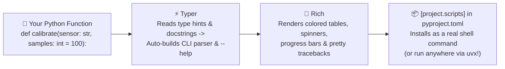

# Chapter 15: CLI Libraries

[← Previous: AWS Lambda](./14-aws-lambda.md) | [Back to README](./README.md) | [Next: Putting It All Together →](./16-putting-it-together.md)

## Why Build CLI Tools in Python?

Web apps get flashy screenshots, but **command-line tools (CLIs) are how engineers actually get work done**—from calibrating robot sensors (`rover calibrate --sensor imu --samples 500`) to dataset cleaners, cloud deploy scripts, and project scaffolders.

Python's standard library includes `argparse`, which requires zero dependencies but lots of manual parser boilerplate. Modern Python CLI development pairs two libraries:

- **[Typer](https://typer.tiangolo.com)** ([GitHub](https://github.com/tiangolo/typer)): Built on [Click](https://click.palletsprojects.com) by the creator of FastAPI. Reads your standard Python type hints and docstrings to generate argument parsers, validation, subcommands, and `--help` menus automatically.
- **[Rich](https://rich.readthedocs.io)** ([GitHub](https://github.com/Textualize/rich)): Renders colored terminal markup, bordered tables, progress bars, panels, syntax-highlighted code, and readable tracebacks.



```bash
uv add typer rich
```

---

## 1. Typer — Type-Safe CLIs with Zero Boilerplate

### Single-Command App (`typer.run`)

Parameters **without** a default value become required positional **Arguments**; parameters **with** a default value become `--flag` **Options**:

```python
# greet.py
import typer


def main(name: str, count: int = 1, excited: bool = False) -> None:
    """Greet NAME on the terminal."""
    suffix = "!" if excited else "."
    for _ in range(count):
        print(f"Hello, {name}{suffix}")


if __name__ == "__main__":
    typer.run(main)
```

```bash
uv run python greet.py Alice --count 2 --excited
uv run python greet.py --help
```

### Multi-Command App (`@app.command`) & Subcommands (`app.add_typer`)

For tools with multiple subcommands (`tasks add`, `tasks list`, `tasks done`) or nested command groups (`app.add_typer(sub_app, name="users")`), create a `typer.Typer()` instance:

```python
# tasks.py
import json
from enum import Enum
from pathlib import Path
import typer

app = typer.Typer(help="A lightweight terminal task manager.")
TASKS_FILE = Path.home() / ".tasks.json"


class Priority(str, Enum):
    low = "low"
    high = "high"


def _load() -> list[dict[str, object]]:
    return json.loads(TASKS_FILE.read_text()) if TASKS_FILE.exists() else []


def _save(tasks: list[dict[str, object]]) -> None:
    TASKS_FILE.write_text(json.dumps(tasks, indent=2))


@app.command()
def add(
    title: str = typer.Argument(help="Task description"),
    priority: Priority = typer.Option(Priority.low, help="Task priority"),
) -> None:
    """Add a new task."""
    tasks = _load()
    task = {"id": len(tasks) + 1, "title": title, "priority": priority.value, "done": False}
    tasks.append(task)
    _save(tasks)
    print(f"Added #{task['id']}: {title} ({priority.value})")


@app.command(name="list")
def list_tasks(show_done: bool = False) -> None:
    """List tasks (pass --show-done to include completed items)."""
    for t in _load():
        if t["done"] and not show_done:
            continue
        mark = "x" if t["done"] else " "
        print(f"[{mark}] #{t['id']} ({t['priority']}) {t['title']}")


@app.command()
def done(task_id: int) -> None:
    """Mark a task as complete."""
    tasks = _load()
    for t in tasks:
        if t["id"] == task_id:
            t["done"] = True
            _save(tasks)
            print(f"Completed #{task_id}.")
            return
    print(f"Task #{task_id} not found.")
    raise typer.Exit(code=1)


if __name__ == "__main__":
    app()
```

*(Note: Using an `Enum` like `Priority` automatically validates choices on the command line and prints valid options if a user makes a typo!)*

---

## 2. Rich — Beautiful Terminal Output

### Console Markup, Tables, Panels, Progress Bars & Syntax

```python
import time
from rich.console import Console
from rich.panel import Panel
from rich.progress import track
from rich.syntax import Syntax
from rich.table import Table

console = Console()
err_console = Console(stderr=True)  # Send errors to stderr so pipes stay clean!

# 1. Styled markup & Panels
console.print(Panel("[bold green]Rover Telemetry Connected[/bold green]", title="Status"))

# 2. Progress bars with track()
for _ in track(range(20), description="Calibrating IMU..."):
    time.sleep(0.02)

# 3. Formatted Tables
table = Table(title="Sensor Health")
table.add_column("Sensor", style="cyan")
table.add_column("Rate (Hz)", justify="right")
table.add_column("Status", style="bold")
table.add_row("LiDAR", "20.0", "[green]OK[/green]")
table.add_row("Depth Cam", "30.0", "[yellow]WARN[/yellow]")
console.print(table)

# 4. Syntax-highlighted code snippets
snippet = "def emergency_stop() -> None:\n    set_motor_velocity(0.0)"
console.print(Syntax(snippet, "python", line_numbers=True))
```

### Rich Logging Handler (`RichHandler`)

Want colored, readable logs and syntax-highlighted tracebacks with Python's standard `logging` module?

```python
import logging
from rich.logging import RichHandler

logging.basicConfig(
    level=logging.INFO,
    format="%(message)s",
    datefmt="[%X]",
    handlers=[RichHandler(rich_tracebacks=True)],
)
log = logging.getLogger("rover")
log.info("Ready to roll!")
```

---

## 3. Typer + Rich Together: `mkproject` Scaffolding CLI

Here is a complete CLI combining Typer's argument parsing with Rich's progress spinners, tables, and panels:

```python
# mkproject.py
from enum import Enum
from pathlib import Path
import typer
from rich.console import Console
from rich.panel import Panel
from rich.progress import Progress, SpinnerColumn, TextColumn
from rich.table import Table

app = typer.Typer(help="Scaffold a new Python project.")
console = Console()


class TemplateKind(str, Enum):
    lib = "lib"
    fastapi = "fastapi"


@app.command()
def create(
    name: str = typer.Argument(help="New project directory name"),
    kind: TemplateKind = typer.Option(TemplateKind.lib, "--kind", "-k", help="Template flavor"),
) -> None:
    """Create a starter Python project directory."""
    root = Path(name)
    if root.exists():
        Console(stderr=True).print(f"[red]Error:[/red] '{name}' already exists.")
        raise typer.Exit(code=1)

    files = {
        "README.md": f"# {name}\n",
        "pyproject.toml": f'[project]\nname = "{name}"\nversion = "0.1.0"\nrequires-python = ">=3.13"\n',
        f"src/{name.replace('-', '_')}/__init__.py": "",
        "tests/test_smoke.py": "def test_truth() -> None:\n    assert True\n",
    }

    with Progress(SpinnerColumn(), TextColumn("{task.description}"), console=console) as progress:
        task = progress.add_task(f"Scaffolding {name} ({kind.value})...", total=len(files))
        for rel_path, content in files.items():
            target = root / rel_path
            target.parent.mkdir(parents=True, exist_ok=True)
            target.write_text(content)
            progress.advance(task)

    summary = Table(title=f"Created {name}")
    summary.add_column("File", style="cyan")
    for rel_path in files:
        summary.add_row(rel_path)
    console.print(summary)
    console.print(Panel(f"[green]Done! Run [bold]cd {name} && uv sync[/bold][/green]"))


if __name__ == "__main__":
    app()
```

---

## 4. Packaging Your CLI as a Real Shell Command (`[project.scripts]` & `uvx`)

Instead of typing `uv run python src/my_cli/main.py`, register an entry point under **`[project.scripts]`** in `pyproject.toml`:

```toml
[project]
name = "rover-cli"
version = "0.1.0"
requires-python = ">=3.13"
dependencies = [
    "typer>=0.29.0",
    "rich>=15.0.0",
]

[project.scripts]
rover = "rover_cli.main:app"
```

Install the project into your environment (`uv sync`) and run the command directly:

```bash
uv run rover --help

# Or install/run globally from anywhere on your machine with uv tool / uvx:
uv tool install --editable .
rover --help

# Once published to PyPI (`uv build && uv publish`), anyone can run it without installing:
uvx rover-cli --help
```

---

## What's Next?

You now have every building block of modern Python development. In [Chapter 16: Putting It All Together](./16-putting-it-together.md), we stitch the entire workflow into a single capstone setup—including a single AI prompt that bootstraps a complete project in under a minute.

[← Previous: AWS Lambda](./14-aws-lambda.md) | [Back to README](./README.md) | [Next: Putting It All Together →](./16-putting-it-together.md)
