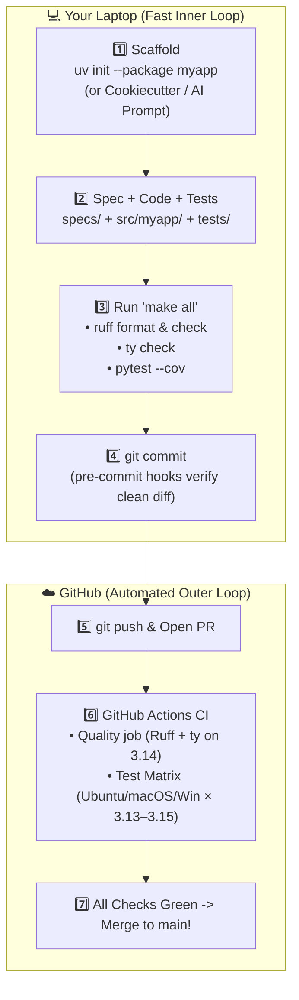

# Chapter 16: Putting It All Together

[← Previous: CLI Libraries](./15-cli-libraries.md) | [Back to README](./README.md)

## Overview: The Grand Finale

You have made it to the capstone! Across this guide, you've assembled the complete modern Python engineering toolkit:

- **Isolated Virtual Environments & `uv`** ([Chapters 2](./02-virtual-environments.md) & [3](./03-dependencies.md))
- **Git Version Control & Branch Workflows** ([Chapter 4](./04-version-control.md))
- **Instant Linting & Code Formatting with Ruff** ([Chapters 5](./05-linting.md) & [6](./06-code-formatting.md))
- **Automated Unit Testing with `pytest`** ([Chapter 7](./07-unit-testing.md))
- **Static Type Checking with `ty`** ([Chapter 8](./08-static-type-checking.md))
- **Structured Logging with `Loguru`** ([Chapter 9](./09-logging.md))
- **Automated CI/CD with GitHub Actions** ([Chapter 10](./10-ci-cd.md))
- **Spec-Driven AI Development (`CLAUDE.md` + `specs/`)** ([Chapter 11](./11-llms.md))
- **Optional Power-Ups:** Databases ([Ch 12](./12-database-libraries.md)), FastAPI ([Ch 13](./13-fastapi.md)), AWS Lambda ([Ch 14](./14-aws-lambda.md)), and Typer/Rich CLIs ([Ch 15](./15-cli-libraries.md))

In this chapter, we wire the entire **Core Track** together into a single, reproducible project setup—using `uv`, a golden `pyproject.toml`, a `Makefile`, `pre-commit` hooks, Cookiecutter templates, GitHub Actions CI, and a **copy-paste AI bootstrap prompt** that builds the whole skeleton for you in 60 seconds.



> [!NOTE]
> Examples in this chapter use **Python 3.14** as the default development version, with `requires-python = ">=3.13"` as the floor and `['3.13', '3.14', '3.15']` in the GitHub Actions test matrix.

---

## Option A: Bootstrap the Entire Project with One AI Agent Prompt

If you use **[Claude Code](./11-llms.md)** (or any terminal coding agent), you don't have to copy-paste six config files by hand. Create an empty directory, launch `claude`, and feed it this **Spec-Driven Bootstrap Prompt**:

```text
Bootstrap a modern Python package named `myapp` in the current directory using `uv`:

1. Project & Layout:
   - Run `uv init --package --python 3.14 .` (if not initialized) with `src/myapp/` and `tests/`.
   - Set `requires-python = ">=3.13"` in `pyproject.toml`.
   - Add dev dependencies via `uv add --dev "pytest>=9.2.0" "pytest-cov>=7.1.0" "ruff>=0.17.0" ty "pre-commit>=4.7.0"`.

2. Tool Configuration (`pyproject.toml`):
   - Ruff: `line-length = 88`, `target-version = "py314"`, `select = ["E", "W", "F", "I", "B", "C4", "UP"]`.
   - ty: `python-version = "3.14"`, `include = ["src", "tests"]`.
   - pytest: `testpaths = ["tests"]`, `addopts = ["-v", "--strict-markers", "--tb=short"]`.
   - coverage: `source = ["src"]`, `omit = ["*/tests/*"]`.

3. Automation & Guardrails:
   - Create a `Makefile` (tab-indented) with `.PHONY` targets: `install` (`uv sync`), `format` (`uv run ruff format .`), `lint` (`uv run ruff check .`), `typecheck` (`uv run ty check`), `test` (`uv run pytest --cov=src --cov-report=term-missing`), `all` (`format lint typecheck test`), and `clean`.
   - Create `.pre-commit-config.yaml` with `astral-sh/ruff-pre-commit` (`v0.17.4`), a local `uv run ty check` hook, and `pre-commit/pre-commit-hooks` (`v6.0.0`).
   - Create `.github/workflows/ci.yml` using `actions/checkout@v7` and `astral-sh/setup-uv@v10.3.3` (`enable-cache: true`):
     - `quality` job on `ubuntu-latest` + Python `3.14` running `ruff check`, `ruff format --check`, and `ty check`.
     - `test` matrix job across `[ubuntu-latest, macos-latest, windows-latest]` × `['3.13', '3.14', '3.15']` running `pytest --cov=src`.

4. Spec-Driven Memory (`CLAUDE.md` & `specs/`):
   - Create `CLAUDE.md` documenting `uv`, `make all`, type-hint rules, and SDD conventions.
   - Create `specs/` with a sample `specs/calculator.md` spec, implement `src/myapp/calculator.py` (`add`, `subtract`, `multiply`, `divide` with zero-check), and write parametrized unit tests in `tests/test_calculator.py`.

5. Verify:
   - Run `make all` and fix any issues until Ruff, ty, and pytest pass with 100% coverage.
```

In under a minute, your agent scaffolds the repo, locks dependencies in `uv.lock`, writes `CLAUDE.md`, and proves the setup works by running `make all`.

---

## Option B: Using a Cookiecutter Template

Want deterministic scaffolding without an LLM? **[Cookiecutter](https://github.com/cookiecutter/cookiecutter)** generates a full project from a maintained template (see also [Copier](https://copier.readthedocs.io/)):

```bash
# Run Cookiecutter directly via uvx (or install globally with `uv tool install cookiecutter`)
uvx cookiecutter https://github.com/amitsk/cookiecutter-python-library

# Answer the interactive prompts:
#   project_name: My Amazing Library
#   project_slug: my_amazing_library
#   author_name: Your Name
```

This creates a ready-to-use repository with `src/`, `tests/`, `pyproject.toml`, `.github/workflows/ci.yml`, and `.pre-commit-config.yaml` already wired up.

---

## Option C: Step-by-Step Manual Setup (Understanding Every Piece)

Whether you generate your project via an AI prompt or Cookiecutter, you should understand every file in the root directory. Here is the complete blueprint.

### 1. Initialize the Package & Git Repo

```bash
uv init --package --python 3.14 myapp
cd myapp
mkdir -p tests specs
```

Create a `.gitignore` so caches, virtual environments, and secrets never touch Git:

```gitignore
.venv/
__pycache__/
*.py[cod]
.pytest_cache/
.coverage
htmlcov/
.mypy_cache/
.ty_cache/
.ruff_cache/
dist/
build/
*.egg-info/
.env
.env.local
```

### 2. The Golden `pyproject.toml`

```toml
[project]
name = "myapp"
version = "0.1.0"
description = "A modern Python application"
authors = [{ name = "Your Name", email = "your.email@example.com" }]
readme = "README.md"
requires-python = ">=3.13"
dependencies = []

[dependency-groups]
dev = [
    "pytest>=9.2.0",
    "pytest-cov>=7.1.0",
    "ruff>=0.17.0",
    "ty",
    "pre-commit>=4.7.0",
]

[build-system]
requires = ["hatchling"]
build-backend = "hatchling.build"

[tool.hatch.build.targets.wheel]
packages = ["src/myapp"]

[tool.ruff]
line-length = 88
target-version = "py314"

[tool.ruff.lint]
select = ["E", "W", "F", "I", "B", "C4", "UP"]

[tool.ruff.format]
quote-style = "double"
indent-style = "space"

[tool.pytest.ini_options]
testpaths = ["tests"]
addopts = ["-v", "--strict-markers", "--tb=short"]

[tool.ty.environment]
python-version = "3.14"

[tool.ty.src]
include = ["src", "tests"]

[tool.coverage.run]
source = ["src"]
omit = ["*/tests/*"]
```

Install the environment and generate `uv.lock`:

```bash
uv sync
```

### 3. The `Makefile` (One Command to Rule Them All)

[Make](https://www.gnu.org/software/make/) lets you and your CI runner execute the exact same shortcuts (`make all`, `make test`). Remember: Make requires **tabs** (not spaces) to indent recipe lines!

```makefile
.PHONY: help install format format-check lint lint-fix typecheck ty test all clean

help:
	@echo "Targets: install | format | lint | typecheck | test | all | clean"

install:
	uv sync

format:
	uv run ruff format .

format-check:
	uv run ruff format --check .

lint:
	uv run ruff check .

lint-fix:
	uv run ruff check --fix .

typecheck:
	uv run ty check

ty: typecheck

test:
	uv run pytest --cov=src --cov-report=term-missing

all: format lint typecheck test
	@echo "✓ All checks passed!"

clean:
	rm -rf .pytest_cache .ruff_cache .ty_cache htmlcov dist build *.egg-info .coverage
	find . -type d -name __pycache__ -exec rm -rf {} +
```

### 4. Sample Module & `pytest` Suite

**`src/myapp/calculator.py`:**
```python
"""Core calculator operations."""


def add(a: float, b: float) -> float:
    """Return the sum of a and b."""
    return a + b


def subtract(a: float, b: float) -> float:
    """Return a minus b."""
    return a - b


def multiply(a: float, b: float) -> float:
    """Return the product of a and b."""
    return a * b


def divide(a: float, b: float) -> float:
    """Divide a by b, raising ValueError on division by zero."""
    if b == 0:
        raise ValueError("Cannot divide by zero")
    return a / b
```

**`tests/test_calculator.py`:**
```python
"""Unit tests for myapp.calculator."""
import pytest
from myapp.calculator import add, divide, multiply, subtract


@pytest.mark.parametrize(
    ("a", "b", "expected"),
    [(2, 3, 5), (-1, 1, 0), (0, 0, 0)],
)
def test_add(a: float, b: float, expected: float) -> None:
    assert add(a, b) == expected


def test_subtract_and_multiply() -> None:
    assert subtract(5, 3) == 2
    assert multiply(3, 4) == 12


def test_divide() -> None:
    assert divide(10, 2) == 5.0
    with pytest.raises(ValueError, match="Cannot divide by zero"):
        divide(10, 0)
```

Run the full quality gauntlet locally:

```bash
make all
```

### 5. Pre-commit Hooks (`.pre-commit-config.yaml`)

 Catch lint, format, and type errors automatically before `git commit` finishes:

```yaml
repos:
  - repo: https://github.com/astral-sh/ruff-pre-commit
    rev: v0.17.4
    hooks:
      - id: ruff
        args: [--fix]
      - id: ruff-format

  - repo: local
    hooks:
      - id: ty
        name: ty
        entry: uv run ty check
        language: system
        types: [python]
        pass_filenames: false

  - repo: https://github.com/pre-commit/pre-commit-hooks
    rev: v6.0.0
    hooks:
      - id: trailing-whitespace
      - id: end-of-file-fixer
      - id: check-yaml
      - id: check-added-large-files
```

Activate the hooks once per clone:

```bash
uv run pre-commit install
```

### 6. GitHub Actions CI (`.github/workflows/ci.yml`)

```yaml
name: CI

on:
  push:
    branches: [main]
  pull_request:
    branches: [main]

jobs:
  quality:
    name: Code Quality
    runs-on: ubuntu-latest
    steps:
      - uses: actions/checkout@v7
      - uses: astral-sh/setup-uv@v10.3.3
        with:
          enable-cache: true
      - run: uv python install 3.14
      - run: uv sync
      - run: uv run ruff check .
      - run: uv run ruff format --check .
      - run: uv run ty check

  test:
    name: Test Python ${{ matrix.python-version }} (${{ matrix.os }})
    runs-on: ${{ matrix.os }}
    strategy:
      fail-fast: false
      matrix:
        os: [ubuntu-latest, macos-latest, windows-latest]
        python-version: ['3.13', '3.14', '3.15']
    steps:
      - uses: actions/checkout@v7
      - uses: astral-sh/setup-uv@v10.3.3
        with:
          enable-cache: true
      - run: uv python install ${{ matrix.python-version }}
      - run: uv sync
      - run: uv run pytest --cov=src --cov-report=xml

      - name: Upload coverage
        if: matrix.os == 'ubuntu-latest' && matrix.python-version == '3.14'
        uses: codecov/codecov-action@v7
        with:
          files: ./coverage.xml
```

### 7. Publish to GitHub & Ship Your First Feature PR

```bash
# Initial commit & create GitHub repo via GitHub CLI
git add .
git commit -m "Initial project setup with uv, Ruff, ty, pytest, and CI"
gh repo create myapp --public --source=. --remote=origin --push

# Daily feature branch workflow
git switch -c feat/power-function
# ... update specs/, src/, and tests/ ...
make all
git commit -am "Add power() function with unit tests"
git push -u origin feat/power-function
gh pr create --fill
```

---

## Daily Cheat Sheet & Troubleshooting

```bash
# Everyday commands
make install                     # Sync .venv from uv.lock
make all                         # Format + lint + typecheck + pytest
uv add httpx                     # Add runtime dependency
uv lock --upgrade && uv sync     # Upgrade dependencies intentionally, then run `make all`
uv run pre-commit run --all-files # Run all pre-commit hooks manually

# "It passes on my laptop, why did CI fail?"
rm -rf .venv && uv sync && make all   # Rebuild clean .venv & verify
```

### Final Checklist Before Every Pull Request
- [ ] **Spec updated?** (`specs/<feature>.md` matches what you built)
- [ ] **`make all` green?** (Ruff lint, Ruff format, `ty` type check, and `pytest` all pass)
- [ ] **No secrets in `git diff`?** (API keys loaded via `os.environ`, never hardcoded)
- [ ] **`uv.lock` committed?** (If you added or upgraded dependencies)

Happy shipping!

[← Previous: CLI Libraries](./15-cli-libraries.md) | [Back to README](./README.md)
