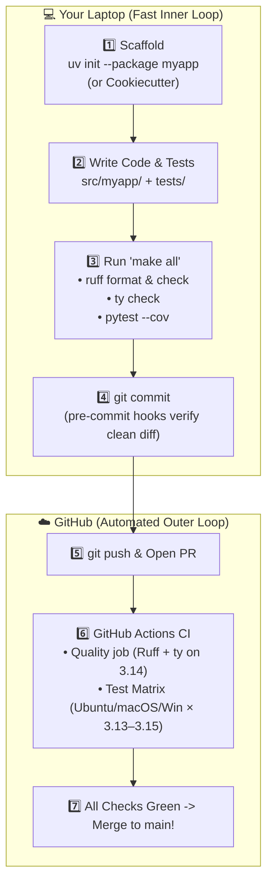

# Chapter 16: Putting It All Together

[← Previous: CLI Libraries](./15-cli-libraries.md) | [Back to README](./README.md)

## Overview: The Grand Finale

You have made it to the capstone! Across this guide, you've assembled the complete modern Python engineering toolkit:

- **Isolated Virtual Environments & `uv`** ([Chapters 2](./02-virtual-environments.md) & [3](./03-dependencies.md))
- **Git Version Control & Branch Workflows** ([Chapter 4](./04-version-control.md))
- **Instant Linting & Code Formatting with Ruff** ([Chapters 5](./05-linting.md) & [6](./06-code-formatting.md))
- **Automated Unit Testing with `pytest`** ([Chapter 7](./07-unit-testing.md))
- **Static Type Checking with `ty`** ([Chapter 8](./08-static-type-checking.md))
- **Structured Logging with `Loguru`** ([Chapter 9](./09-logging.md))
- **Automated CI/CD with GitHub Actions** ([Chapter 10](./10-ci-cd.md))
- **Optional Power-Ups:** LLMs & Python sandboxes ([Ch 11](./11-llms.md)), Databases ([Ch 12](./12-database-libraries.md)), FastAPI ([Ch 13](./13-fastapi.md)), AWS Lambda ([Ch 14](./14-aws-lambda.md)), and Typer/Rich CLIs ([Ch 15](./15-cli-libraries.md))

In this chapter, we wire the entire **Core Track** together into a single, reproducible project setup—using `uv`, a golden `pyproject.toml`, a `Makefile` (so `make all` runs your entire quality gauntlet in one command), `pre-commit` hooks, Cookiecutter templates, and GitHub Actions CI.

Whether your next project is a FastAPI startup backend, an LLM agent, or a ROS 2 robotics kinematics library, **this is the blueprint you can copy-paste on Day 1.**



> [!NOTE]
> Examples in this chapter use **Python 3.14** as the default development version, with `requires-python = ">=3.13"` as the floor and `['3.13', '3.14', '3.15']` in the GitHub Actions test matrix.

## Creating a New Project with uv

Let's start a new Python project using modern best practices.

### 1. Create Project Directory

```bash
# Create and navigate to project directory
mkdir myapp
cd myapp
```

### 2. Initialize with uv (preferred)

```bash
# From an empty myapp/ directory, or use uv init myapp
uv init --package myapp
cd myapp   # if you used uv init myapp from the parent
```

`uv init --package` gives you a src layout and a `pyproject.toml` that is already a package. That is the shape this chapter assumes. Alternatively, create a layout by hand and add a `pyproject.toml` (below).

### 3. Initialize Git

```bash
git init

cat > .gitignore << 'EOF'
# Virtual environments
.venv/
venv/
env/

# Python
__pycache__/
*.py[cod]
*$py.class
*.so
.Python

# Testing
.pytest_cache/
.coverage
htmlcov/
*.cover

# Type checking / lint caches
.mypy_cache/
.ty_cache/
.ruff_cache/
.pytype/

# IDEs
.vscode/
.idea/
*.swp

# Distribution
dist/
build/
*.egg-info/

# Environment
.env
.env.local
EOF
```

### 4. Project structure

```
myapp/
├── .git/
├── .gitignore
├── .venv/
├── src/
│   └── myapp/
│       ├── __init__.py
│       └── main.py
├── tests/
│   ├── __init__.py
│   └── test_main.py
├── docs/
├── Makefile
├── pyproject.toml
├── uv.lock
└── README.md
```

Create folders if needed:

```bash
mkdir -p src/myapp tests docs
touch src/myapp/__init__.py tests/__init__.py
touch src/myapp/main.py tests/test_main.py README.md
```

### 5. Golden pyproject.toml

This is the configuration this guide treats as the default. Pins are floors, not fashion statements: pytest 9, Ruff 0.17, Python 3.13+, type-checked and formatted as 3.14.

```bash
cat > pyproject.toml << 'EOF'
[project]
name = "myapp"
version = "0.1.0"
description = "A sample Python application"
authors = [
    {name = "Your Name", email = "your.email@example.com"}
]
readme = "README.md"
requires-python = ">=3.13"
dependencies = []

[dependency-groups]
dev = [
    "pytest>=9.2.0",
    "pytest-cov>=7.1.0",
    "ruff>=0.17.0",
    "ty",
    "pre-commit>=4.7.0",
]

[build-system]
requires = ["hatchling"]
build-backend = "hatchling.build"

[tool.hatch.build.targets.wheel]
packages = ["src/myapp"]

[tool.ruff]
line-length = 88
target-version = "py314"
exclude = [
    ".git",
    ".venv",
    "__pycache__",
    "build",
    "dist",
]

[tool.ruff.lint]
select = [
    "E",
    "W",
    "F",
    "I",
    "B",
    "C4",
    "UP",
]

[tool.ruff.format]
quote-style = "double"
indent-style = "space"

[tool.pytest.ini_options]
testpaths = ["tests"]
python_files = ["test_*.py"]
python_functions = ["test_*"]
addopts = [
    "-v",
    "--strict-markers",
    "--tb=short",
]

[tool.ty.environment]
python-version = "3.14"

[tool.ty.src]
include = ["src", "tests"]

[tool.coverage.run]
source = ["src"]
omit = ["*/tests/*"]

[tool.coverage.report]
exclude_lines = [
    "pragma: no cover",
    "def __repr__",
    "raise AssertionError",
    "raise NotImplementedError",
    "if __name__ == .__main__.:",
]
EOF
```

`requires-python = ">=3.13"` is the install floor. `target-version = "py314"` and `python-version = "3.14"` tell Ruff and ty to assume 3.14 syntax and stdlib. That split is intentional: you can still run on 3.13, while new examples are written as 3.14.

### 6. Install development dependencies

```bash
uv sync
# Commit the lockfile for reproducible CI
# git add uv.lock
```

`uv.lock` is not clutter. It is how CI installs the same versions you just tested.

## Using Cookiecutter Templates

[Cookiecutter](https://github.com/cookiecutter/cookiecutter) is a tool that creates projects from templates. There are many Python project templates available. Hand-rolling `pyproject.toml` is educational. Generating it from a maintained template is how you skip the third time you forget `.ty_cache/` in `.gitignore`.

[Copier](https://copier.readthedocs.io/) is also popular for the same job, with a different template format and first-class update-an-existing-project support. This chapter stays with Cookiecutter.

### Installing Cookiecutter

```bash
uv tool install cookiecutter
# or: uvx cookiecutter ...
```

### Using a Python Library Template

Let's use a professional Python library template:

```bash
# Use a cookiecutter template
cookiecutter https://github.com/amitsk/cookiecutter-python-library

# You'll be prompted for project details:
# - project_name: My Amazing Library
# - project_slug: my-amazing-library
# - author_name: Your Name
# - email: your.email@example.com
# - etc.
```

This creates a complete project structure with:
- Proper directory layout
- pyproject.toml configuration
- Testing setup
- Documentation structure
- CI/CD configuration
- Pre-commit hooks
- Example code

Answer the prompts honestly. `project_slug` becomes the import name, and renaming it later is a small adventure.

### Exploring the Generated Project

```bash
cd my-amazing-library
ls -la
```

You'll see:
```
my-amazing-library/
├── .github/
│   └── workflows/
│       └── ci.yml
├── .gitignore
├── .pre-commit-config.yaml
├── src/
│   └── my_amazing_library/
│       ├── __init__.py
│       └── main.py
├── tests/
│   ├── __init__.py
│   └── test_main.py
├── docs/
├── pyproject.toml
├── README.md
└── LICENSE
```

## Automating Tasks with Make

[Make](https://www.gnu.org/software/make/) is a classic build automation tool that's perfect for running common development tasks. While it's traditionally used for C/C++ projects, it works great for Python too. It is 1970s technology that still wins because `make test` is four letters and everyone already knows it.

### Why Use Make?

- **Simple**: Easy-to-read syntax for defining tasks
- **Universal**: Available on all Unix-like systems
- **Fast**: Only runs what's needed
- **Standard**: Developers are familiar with `make test`, `make lint`, etc.
- **IDE Integration**: Most IDEs can run Make targets

### Creating a Makefile

Create a file named `Makefile` in your project root:

```makefile
# Makefile for Python project using uv

.PHONY: help install test lint format typecheck ty clean all

# Default target
help:
	@echo "Available targets:"
	@echo "  make install    - Install dependencies"
	@echo "  make test       - Run tests with coverage"
	@echo "  make lint       - Run ruff linter"
	@echo "  make format     - Format code with ruff"
	@echo "  make typecheck  - Run ty type checker"
	@echo "  make ty         - Alias for typecheck"
	@echo "  make clean      - Remove generated files"
	@echo "  make all        - Run format, lint, typecheck, and test"

# Install dependencies
install:
	uv sync

# Run tests with coverage
test:
	uv run pytest --cov=src --cov-report=term-missing --cov-report=html

# Run linter
lint:
	uv run ruff check .

# Fix linting issues
lint-fix:
	uv run ruff check --fix .

# Format code
format:
	uv run ruff format .

# Check formatting without making changes
format-check:
	uv run ruff format --check .

# Run type checker with ty
typecheck:
	uv run ty check

# Alias for typecheck
ty: typecheck

# Run mypy (alternative type checker)
mypy:
	uv run mypy src/

# Clean generated files
clean:
	rm -rf .pytest_cache
	rm -rf .mypy_cache
	rm -rf .ruff_cache
	rm -rf .ty_cache
	rm -rf htmlcov
	rm -rf dist
	rm -rf build
	rm -rf *.egg-info
	find . -type d -name __pycache__ -exec rm -rf {} +
	find . -type f -name "*.pyc" -delete
	find . -type f -name "*.pyo" -delete
	find . -type f -name ".coverage" -delete

# Run all quality checks
all: format lint typecheck test
	@echo "✓ All checks passed!"

# Pre-commit checks (fast version without tests)
check: format-check lint typecheck
	@echo "✓ Pre-commit checks passed!"
```

Every command goes through `uv run` so you are using the project environment, not whatever `ruff` happens to be on your PATH this week.

### Understanding Makefile Syntax

**Basic Structure:**
```makefile
target: dependencies
	command
```

**Key Points:**
- Targets are the task names (e.g., `test`, `lint`)
- `.PHONY:` declares targets that don't create files
- `@echo` prints messages (@ suppresses command echo)
- Commands must be indented with a **tab**, not spaces. Make will not politely mention this. It will say `missing separator` and wait for you to remember 1976.
- `make` alone runs the first target (usually `help`)

### Using the Makefile

```bash
# Show available commands
make
# or
make help

# Install dependencies
make install

# Run tests
make test

# Format code
make format

# Check linting
make lint

# Fix linting issues
make lint-fix

# Run type checker
make ty

# Run all checks
make all

# Quick pre-commit check (no tests)
make check

# Clean up generated files
make clean
```

### Advanced Makefile Features

**Variables:**
```makefile
PYTHON := python3
SRC_DIR := src
TEST_DIR := tests

test:
	uv run pytest $(TEST_DIR) --cov=$(SRC_DIR)
```

**Conditional Commands:**
```makefile
install:
	@command -v uv >/dev/null 2>&1 || { \
		echo "Installing uv..."; \
		curl -LsSf https://astral.sh/uv/install.sh | sh; \
	}
	uv sync
```

**Multiple Commands:**
```makefile
deploy: all
	@echo "Running final checks..."
	@make test
	@echo "Building package..."
	@uv build
	@echo "Ready to deploy!"
```

### Integrating with CI/CD

Your CI/CD pipeline can use the same Make targets. Local and CI should disagree as little as possible; that is the entire trick.

**.github/workflows/ci.yml:**
```yaml
name: CI

on: [push, pull_request]

jobs:
  test:
    runs-on: ubuntu-latest
    steps:
      - uses: actions/checkout@v7
      - uses: astral-sh/setup-uv@v10.3.3
        with:
          enable-cache: true
      - run: uv python install 3.14
      - name: Install dependencies
        run: make install
      - name: Run checks
        run: make all
```

### Daily Workflow with Make

```bash
# Morning: update and check
git pull
make install
make check

# During development
# ... write code ...
make test        # Run tests frequently
make format      # Format before committing

# Before committing
make all         # Run all checks

# Commit
git add .
git commit -m "Add feature X"
```

### Why Make Over Scripts?

You might wonder why not use a shell script or Python script. Here's why Make is often better:

| Feature | Make | Shell Script | Python Script |
|---------|------|--------------|---------------|
| **Learning Curve** | Low | Low | Medium |
| **Speed** | Fast (built-in) | Fast | Slower (startup) |
| **IDE Support** | Excellent | Good | Good |
| **Convention** | Standard | Variable | Variable |
| **Dependencies** | Built-in tracking | Manual | Manual |
| **Cross-platform** | Good (Unix) | Good (Unix) | Excellent |

**When to use alternatives:**
- **Task runners (invoke, nox)**: Complex workflows, need Python features
- **Scripts**: Windows-only projects, custom logic
- **Just**: If you prefer more modern syntax

### Quick Reference

```bash
# Common Make commands
make              # Show help
make install      # Install dependencies
make test         # Run tests
make lint         # Check code
make format       # Format code
make ty           # Type check
make all          # Run everything
make clean        # Clean up

# Create Makefile
# - Use tabs (not spaces) for indentation
# - Declare .PHONY targets
# - Add help target first
# - Keep commands simple
```

## Complete Project Workflow

Now let's walk through a complete workflow using all the tools.

### Step 1: Write Initial Code

**src/myapp/calculator.py:**
```python
"""A simple calculator module."""


def add(a: int, b: int) -> int:
    """Add two numbers.

    Args:
        a: First number
        b: Second number

    Returns:
        Sum of a and b
    """
    return a + b


def subtract(a: int, b: int) -> int:
    """Subtract b from a."""
    return a - b


def multiply(a: int, b: int) -> int:
    """Multiply two numbers."""
    return a * b


def divide(a: float, b: float) -> float:
    """Divide a by b.

    Args:
        a: Numerator
        b: Denominator

    Returns:
        Result of division

    Raises:
        ValueError: If b is zero
    """
    if b == 0:
        raise ValueError("Cannot divide by zero")
    return a / b
```

A calculator is not a product. It is a module small enough that the tooling is the point, and large enough that skipping tests would be embarrassing.

### Step 2: Write Tests

**tests/test_calculator.py:**
```python
"""Tests for calculator module."""
import pytest
from myapp.calculator import add, subtract, multiply, divide


def test_add():
    """Test addition."""
    assert add(2, 3) == 5
    assert add(-1, 1) == 0
    assert add(0, 0) == 0


def test_subtract():
    """Test subtraction."""
    assert subtract(5, 3) == 2
    assert subtract(0, 5) == -5


def test_multiply():
    """Test multiplication."""
    assert multiply(3, 4) == 12
    assert multiply(0, 100) == 0


def test_divide():
    """Test division."""
    assert divide(10, 2) == 5
    assert divide(9, 3) == 3


def test_divide_by_zero():
    """Test division by zero raises error."""
    with pytest.raises(ValueError, match="Cannot divide by zero"):
        divide(10, 0)


@pytest.mark.parametrize("a,b,expected", [
    (2, 3, 5),
    (0, 0, 0),
    (-1, 1, 0),
    (100, 200, 300),
])
def test_add_parametrized(a, b, expected):
    """Test addition with multiple inputs."""
    assert add(a, b) == expected
```

### Step 3: Run Quality Checks

```bash
# Using Make (recommended)
make format      # Format code
make lint        # Check linting
make ty          # Type check
make test        # Run tests with coverage
make all         # Run all checks

# Or run commands directly
uv run ruff format .
uv run ruff check --fix .
uv run ty check
uv run pytest --cov=src --cov-report=term-missing
```

If `make all` is green locally and red in CI, the environments disagree. Fix that before adding more features. The features are not the problem.

### Step 4: Set Up Pre-commit Hooks

Create **.pre-commit-config.yaml:**
```yaml
repos:
  - repo: https://github.com/astral-sh/ruff-pre-commit
    rev: v0.17.4  # pin a current release
    hooks:
      - id: ruff
        args: [--fix]
      - id: ruff-format

  - repo: local
    hooks:
      - id: ty
        name: ty
        entry: uv run ty check
        language: system
        types: [python]
        pass_filenames: false

  - repo: https://github.com/pre-commit/pre-commit-hooks
    rev: v6.0.0
    hooks:
      - id: trailing-whitespace
      - id: end-of-file-fixer
      - id: check-yaml
      - id: check-added-large-files
```

Install the hooks:
```bash
uv run pre-commit install
```

Now quality checks run automatically on commit. The first run may rewrite files. That is the hook doing its job, not Git being haunted.

### Step 5: Set Up GitHub Repository

```bash
git add .
git commit -m "Initial project setup

- Add calculator module with basic operations
- Add comprehensive tests with pytest
- Configure ruff for linting and formatting
- Set up ty for type checking
- Add Makefile for task automation
- Add pre-commit hooks
"

gh repo create myapp --public --source=. --remote=origin
git push -u origin main
```

### Step 6: Set Up CI/CD

Create **.github/workflows/ci.yml:**
```yaml
name: CI

on:
  push:
    branches: [main]
  pull_request:
    branches: [main]

jobs:
  quality:
    name: Code Quality
    runs-on: ubuntu-latest
    steps:
      - uses: actions/checkout@v7
      - uses: astral-sh/setup-uv@v10.3.3
        with:
          enable-cache: true
      - run: uv python install 3.14
      - run: uv sync
      - run: uv run ruff check .
      - run: uv run ruff format --check .
      - run: uv run ty check

  test:
    name: Test Python ${{ matrix.python-version }}
    runs-on: ${{ matrix.os }}
    strategy:
      fail-fast: false
      matrix:
        os: [ubuntu-latest, macos-latest, windows-latest]
        python-version: ['3.13', '3.14', '3.15']

    steps:
      - uses: actions/checkout@v7
      - uses: astral-sh/setup-uv@v10.3.3
        with:
          enable-cache: true
      - run: uv python install ${{ matrix.python-version }}
      - run: uv sync
      - run: uv run pytest --cov=src --cov-report=xml

      - name: Upload coverage
        if: matrix.os == 'ubuntu-latest' && matrix.python-version == '3.14'
        uses: codecov/codecov-action@v7
        with:
          files: ./coverage.xml
```

The quality job runs on **3.14**, the default in this guide. The test matrix covers **3.13, 3.14, and 3.15** because `requires-python` starts at 3.13 and 3.15 is the current stable release. Coverage uploads from the default version so you are not paying Codecov to store three copies of the same good news.

Commit and push:
```bash
git add .github/workflows/ci.yml
git commit -m "Add CI/CD workflow"
git push
```

### Step 7: Working on a Feature

```bash
# Create a feature branch
git checkout -b add-power-function

# Write the code
cat >> src/myapp/calculator.py << 'EOF'


def power(base: float, exponent: float) -> float:
    """Raise base to the power of exponent.

    Args:
        base: Base number
        exponent: Exponent

    Returns:
        base raised to exponent
    """
    return base ** exponent
EOF

# Write tests
cat >> tests/test_calculator.py << 'EOF'


def test_power():
    """Test power function."""
    assert power(2, 3) == 8
    assert power(5, 2) == 25
    assert power(10, 0) == 1
    assert power(2, -1) == 0.5
EOF

# Run quality checks
make all

# Or run individually
# uv run ruff format .
# uv run ruff check --fix .
# uv run ty check
# uv run pytest

# Commit (pre-commit hooks run automatically)
git add .
git commit -m "Add power function to calculator

- Implement power function with type hints
- Add comprehensive tests
- Update documentation
"

# Push and create PR
git push -u origin add-power-function
gh pr create --title "Add power function" --body "Adds exponentiation support to calculator"
```

The test file needs `from myapp.calculator import power` as well. Append that import (or add `power` to the existing import) before you pretend the tests passed. `make all` will tell you if you forgot; that is what it is for.

### Step 8: Code Review and Merge

1. CI runs automatically on the PR
2. Review the code on GitHub
3. Merge when CI passes and review is approved
4. Delete the feature branch

```bash
# After merge, update local main
git checkout main
git pull origin main
git branch -d add-power-function
```

Green CI is necessary, not sufficient. Read the diff. The robot is good at types. It is worse at "did we mean to do this."

## Daily Development Workflow

Here's your typical daily workflow:

### Morning Routine

```bash
# Update your local repository
git checkout main
git pull origin main

# Start working on a task
git checkout -b feature-name

# Set up environment
source .venv/bin/activate
```

On Windows, use `.venv\Scripts\activate`. On any platform, `uv run` works without activating if you would rather not think about shells.

### Development Loop

```bash
# 1. Write code
# 2. Run tests frequently
make test
# or: uv run pytest

# 3. Check code quality
make check
# or: uv run ruff check --fix . && uv run ruff format . && uv run ty check

# 4. Commit frequently
git add .
git commit -m "Descriptive message"

# 5. Push when ready
git push -u origin feature-name
```

### Before Submitting PR

```bash
# Final checks
make all

# Or run individually
uv run ruff check .
uv run ruff format --check .
uv run ty check
uv run pytest --cov=src

# Ensure all tests pass
# Create PR
gh pr create
```

## Project Maintenance

### Adding a Dependency

```bash
# Add to pyproject.toml and lockfile
uv add requests
```

### Updating Dependencies

```bash
# Refresh lockfile toward latest allowed versions
uv lock --upgrade
uv sync

# Or:
uv pip list --outdated
```

Upgrade on purpose, then run `make all`. Surprise upgrades in CI are a genre of Monday.

### Running Different Checks

```bash
# Using Make (recommended)
make format        # Format code
make lint          # Check linting
make lint-fix      # Fix linting issues
make ty            # Type check
make test          # Test with coverage
make all           # Run all checks

# Or run commands directly
uv run ruff format .
uv run ruff check .
uv run ruff check --fix .
uv run ty check
uv run pytest --cov=src --cov-report=html
open htmlcov/index.html  # View coverage report

# All checks manually
uv run ruff check --fix . && uv run ruff format . && uv run ty check && uv run pytest
```

Bare `ruff` / `pytest` / `ty` on your PATH may be a different version than the project. `uv run` is the difference between "works on my machine" and "works in this repo."

## Troubleshooting Common Issues

### Pre-commit Hooks Failing

```bash
# Run manually to see errors
uv run pre-commit run --all-files

# Update hooks
uv run pre-commit autoupdate

# Skip hooks if needed (not recommended)
git commit --no-verify
```

`--no-verify` is an escape hatch, not a workflow. If you use it every day, the hooks are wrong or you are.

### CI Failing Locally Passing

```bash
# Run in clean environment
rm -rf .venv
uv sync
uv run pytest
```

If that still passes, check Python versions. Local 3.14 vs CI 3.13 is a classic. The matrix exists so you find this before users do.

### Merge Conflicts

```bash
# Update your branch with main
git checkout main
git pull origin main
git checkout your-branch
git merge main

# Resolve conflicts manually
# Then commit
git add .
git commit -m "Merge main and resolve conflicts"
```

## Best Practices Summary

### Do

- Use virtual environments for every project
- Commit frequently with descriptive messages
- Write tests for new code
- Run quality checks before pushing
- Use feature branches
- Review code before merging
- Keep dependencies updated
- Document complex code
- Pin CI actions and Python versions on purpose (`checkout@v7`, `setup-uv@v10.3.3`, default 3.14)

### Don't

- Commit directly to main
- Push without running tests
- Ignore linter warnings
- Skip code review
- Commit secrets or sensitive data
- Leave commented-out code
- Merge broken CI
- Use `--no-verify` habitually
- Let 3.12 linger as "the default" in a workflow you copied from an old gist

## Quick Reference Commands

```bash
# Project setup
uv init --package myapp && cd myapp
uv add --dev "ruff>=0.17.0" "pytest>=9.2.0" pytest-cov ty pre-commit
uv sync

# Using Make (recommended)
make install       # Install dependencies
make format        # Format code
make lint          # Check linting
make ty            # Type check
make test          # Run tests
make all           # Run all checks
make clean         # Clean generated files

# Quality checks (direct commands)
uv run ruff check --fix .
uv run ruff format .
uv run ty check
uv run pytest --cov=src

# Git workflow
git checkout -b feature-name
git add .
git commit -m "message"
git push -u origin feature-name
gh pr create

# Maintenance
uv lock --upgrade && uv sync
uv run pre-commit autoupdate
uv run pytest --cov=src --cov-report=html
```

## Next Steps

You now have a complete, professional Python development setup. Here's what you can do next:

### 1. Practice

Create a small project using everything you've learned:
- Set up the project structure
- Write some code
- Add tests
- Set up CI/CD
- Make a few commits
- Create and merge a PR

A calculator is fine. A real itch you have is better.

### 2. Customize

Adapt these tools to your needs:
- Adjust ruff rules
- Configure ty (or mypy) strictness
- Customize pre-commit hooks
- Add project-specific tools

The golden `pyproject.toml` is a starting point, not a constitution.

### 3. Learn More

Explore advanced topics:
- Advanced pytest features (fixtures, markers, plugins)
- Type system advanced features (generics, protocols)
- GitHub Actions advanced workflows
- Performance profiling and optimization
- Security best practices
- Chapters 12–15, if you skipped them: databases, FastAPI, Lambda, CLIs

### 4. Share

Help others learn:
- Share your setup with teammates
- Contribute to open source
- Write about your experience
- Mentor newcomers

A Makefile and a CI file are easier to share than a verbal tradition of "run these five commands in this order."

## Resources

### Official Documentation

- [Python](https://docs.python.org/)
- [uv](https://docs.astral.sh/uv/)
- [Ruff](https://docs.astral.sh/ruff/)
- [pytest](https://docs.pytest.org/)
- [ty](https://docs.astral.sh/ty/)
- [mypy](https://mypy.readthedocs.io/)
- [GitHub Actions](https://docs.github.com/actions)

### Community

- [Python Discord](https://discord.gg/python)
- [r/Python](https://reddit.com/r/Python)
- [Python User Groups](https://wiki.python.org/moin/LocalUserGroups)

### Templates

- [cookiecutter-python-library](https://github.com/amitsk/cookiecutter-python-library)
- [PyPA sample project](https://github.com/pypa/sampleproject)
- [Copier](https://copier.readthedocs.io/) (also popular for project templates)

## Conclusion

You've learned the complete toolkit for modern Python development:

1. **Virtual Environments**: Isolate project dependencies with uv
2. **Version Control**: Track changes and collaborate with Git
3. **Linting**: Catch errors automatically with Ruff
4. **Formatting**: Maintain consistent style with Ruff
5. **Testing**: Verify code correctness with pytest
6. **Type Checking**: Catch type errors early with ty
7. **Task Automation**: Simplify workflows with Make
8. **CI/CD**: Automate quality checks with GitHub Actions
9. **AI Tools**: Accelerate development with LLMs
10. **Complete Workflow**: Put it all together

These tools and practices will serve you throughout your Python development journey. Start simple, add tools gradually, and soon this workflow will become second nature. The day `make all` is muscle memory is the day you can spend your attention on the actual problem.

Happy coding.

[← Previous: CLI Libraries](./15-cli-libraries.md) | [Back to README](./README.md)
