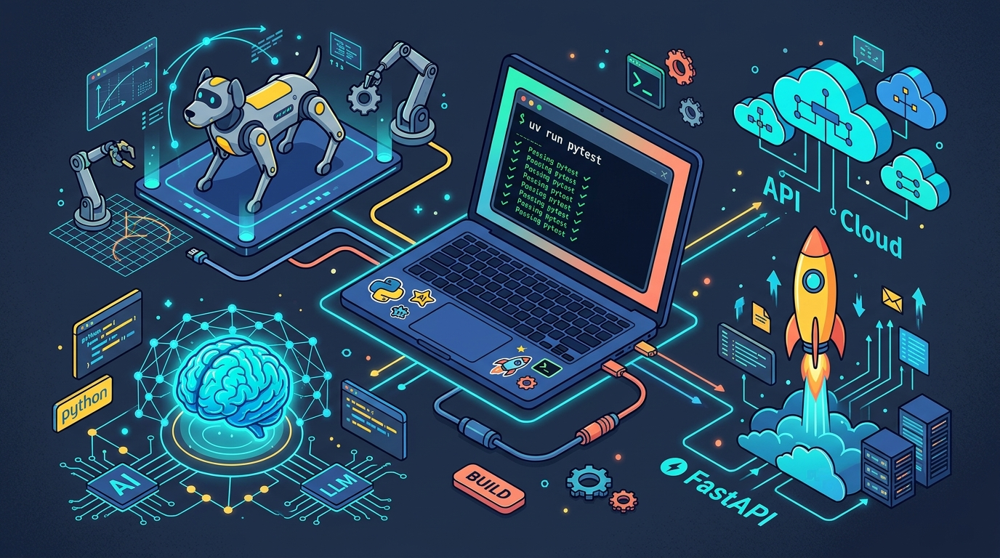
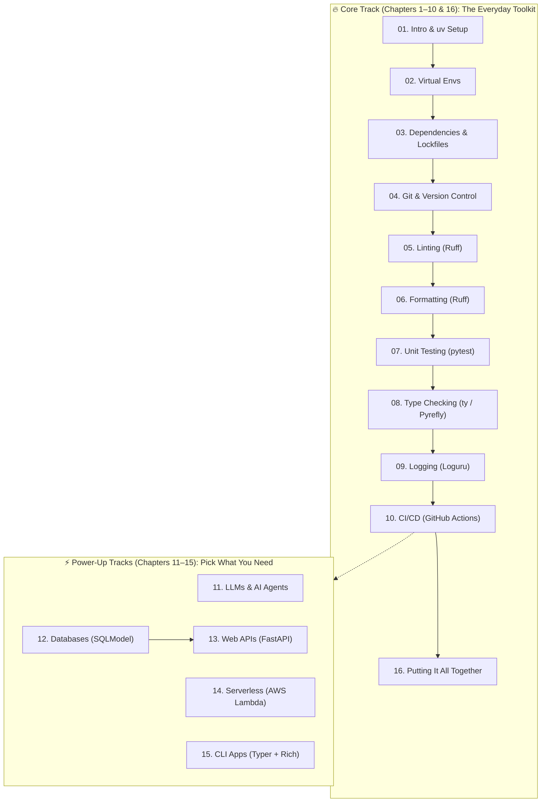

# Python Development Environment Setup Guide

You already know how to write a Python loop, define a function, and celebrate when your script finally runs without a traceback.

**This guide is about everything that happens next.**

It’s the survival kit between *"I wrote a cool script for my CS class / hackathon at 2 a.m."* and *"Other people (and my future self in six months) can actually run, test, and ship this thing without crying."*

We cover isolated virtual environments, pinned dependencies that don't randomly explode on your teammate's laptop, Git habits that won't make your group project partner block your number, automated linters, fast tests, AI coding agents, and how all of these fit together.

---

## About This Guide

This tutorial is built for **CS students, self-taught coders, and new developers** who know basic Python syntax and want the real-world engineering workflow around it.

> [!IMPORTANT]
> **This is not a "What is a variable?" Python tutorial.** If you want to learn or brush up on core Python syntax first, check out these classics and come right back:
> - [Official Python Tutorial](https://docs.python.org/3/tutorial/) — straight from the source at Python.org
> - [Automate the Boring Stuff with Python](https://automatetheboringstuff.com/) — legendary book for building practical scripts fast
> - [Real Python](https://realpython.com/) — deep-dive tutorials when you want to see how something works
> - [Python for Beginners](https://www.python.org/about/gettingstarted/) — starter links from python.org

---

## Where Does This Stuff Actually Matter?

If you've only used Python for homework assignments or single-file scripts, all this talk about "lockfiles" and "static type checkers" might sound like bureaucracy. Here is why you actually care—because Python isn't just a teaching language anymore; it is the glue holding modern tech together:

- **AI & Large Language Models (LLMs):** From training models in PyTorch to building autonomous agents. In fact, modern LLMs don't just help *you* write Python—they use Python as **their own scripting language** inside sandboxed environments to solve math, crunch data, and orchestrate complex multi-step tasks.
- **Robotics, Drones & Physical AI:** Walk into almost any robotics lab and you'll find Python everywhere. Whether you're wiring up nodes in **ROS 2 (`rclpy`)**, training a quadruped robot to walk in **MuJoCo** or **NVIDIA Isaac Lab**, running computer vision on a **Raspberry Pi / Jetson**, or flashing **MicroPython / CircuitPython** onto a microcontroller—Python is the brain that glues sensors, planners, and fast C++ motor controllers together.
- **High-Speed Web APIs & Cloud Backends:** Frameworks like **FastAPI** and serverless platforms like **AWS Lambda** let you ship production backends in a weekend.
- **Developer Tools & Automation:** With **Typer** and **Rich**, you can turn a messy script into a slick terminal CLI tool your whole team uses.

And in *every single one* of those worlds, the #1 thing that derails new developers isn't an algorithm—it's a broken Python environment, a mismatched library version, or an untested change that breaks right before demo day. Let's fix that permanently.

---

## Your Learning Roadmap

You don't have to read all 16 chapters in one sitting. Here is how the guide is mapped out:

### Core vs. Optional Tracks

- **Core Track (Recommended First):** **Chapters 1–10 and 16** — environments, dependencies, Git, Ruff, pytest, type checking, logging, CI/CD, and a full capstone setup. Whether you're building a web app, an ML pipeline, or a ROS 2 robotics package, you will use these every day.
- **Optional Power-Ups:** **Chapters 11–15** — AI coding tools & how LLMs use Python, databases, FastAPI, AWS Lambda, and CLI libraries. Jump into these whenever your project needs them.

---

## Table of Contents

1. [Introduction](./01-introduction.md)
   - Why Dev Environments Matter (From Web Apps to Robotics & AI)
   - How LLMs Use Python as Their Superpower
   - Software Engineering Best Practices (Minus the Boring Jargon)
   - Tools Overview (`uv`, VS Code)

2. [Python Virtual Environments](./02-virtual-environments.md)
   - Understanding Virtual Environments
   - Creating Virtual Environments (`venv` vs `uv`)
   - Working with `uv`

3. [Managing Dependencies](./03-dependencies.md)
   - What are Dependencies?
   - Using `pip` for Package Management
   - Managing Dependencies with `uv`
   - Working with `pyproject.toml` and Lockfiles

4. [Version Control](./04-version-control.md)
   - Goodbye `project_final_v2_ACTUALLY_FINAL.zip`
   - Getting Started with Git
   - Branching, PRs, and Best Practices

5. [Linting](./05-linting.md)
   - What is Linting?
   - Overview of Python Linters
   - Deep Dive into Ruff

6. [Code Formatting](./06-code-formatting.md)
   - Why Stop Arguing About Spaces
   - Formatting Tools Overview
   - Formatting with Ruff

7. [Unit Testing](./07-unit-testing.md)
   - Understanding Unit Testing
   - Introduction to `pytest`
   - Writing and Running Tests

8. [Static Type Checking](./08-static-type-checking.md)
   - What is Static Type Checking?
   - Type Checking Tools
   - Using `mypy`, `ty`, and `Pyrefly`

9. [Logging](./09-logging.md)
   - `print()` vs. Proper Logging
   - Python `logging` stdlib, `loguru`, and `picologging`
   - Structured Logging and Log Rotation

10. [CI/CD](./10-ci-cd.md)
    - Continuous Integration and Deployment
    - GitHub Actions
    - Automating Your Workflow

11. [LLMs and AI-Powered Development](./11-llms.md)
    - AI in Python Development & How LLMs Use Python as a Scripting Language
    - The Elephant–Goldfish Model & Spec-Driven Development (SDD)
    - AI Coding Tools Overview & Deep Dive into Claude Code with Specs

12. [Database Libraries](./12-database-libraries.md)
    - DBAPI, SQLAlchemy, and SQLModel Compared
    - Type-Safe Database Access with SQLModel
    - Migrations with Alembic

13. [REST APIs with FastAPI](./13-fastapi.md)
    - Building Type-Safe APIs with FastAPI & SQLModel
    - Automatic OpenAPI Documentation & Testing with `TestClient`
    - HTTP Client Libraries (`requests` and `httpx` with HTTP/2)

14. [AWS Lambda with Python](./14-aws-lambda.md)
    - Serverless Python with AWS Lambda
    - AWS SAM for Local Development and Deployment
    - AWS Lambda Powertools for Production

15. [CLI Libraries](./15-cli-libraries.md)
    - Building CLI Tools with Typer
    - Beautiful Terminal Output with Rich
    - Combining Typer and Rich

16. [Putting It All Together](./16-putting-it-together.md)
    - Bootstrapping a Complete Project with One AI Agent Prompt
    - Creating a Project from Scratch (`uv`, `pyproject.toml`, `Makefile`, `pre-commit`)
    - Using Cookiecutter Templates & Publishing with GitHub Actions CI/CD

---

## Prerequisites

- Basic understanding of Python programming (variables, functions, loops, imports)
- A computer running Windows, macOS, or Linux
- Willingness to open a terminal. Clicking around is optional; typing `uv run` is where the magic happens.

## Getting Started (Which Python Version?)

Start with [Chapter 1: Introduction](./01-introduction.md).

As of November 2026:
- **Python 3.15** is the newest stable release (shipped October 9, 2026; currently at 3.15.2).
- **Python 3.14** is the battle-tested sweet spot with a full year of pre-compiled binary wheels (`numpy`, `torch`, robotics simulators, etc.).
- **Python 3.13** is the practical minimum floor (`requires-python = ">=3.13"`).

Examples in the core chapters use **3.14** because having every C++/Rust-backed package install in two seconds without compiling from source is much more fun than chasing bleeding-edge version numbers. Don't start a brand-new project on Python 3.11 just because a Stack Overflow answer from 2024 had it in a screenshot!

> [!TIP]
> **What's cool in Python 3.15?** It brings **lazy imports** (faster CLI startup for free), built-in `frozendict` and `sentinel` types, **UTF-8 by default** everywhere (goodbye weird Windows file encoding bugs), comprehension unpacking, and a stable ABI for free-threaded (no-GIL) builds. Add `3.15` to your GitHub Actions CI matrix now, and flip your local default once all your favorite libraries ship 3.15 wheels.

**Last reviewed:** November 2026 (Python 3.15 current stable; 3.14 in examples; `requires-python >= 3.13`; `uv` project workflow).

## Contributing

Spotted a typo, a broken link, or a tool that changed its flags? Open an issue or send a pull request! Bugs in tutorials have a weirdly long half-life, and we'd love your help squashing them.

## License

This guide is released under the [MIT License](./LICENSE). Use it for your classes, clubs, hackathons, or onboarding—just keep the attribution.
